# 《网络编程开发及实战（上）》图文教程

> 课程来源：华清远见 · 嵌入式非凡就业班　第二阶段 04《网络编程开发及实战（上）》
> 覆盖 13 个小节、36 个授课视频，总时长约 9 小时 20 分钟。
> 本教程按**知识结构**重新组织，不按视频时间顺序；每个重点知识点配课程原片截图，并对 ASR 转写中的同音错误、老师口头带过的推导做了校正与补充。

---

## 这门课在讲什么

这门课是嵌入式 Linux 应用层开发的“网络篇”。它不满足于让你会调用 `socket()`，而是要让你同时具备三种视角：

1. **协议视角**：数据从应用到网卡，经过哪些层、每层加了什么包头、为什么这么设计（OSI、TCP/IP、IP、TCP、UDP、以太网）。
2. **编程视角**：Linux 下 TCP/UDP/UNIX 域套接字的 API 调用顺序、参数含义、阻塞行为、并发模型（多进程/多线程）。
3. **调试视角**：用 Wireshark 抓包验证握手、挥手、重传、分片，把“纸面协议”变成“看得见的数据”。

三者是同一件事的三个切面：**协议决定 API 的语义，API 体现协议的过程，抓包验证前两者**。

---

## 教程结构（13 节）

| 节 | 标题 | 核心内容 | 视频时长 |
|---|---|---|---|
| 01 | [什么是互联网](第01节_什么是互联网.md) | 网络定义与分类、网络的网络、互联网组成、三阶段发展史、ISP/IXP | 23:18 |
| 02 | [OSI 七层体系结构](第02节_OSI七层体系结构.md) | 为什么要分层、协议三要素、透明传输、OSI 七层逐层功能 | 48:00 |
| 03 | [TCP/IP 协议与五层体系结构](第03节_TCP_IP协议与五层体系结构.md) | OSI 与 TCP/IP 的对应、五层模型、各层协议族、分层优缺点 | 37:00 |
| 04 | [IP 地址与端口号](第04节_IP地址与端口号.md) | 分类 IP、CIDR、子网掩码、IPv6、协议端口号 | 59:00 |
| 05 | [字节序及 IP 地址转换](第05节_字节序及IP地址转换.md) | 大端/小端、htonl/ntohl、inet_pton/inet_ntop | 15:00 |
| 06 | [socket 套接字及 TCP 实现框架](第06节_socket套接字及TCP的实现框架.md) | socket 概念、TCP C/S 模型、常用 API 与调用顺序 | 44:00 |
| 07 | [实现 TCP 通信](第07节_实现TCP通信.md) | 服务器/客户端代码逐行实现、阻塞与错误处理、代码优化 | 72:00 |
| 08 | [TCP 并发实现](第08节_TCP并发实现.md) | 多进程并发、僵尸进程处理、多线程并发 | 54:00 |
| 09 | [实现 UDP 通信](第09节_实现UDP通信.md) | UDP 函数接口、服务器/客户端实现、与 TCP 的差异 | 34:00 |
| 10 | [TCP 如何实现可靠传输](第10节_TCP协议是如何实现可靠传输的.md) | TCP 特点、序号/确认/重传、滑动窗口、TCP 包头 | 42:00 |
| 11 | [TCP 连接管理与 UDP 协议](第11节_TCP连接管理与UDP协议.md) | 三次握手、四次挥手、Wireshark 抓包、UDP 协议 | 59:00 |
| 12 | [IP 协议与 Ethernet 协议](第12节_IP协议与ethernet协议.md) | IP 包头逐字段、分片、以太网帧格式、MTU | 43:00 |
| 13 | [UNIX 域套接字](第13节_UNIX域套接字.md) | AF_UNIX 地址结构、流式/数据报实现、与 INET 的差异 | 30:00 |

---

## 素材说明

本教程的每个小节目录下分别存放三类素材，互不混放：

```
网络编程开发及实战(上)/
├─ asr/            ASR 逐字稿（按小节/视频分文件，带时间戳，保留原始识别结果）
├─ screenshots/    课程原片截图（按小节/视频分目录，文件名 f<秒>.jpg，秒数=视频内容时间）
└─ 教程/           图文教程（本目录，Markdown，可转 Word）
```

- 截图文件名中的数字是**视频内容时间（秒）**，例如 `f0270.jpg` 对应视频第 270 秒，方便回看核对。
- ASR 文本保留了同音错字（如“城域网”识别为“成域网”），教程正文已按上下文校正；需要引用原话时以 ASR 为准并自行核对。
- 截图为播放器区域 2 倍分辨率截图，右下角带课程平台水印，仅供个人学习使用，请勿外传。

---

## 怎么用这套教程

- **第一遍**：按 01→13 顺序读，重点看每节开头的“学习目标”和结尾的“小结与自测”。
- **写代码时**：直接跳到 06～09，对照 API 调用顺序与示例代码；遇到“为什么 bind 失败/为什么 accept 阻塞”再回看 10～12 的协议部分。
- **调试时**：看 11、12 的抓包与包头字段，配合 Wireshark 逐字段对照。
- **复习/面试**：看每节的“易错点”表和自测题；02、10、11 是面试高频。

---

## 前置知识

- C 语言：指针、结构体、数组、函数指针（第 06～09 节的代码大量使用 `struct sockaddr` 及其派生结构）。
- Linux 基本操作：编译（gcc）、运行、查看进程（ps）、查看端口（netstat/ss）。
- 进程与线程基础：fork、pthread（第 08 节并发会用到；没学过可先看第 08 节开头的补充）。

---

## 关于纠错与补充

课程录制较早，部分表述与今天的工程实践存在差异；ASR 也存在同音字错误。教程采取以下原则：

1. **术语统一**：如“传输层/运输层”统一为“传输层”，“汇化层”更正为“会话层”。
2. **事实校正**：如 ARPANET 的节点数、TCP/IP 成为标准的时间、MTU 的典型值等，以教材与 RFC 为准。
3. **补充推导**：老师口头带过、未写在画面上的内容（如“为什么端口号是 16 位”“为什么三次握手不是两次”），教程用“补充”标注并给出推导。
4. **标注时代差异**：如分类 IP 地址、`gethostbyname` 等在今天已较少使用，教程会说明其历史地位与现代替代方案。

> 若发现教程与视频原话不一致，以视频与 RFC 为准；欢迎在阅读时对照 ASR 原文与截图自行核验。

<!-- pagebreak -->

# 第 01 节　什么是互联网？

> 对应视频：4.1《什么是互联网？》（23:18）
> 本节是整门课的“地图”：先建立**计算机网络 / 互联网 / 端系统 / ISP** 这几个最基本的概念，后面所有 socket 编程、TCP/UDP、抓包实验都建立在这些概念之上。

## 学习目标

学完本节，应当能回答：

1. 计算机网络的定义有哪两种常见表述？各自强调什么？
2. 按作用范围、按使用者，网络分别怎么分类？边界大概是多少？
3. 为什么说互联网是“网络的网络”？路由器和主机（端系统）的区别是什么？
4. 互联网的“边缘部分”和“核心部分”分别由什么组成、各自负责什么？
5. 互联网基础结构发展的三个阶段，各阶段的标志性事件和结构特征是什么？
6. ISP、IXP、内容提供者（ICP）在今天的互联网里各自扮演什么角色？

---

## 一、计算机网络的定义

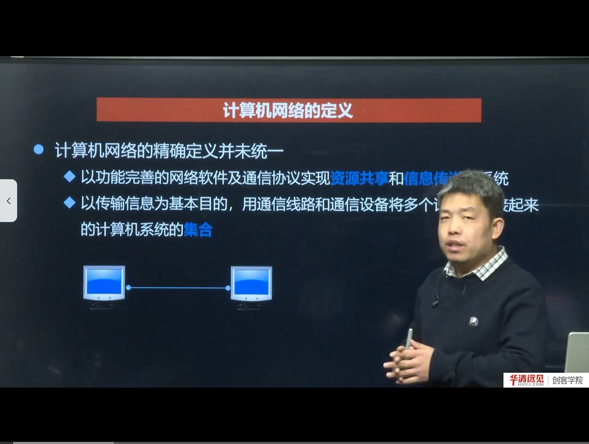

老师先给了一个很重要的前提：**计算机网络的“精确定义”并没有统一**，不同时期人们的认识并不相同。课程里给出了两种常见表述：

- **表述一（从功能出发）**：以功能完善的网络软件及通信协议，实现**资源共享**和**信息传递**的系统。
- **表述二（从构成出发）**：以传输信息为基本目的，用通信线路和通信设备将多个计算机连接起来的**计算机系统的集合**。

这两种表述其实是同一件事的两个侧面：表述二说“长什么样”（计算机 + 通信线路 + 通信设备），表述一说“靠什么工作、用来干什么”（软件 + 协议，资源共享 + 信息传递）。

> **补充：为什么一定要强调“协议”**
> 只把两台计算机用一根网线连起来，严格说只是一个“能通电的连接”，还不构成可用的计算机网络。双方必须约定好**怎么表示数据、谁先发、出错怎么办**，这些约定就是协议。所以“有连接”只是必要条件，“有协议”才是充分条件。这也是后面课程要花大量篇幅讲 TCP/IP、讲 socket 接口的原因。

老师用一张“两台计算机 + 一条线”的图做了最简说明：这是网络的**最小形态**；把规模扩大、把多个这样的网络再连起来，就得到互联网。

---

## 二、计算机网络的分类

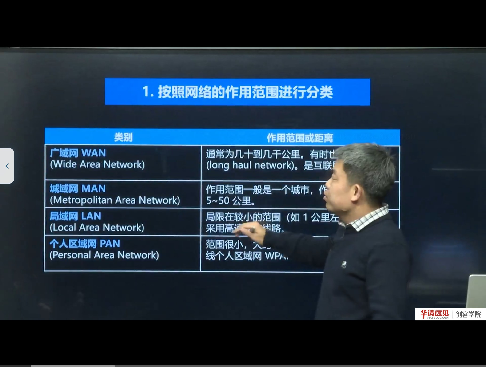

课程按两种方式分类。

### 2.1 按作用范围（覆盖距离）

| 类别 | 英文 | 典型覆盖范围 | 备注 |
|---|---|---|---|
| 广域网 | WAN（Wide Area Network） | 几十到几千公里 | 也叫远程网（long haul network）；互联网的核心部分属于广域网范畴 |
| 城域网 | MAN（Metropolitan Area Network） | 一个城市，约 5～50 公里 | 早期用于城市范围内的骨干连接 |
| 局域网 | LAN（Local Area Network） | 约 1 公里以内 | 学校机房、办公室、家庭网络；采用高速线路 |
| 个人区域网 | PAN（Personal Area Network） | 约 10 米 | 手机热点、蓝牙耳机等，常称无线个人区域网 WPAN |

> **纠错：ASR 把“城域网”识别成了“成域网”**，把“集线器”识别成了“极限器”。本节统一用“城域网”“集线器”。

### 2.2 按使用者

- **公用网（公众网）**：按规定交纳费用的人都可以使用，例如运营商面向公众提供的网络。
- **专用网**：为特殊业务需要而建造，只对特定单位/人员开放，例如军队、银行、企业内部网络。

> **补充：还有别的分法**
> 实际教材里还会按**拓扑结构**（总线、星型、环型、网状）、按**交换方式**（电路交换、报文交换、分组交换）、按**传输介质**（有线、无线）来分类。本节只需要记住“范围”和“使用者”这两条主线，因为后面讲 IP、讲路由时最常用的是“范围”这一维度。

---

## 三、网络的网络：互联网的本质

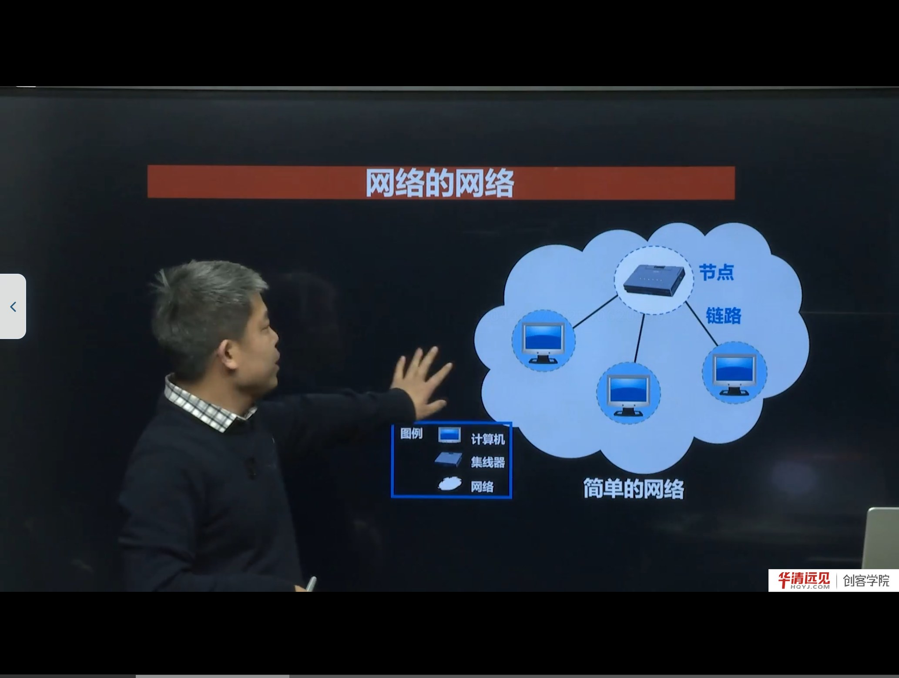

### 3.1 最简单的网络

一个简单网络由两类元素构成：

- **节点（node）**：可以是计算机，也可以是集线器、交换机、路由器；
- **链路（link）**：连接节点的通信线路。

图中是 4 个节点、3 条链路的例子。注意“节点”不等于“主机”：节点是拓扑概念，主机是端到端通信的概念。

### 3.2 从“网络”到“网络的网络”

把若干个这样的网络，**用路由器连接起来**，就形成了范围更大的**互联网络（internetwork）**，也就是“网络的网络”。

老师给了一个非常精炼的对照：

> 网络：把许多**计算机**连在一起；
> 互联网络：把许多**网络**通过**路由器**连在一起。

### 3.3 主机与路由器的区别（易错点）

与网络相连的计算机称为**主机（host）**。老师特别提醒：

- 路由器本质上也是一台计算机（有 CPU、内存、操作系统），**但它不算主机**；
- 原因是：数据传输是“主机到主机”，也就是从网络边缘的一台计算机到另一台计算机；路由器在中间只承担**转发**职责，是“中转站”，不是通信的端点。

> **补充：端系统（end system）**
> 处在互联网边缘、真正发起和接收通信的那些设备，在教材里称为**端系统**。端系统可大可小：
> - 小的：PC、手机、网络摄像头、智能音箱；
> - 大的：服务器、超级计算机。
>
> 端系统的拥有者可以是个人、单位，也可以是 ISP。理解“端系统”很重要：后面写 socket 程序时，你写的程序永远运行在某个端系统上，而路由器上跑的是转发程序，不是你写的应用。

---

## 四、互联网（Internet）的定义

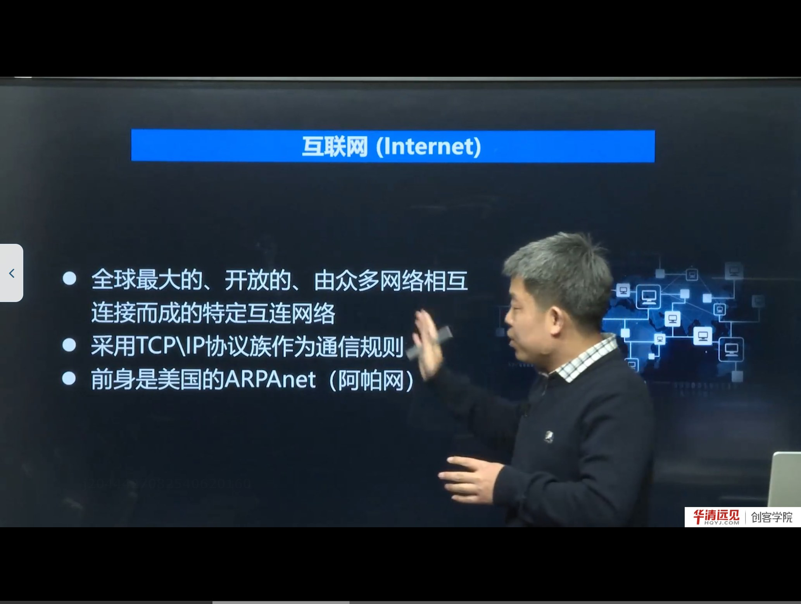

课程给出的定义是：

> 互联网是**全球最大的、开放的、由众多网络相互连接而成的特定互连网络**，它采用 **TCP/IP 协议族**作为通信规则，前身是美国的 **ARPANET（阿帕网）**。

这里有三个关键词：

1. **最大**：规模上覆盖全球；
2. **开放**：任何遵循 TCP/IP 的网络都可以接入（这是它能“滚雪球”的根本原因）；
3. **特定**：不是随便一个互连网络都叫 Internet，只有使用 TCP/IP 协议族、全球互联的那一个才叫 Internet。

> **纠错：ASR 里的“APA 网 / APPLE NAT / ARPOP 网”都是 ARPANET（阿帕网）**；“TCPIP 协议组”规范说法是“TCP/IP 协议族（protocol suite）”。

> **概念辨析：internet 与 Internet**
> 小写 **internet**（互连网络）是通用名词，指任何把多个网络互连起来的网络；大写 **Internet**（互联网/因特网）是专有名词，特指我们日常使用的这个全球互联网。教材和 RFC 里对大小写区分很严格。

---

## 五、互联网的组成：边缘部分与核心部分

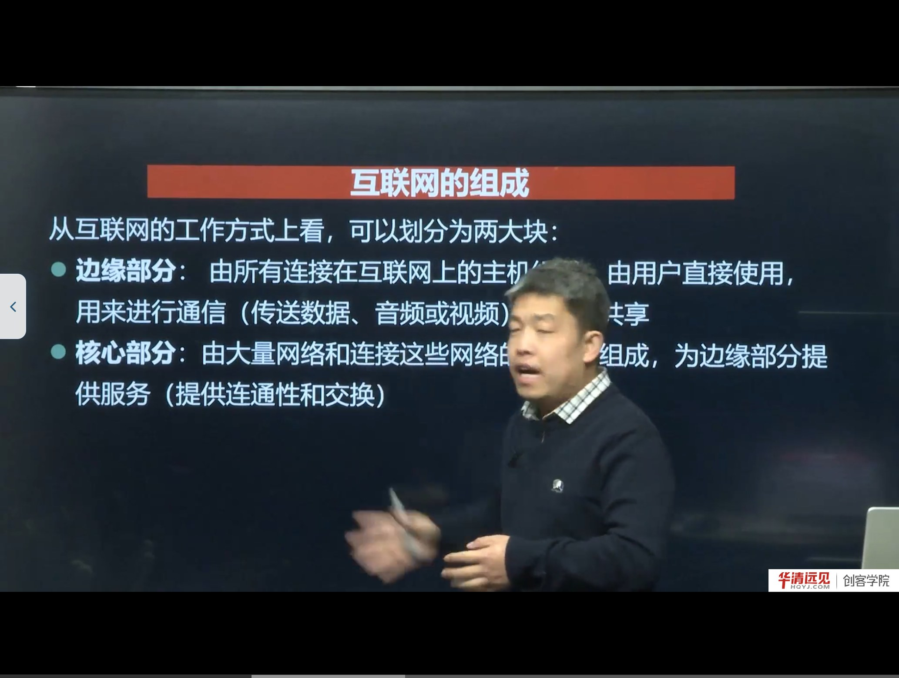

从**工作方式**看，互联网可以分成两大块：

| 部分 | 组成 | 作用 |
|---|---|---|
| 边缘部分 | 所有连接在互联网上的主机（端系统） | 由用户直接使用，用来通信（传数据、音频、视频），实现资源共享 |
| 核心部分 | 大量网络 + 连接这些网络的路由器 | 为边缘部分提供服务：**连通性**和**交换** |

这个划分方式非常重要，因为它对应了后面课程的两条主线：

- 边缘部分 → 你写的应用程序（socket 编程、客户端/服务器模型）；
- 核心部分 → IP 协议、路由与转发、以太网（后面 4.10～4.12 的内容）。

> **补充：边缘部分的两种通信方式**
> 老师本节没有展开，但这是后面“TCP 并发”一节的伏笔：
> - **C/S（客户/服务器）方式**：客户端主动请求，服务器被动等待并响应。后面写的 TCP 服务器/客户端就是这种模型。
> - **P2P（对等）方式**：每个节点既是客户端又是服务器，彼此直接交换数据（如 BitTorrent）。
>
> 这两种方式的差别，决定了程序里“谁先 bind、谁先 connect、谁阻塞在 accept”的顺序。

---

## 六、互联网基础结构发展的三个阶段

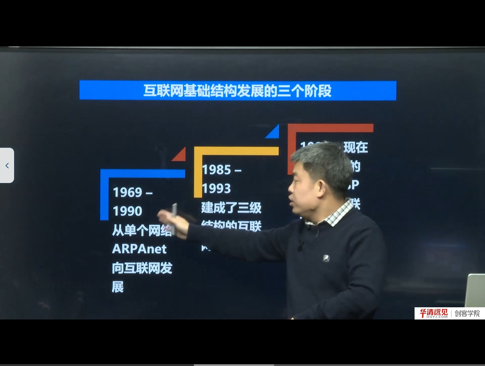

| 阶段 | 时间 | 标志 | 结构特征 |
|---|---|---|---|
| 第一阶段 | 1969 — 1990 | 从单个分组交换网 ARPANET 起步；1983 年 TCP/IP 成为 ARPANET 的标准协议 | 从“一个网络”走向“互联网” |
| 第二阶段 | 1985 — 1993 | 美国国家科学基金网 NSFNET 建成 | 三级结构：主干网 → 地区网 → 校园网 |
| 第三阶段 | 1993 — 现在 | 出现 ISP（互联网服务提供者），商业化运营 | 多层次 ISP 结构：主干 ISP / 地区 ISP / 本地 ISP |

### 6.1 第一阶段：ARPANET 与 TCP/IP

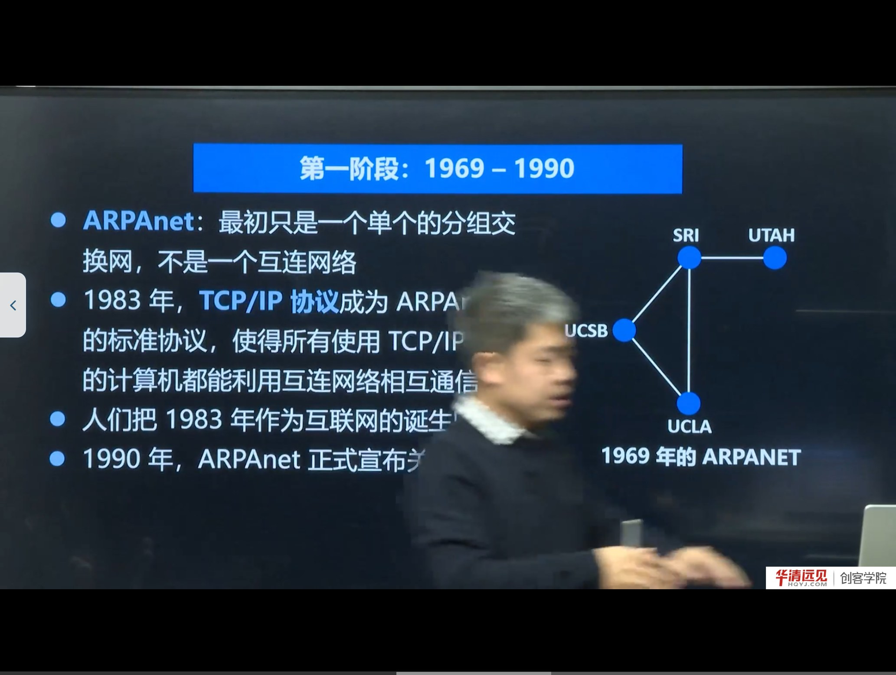

- 1969 年的 ARPANET 只有 **4 个节点**（UCLA、SRI、UCSB、UTAH），最初只是一个**单个的分组交换网**，还不是互联网络；
- 1983 年，**TCP/IP 协议成为 ARPANET 上的标准协议**，所有使用 TCP/IP 的计算机都能通过互连网络相互通信——正因如此，人们把 **1983 年**视为互联网的诞生时间；
- 1990 年，ARPANET 完成历史使命，正式关闭。

> **补充：什么是“分组交换”**
> 老师用“把一大段数据切成一小段一小段发送、到对端再组装”来解释。严格说：
> - 发送前把报文划分成**分组（packet）**，每个分组带上目的地址等控制信息；
> - 每个分组可以**独立选择路径**，经不同链路转发；
> - 到达目的端后再按序号重组。
>
> 与它相对的是**电路交换**（打电话：先建立独占通路，再通话，最后释放）。分组交换不独占线路、线路利用率高、更抗毁坏，这是互联网选择它的根本原因。代价是会出现**乱序、丢包、时延抖动**——这正是后面 TCP 要解决可靠传输的原因。

### 6.2 第二阶段：NSFNET 的三级结构

- 1985 年起，美国国家科学基金会（NSF）组建 NSFNET，用于科研教育；
- 结构是**三级**：主干网（backbone）→ 地区网（regional）→ 校园网（campus）；
- 它覆盖了全美主要大学和研究所，为互联网走出军营、走向学术界和商业界奠定了基础。

> **注意**：这里的“国家”指美国，不是中国。互联网是从美国的 ARPANET 发展起来的。

### 6.3 第三阶段：ISP 与多层次结构

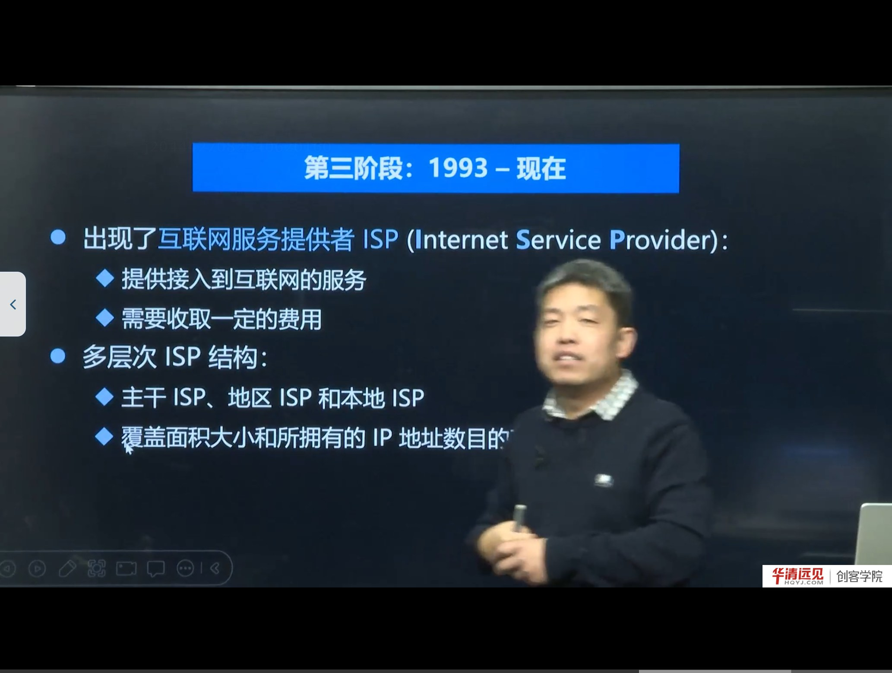

1993 年起，互联网进入商业化阶段：

- 美国政府逐渐淡出互联网的运营；
- 出现**互联网服务提供者 ISP（Internet Service Provider）**，提供接入互联网的服务并收取费用；
- 形成**多层次 ISP 结构**：
  - **主干 ISP**：覆盖范围最大、拥有 IP 地址最多、速率最高，全球只有十几家；
  - **地区 ISP**：覆盖一个地区，全球有十几万个；
  - **本地 ISP**：直接面向最终用户（家庭、企业）。

判断 ISP 层级的两个维度：**覆盖面积**和**拥有的 IP 地址数量**。

> **补充：ISP 之间怎么结算**
> 用户向本地 ISP 付费；本地 ISP 向地区 ISP 付费；地区 ISP 向主干 ISP 付费。越往上，覆盖面越大、单价越低但总量越大。这也是为什么“跨网访问”有时会慢——数据要绕到更高的层级再下来。

### 6.4 IXP：互联网交换点

课程还讲了一个关键设施——**IXP（Internet Exchange Point，互联网交换点）**：

- 作用：让**地区网络与网络之间直接交换流量**；
- 没有 IXP 时：主机 A → 本地 ISP → 地区 ISP → 主干 ISP → 地区 ISP → 本地 ISP → 主机 B，绕一大圈；
- 有了 IXP：两个本地/地区 ISP 直接在交换点互联，**不必经过主干 ISP**。

好处有两点：**提高速率（减少绕行）**、**降低成本（少付主干 ISP 的流量费）**。

### 6.5 内容提供者（ICP）

最后一个角色是**内容提供者**，例如抖音这类拥有大量视频内容的公司：

- 视频多 → 需要大量服务器存储；
- 用户多 → 需要庞大的内部网络来承载输入/输出流量；
- 为了提高效率，内容提供商会**尽可能靠近用户**，直接与本地 ISP、地区 ISP 甚至主干 ISP 互联，互联点越多、越靠近用户，访问越快、体验越好。

> **补充**：这就是今天常说的 **CDN（内容分发网络）** 的雏形——把内容缓存到离用户更近的节点，减少骨干网压力。后面讲 HTTP 服务器时还会遇到“就近访问”的思路。

---

## 七、万维网与互联网的爆发

课程最后提到：在**万维网（WWW）**出现之前，互联网上传输的数据比较单调；万维网出现后，图片、声音、视频都可以传输，互联网内容变得丰富，用户数量随之爆发式增长。

- 万维网是 20 世纪 90 年代的产物；
- 它被老师称为互联网**指数级增长的主要动力之一**；
- 课程给了一组数据：2001 年网民约 22.67 亿，2020 年 6 月约 46.48 亿（老师也说明这个数据并非十分精确，重点在趋势）。

> **概念辨析：互联网 ≠ 万维网**
> - **互联网（Internet）** 是底层的网络基础设施（TCP/IP、路由器、链路）；
> - **万维网（WWW）** 是运行在互联网之上的一种应用（HTTP + HTML + 浏览器 + 超链接）。
>
> 类似地，电子邮件、FTP、即时通信也都是互联网上的应用。把“上网”等同于“打开网页”是常见的误解。

---

## 八、本节易错点汇总

| 容易说错/写错 | 正确说法 | 说明 |
|---|---|---|
| 成域网 | 城域网（MAN） | 同音字，ASR 高频错误 |
| 极限器 | 集线器（hub） | 同音字 |
| APA 网 / APPLE NAT / ARPOP 网 | ARPANET（阿帕网） | 音译 + 连读导致 |
| TCPIP 协议组 | TCP/IP 协议族 | 规范术语 |
| 路由器也是主机 | 路由器是转发设备，不是主机 | 主机是通信端点 |
| 互联网就是万维网 | 互联网是基础设施，万维网是应用 | 层级不同 |
| 1983 年 ARPANET 诞生 | 1969 年 ARPANET 建成；1983 年 TCP/IP 成为标准，被视为互联网诞生 | 两个时间点不要混 |

---

## 九、小结与自测

**一句话总结**：本节从“两台计算机连起来就是网络”讲起，逐层放大到“网络通过网络互联成为互联网”，再给出互联网的边缘/核心两分法和三阶段发展史，最后落到 ISP、IXP、内容提供者这些今天互联网的真实角色。

**自测题**

1. 用一句话区分“网络”和“互联网络”。
2. WAN、MAN、LAN、PAN 的覆盖范围大致是多少？各举一个例子。
3. 为什么说路由器不算主机？如果一台路由器上跑了 Web 服务，它算主机吗？（提示：从“是否作为通信端点”判断）
4. 互联网发展三阶段各自的标志事件是什么？
5. IXP 解决了什么问题？没有 IXP 时数据是怎么走的？
6. 互联网与万维网是什么关系？

**下一节预告**：有了“网络的网络”这个直观认识后，下一节要回答一个更工程化的问题——这么多网络和主机，靠什么规则协同工作？这就是**网络体系结构与 OSI 七层模型**。

<!-- pagebreak -->

# 第 02 节　OSI 七层体系结构

> 对应视频：4.2《OSI七层体系结构》，含三个子视频：
> ① 网络体系结构的形成（10:00）　② 协议与划分层次（19:00）　③ OSI 七层体系结构（19:00）
>
> 本节回答一个核心问题：**两台计算机要通信，为什么必须“分层”？分层的依据是什么？** 最后给出 OSI 七层模型这张“网络世界的总图”。

## 学习目标

1. 说清两台计算机通信要解决的至少 7 个问题，理解“分层”是对付复杂性的手段。
2. 掌握网络协议的定义与三要素（语法、语义、同步），能各举一例。
3. 理解“对等层通信”“透明传输”“封装/解封装”三个概念。
4. 记住体系结构 = 各层 + 协议的集合，并区分“体系结构（抽象）”与“实现（具体）”。
5. 背下 OSI 七层的名称、顺序，以及每层的主要功能。

---

## 一、为什么需要分层：从“两台计算机传文件”说起

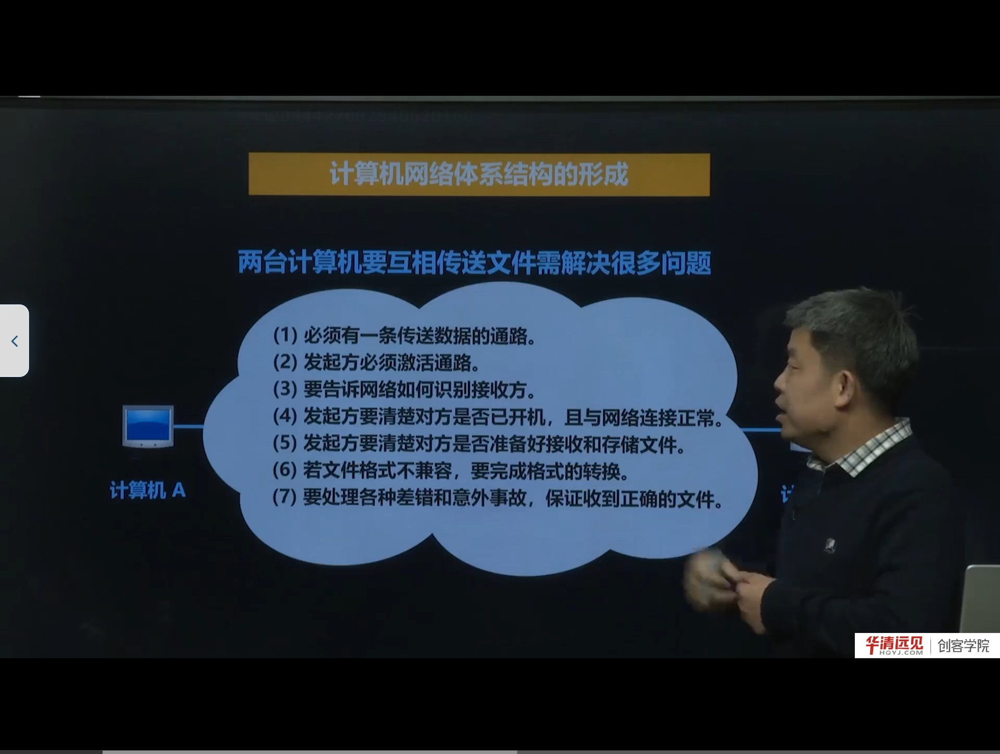

课程先不谈协议，而是把“计算机 A 给计算机 B 传一个文件”拆成若干具体问题：

1. **必须有一条传送数据的通路**——物理上得连起来；
2. **发起方必须激活通路**——发指令让线路进入可传输状态；
3. **要告诉网络如何识别接收方**——数据发给谁？怎么标识那台计算机？
4. **发起方要清楚对方是否已开机，且与网络连接正常**；
5. **发起方要清楚对方是否准备好接收和存储文件**——对方缓冲区满了还猛发，就会丢数据；
6. **文件格式不兼容时要完成格式转换**——例如 Linux 与 Windows 的文本换行、编码差异；
7. **要处理各种差错和意外事故**——中间路由器故障、比特翻转（0010 变成 0100）等，保证最终收到正确文件。

这 7 个问题覆盖了从“插上网线”到“文件语义”的全部层次。如果写一个程序时把这些逻辑全揉在一起，代码将无法维护、无法复用，换一种介质或换一种应用就得重写。

> **补充：分层的本质是“关注点分离”**
> ARPANET 在设计时提出分层：把庞大而复杂的问题分解成若干较小的局部问题，**每一层只解决一类问题，并且只使用下一层提供的服务、只向上层提供服务**。这样：
> - 某一层内部实现变化（比如把网线换成光纤），不影响上层；
> - 不同厂商只要遵守同一层的接口，就能互通。
>
> 这就是“分层”能成为网络体系结构基础的根本原因。

---

## 二、网络协议与它的三要素

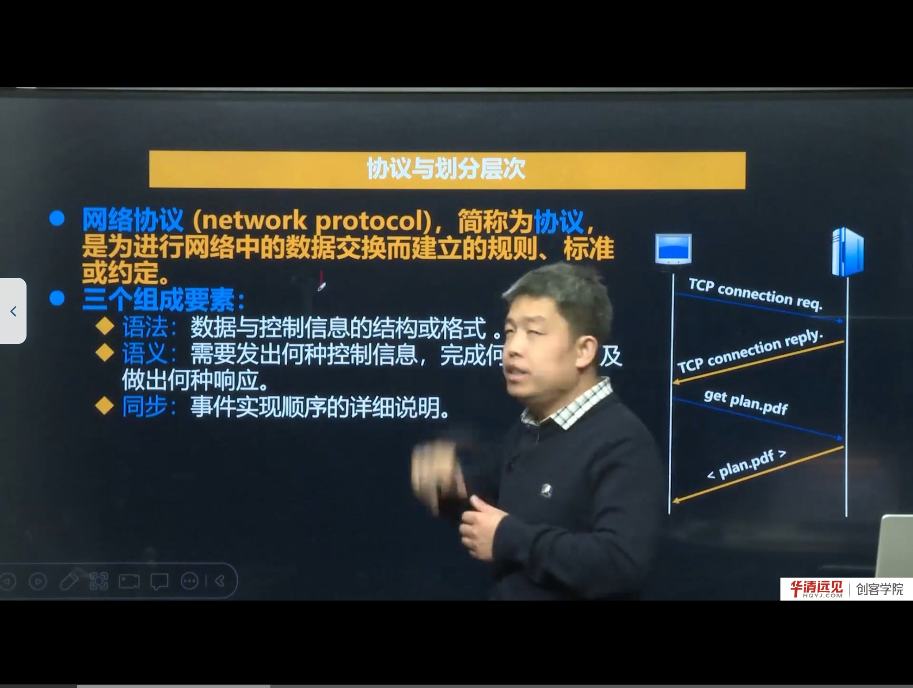

**网络协议**（network protocol）的定义：

> 为进行网络中的**数据交换**而建立的**规则、标准或约定**。

老师用“两个人说话”作类比：双方必须使用彼此能听懂的语言、遵守共同的表达习惯，才能交流。协议就是计算机之间的“共同语言”。

协议由**三个要素**组成：

| 要素 | 含义 | 通俗解释 | 例子 |
|---|---|---|---|
| 语法 | 数据与控制信息的**结构或格式** | 话怎么说、句子怎么组织 | 报文首部哪些字节表示类型、哪些表示长度 |
| 语义 | 需要发出何种控制信息、完成何种动作、做出何种响应 | 这句话是什么意思、要对方做什么 | “1”代表文件名、“2”代表文件内容 |
| 同步 | **事件实现顺序**的详细说明 | 谁先说、谁后说、说到哪一步 | 先发文件名和大小，对方准备好后再发内容 |

课程举了一个很直观的例子：传文件前先发一个字节的类型标志，`1` 表示“接下来是文件名”，`2` 表示“接下来是文件内容”。**这个“1 字节标志 + 内容”的格式就是语法；“1 代表文件名”就是语义；“先告诉对方文件名/大小、等对方开辟好内存再发内容”就是同步。**

> **纠错**：ASR 把“会话层”识别成“汇化层/绘画层”，把“差错”识别成“插错”，把“校验”识别成“教验”，把“应用层”识别成“营运层”。本节统一使用规范术语。

> **补充：协议有两种存在形式**
> - **文字描述**：RFC、国家标准，给人看、给厂商实现用；
> - **程序代码**：操作系统内核或库里的实现，给机器执行用。
>
> 二者是“规范”与“实现”的关系。考试常考“协议的三要素”，而工程里更常问“这个字段在报文里的偏移是多少”——前者是语法，后者是实现细节。

---

## 三、分层、对等层通信与透明传输

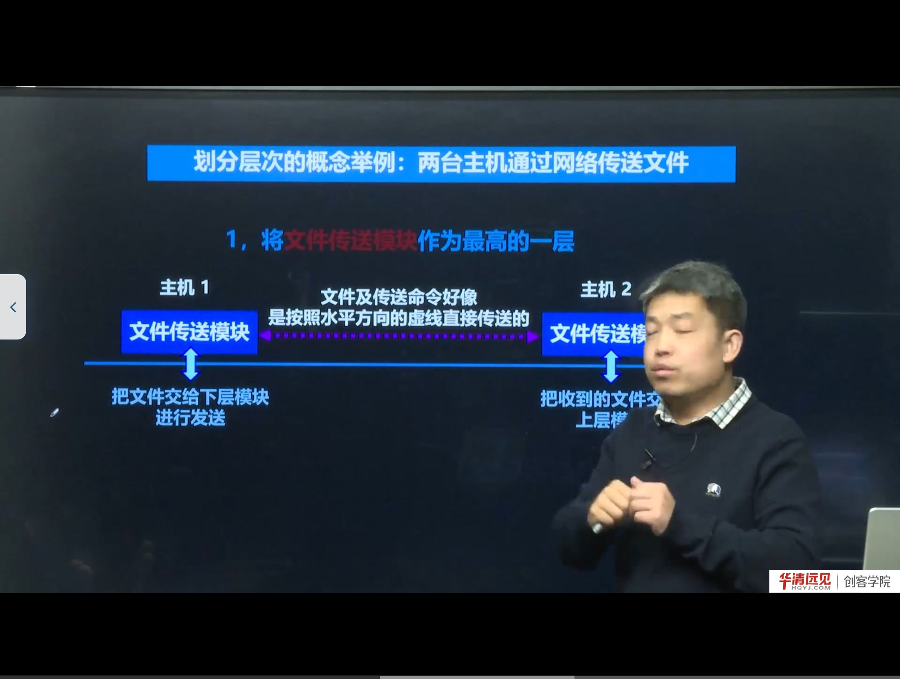

课程用“两台主机传文件”举例，把任务分成三层：

| 层次 | 角色（类比） | 负责的事 |
|---|---|---|
| 文件传送模块（最高层） | 微信/QQ | 文件的名字、大小、格式、内容组织 |
| 通信服务模块（中间层） | 快递公司 | 数据发给谁（地址）、可靠地把数据送到 |
| 网络接入模块（最底层） | 快递员/运输工具 | 通过网卡真正把比特发出去、收进来 |

关键点：

- **每一层只把数据交给下一层去“发送”，自己并不直接对物理线路操作**；
- 从上层看，数据像是沿着水平虚线“直接”到达对方同一层——这叫**对等层通信**（peer-to-peer，逻辑上的通信）；
- 实际上数据是**垂直向下**逐层传递、再经物理介质传到对方、再**垂直向上**逐层递交的；
- 下层对上层**隐藏**了自己的实现细节，上层感觉不到下层的存在——这就是**透明传输**。

> **补充：封装与解封装**
> 数据每向下一层，就会被加上该层的控制信息（首部，有时还有尾部），这叫**封装（encapsulation）**：
> - 应用数据 →（传输层加 TCP/UDP 首部）→ 报文段/用户数据报；
> - →（网络层加 IP 首部）→ IP 数据报/分组；
> - →（数据链路层加帧首部与帧尾）→ 帧；
> - →（物理层）→ 比特流。
>
> 到达对方后逐层剥掉首部，叫**解封装**。后面讲 TCP/IP 五层结构、讲抓包时，看到的“每一层包头”就是封装的结果。

---

## 四、各层要完成的主要功能

课程把“每一层都可能要做的事”归纳为五类，这些词在后面每一层都会反复出现：

| 功能 | 含义 | 典型位置 |
|---|---|---|
| 差错控制 | 使对等方的通信更可靠：检错、纠错、重传 | 数据链路层（帧校验）、传输层（TCP 重传） |
| 流量控制 | 发送端速率要让接收端来得及接收 | 传输层（滑动窗口）、数据链路层 |
| 分段与重装 | 大块数据切成小段发送，到对端再按序组装 | 传输层（TCP 分段）、网络层（IP 分片） |
| 复用与分用 | 多个上层应用共用一条下层连接（复用）；一条连接把数据分给多个上层应用（分用） | 传输层（端口号） |
| 连接的建立与释放 | 传数据前建立逻辑连接，传完释放 | 传输层（TCP 三次握手/四次挥手） |

> **理解“复用/分用”的小技巧**
> 老师用“一支笔很多人用”解释复用：**多个上层实体共用同一个下层实体**。反过来，**一个下层实体把数据分发给多个上层实体**就是分用。传输层用**端口号**实现这件事：多个应用（微信、QQ、浏览器）复用同一个 IP 地址的 TCP 连接；收到的数据再按端口号分用给对应进程。这正是后面 socket 编程中 `bind(port)` 的意义。

---

## 五、什么是“网络体系结构”

课程给了一个很容易被忽略但很重要的定义：

> **计算机网络体系结构 = 计算机网络各层及其协议的集合。**

并且强调：

- **体系结构是抽象的**，是一种“定义/规范”，回答“分几层、每层做什么、层间接口是什么”；
- **实现是具体的**，是真正运行在计算机上的硬件和软件（比如 Linux 内核里的 TCP/IP 协议栈、网卡驱动）。
- 同一个体系结构可以有多种实现；同一份协议文字，可以被不同厂商写成不同的代码。

这就解释了一个常见困惑：**“OSI 七层”是体系结构，不是一套具体软件**。你电脑里跑的并不是“OSI 协议栈”，而是 TCP/IP 协议栈。

---

## 六、OSI 七层参考模型

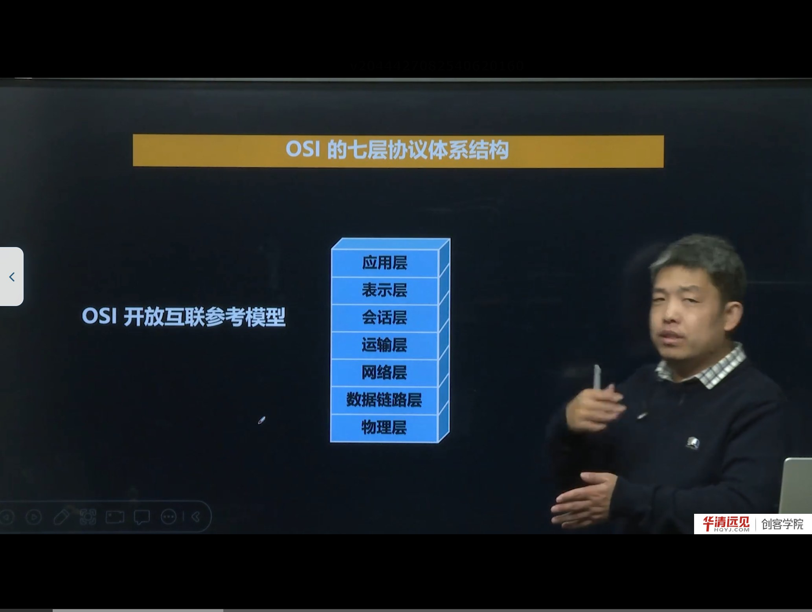

OSI/RM（Open Systems Interconnection Reference Model，开放系统互连参考模型）由 ISO 提出，1983 年形成 **ISO 7498** 国际标准，即七层协议体系结构。

课程特别说明了两点：

1. OSI **并没有真正完全落地实现**，事实上被广泛使用的是 **TCP/IP**；
2. 但 OSI 仍有很强的**参考价值**：局域网、无线网络在讲自己的分层时，仍会对照 OSI；面试也几乎必问“OSI 七层是哪七层”。

### 6.1 记忆口诀

自下而上：**物、数、网、传、会、表、应**（物理层、数据链路层、网络层、传输层、会话层、表示层、应用层）。

> 注意：第 4 层有人叫“传输层”，也有人叫“运输层”，指的是同一层（Transport Layer），不同教材译法不同，不要当成两层。

### 6.2 高层三层：面向“数据处理”

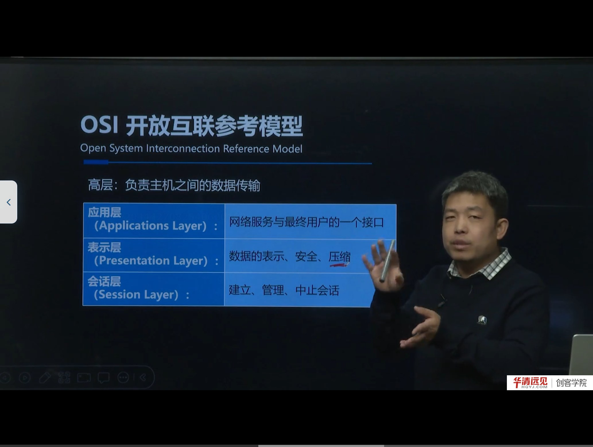

| 层次 | 主要功能 | 课程中的例子 |
|---|---|---|
| 应用层（Application） | 网络服务与最终用户的接口 | 微信聊天、抖音刷视频、浏览器看网页 |
| 表示层（Presentation） | 数据的表示、安全、压缩 | 文字/视频的不同表示；压缩与解压缩；加密与解密 |
| 会话层（Session） | 建立、管理、中止会话 | 两个应用之间的一次“会话”（如微信支付跳转到其他支付应用） |

课程用“上下层关注点不同”来解释表示层为什么存在：**上层只关心数据怎么方便表示，下层只关心数据怎么高效传输**，两者之间需要一个“翻译/压缩”的层次。

> **补充**：在 TCP/IP 模型中，表示层和会话层的功能被并入了应用层（由应用程序自己实现）。所以实际写代码时，你不会看到“表示层协议”这样的东西，但会遇到“序列化/反序列化”“压缩”“TLS 加密”这些属于表示层范畴的工作。

### 6.3 低层四层：面向“数据传输”

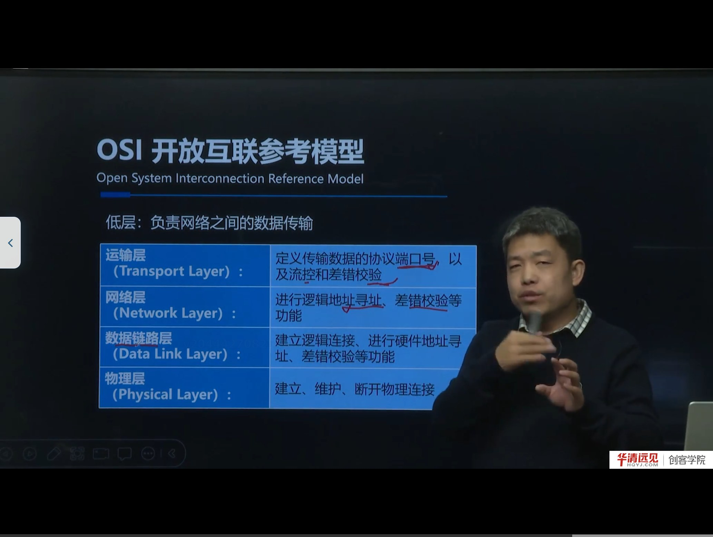

| 层次 | 主要功能 | 关键概念 |
|---|---|---|
| 传输层（Transport） | 定义传输数据的协议端口号，以及流控和差错校验 | 端口号、端到端、TCP/UDP |
| 网络层（Network） | 逻辑地址寻址、差错校验等 | IP 地址、路由、分组转发 |
| 数据链路层（Data Link） | 建立逻辑连接、硬件地址寻址、差错校验 | MAC 地址、帧、CSMA/CD |
| 物理层（Physical） | 建立、维护、断开物理连接 | 网线、光纤、无线信号、比特流 |

课程用“从北京去上海”的类比讲网络层与数据链路层的区别：

- **网络层**：解决“从北京（源主机）到上海（目的主机）”的**端到端**路径选择——对应 IP 地址与路由；
- **数据链路层**：解决“出门坐哪趟地铁/公交、这一站到下一站怎么走”——对应**每一段链路**上的帧传输与 MAC 地址。

> **补充：为什么传输层需要端口号，网络层不需要**
> 网络层只把数据送到“主机”，一台主机上可能同时跑微信、QQ、浏览器，必须再有一层用**端口号**区分“交给哪个进程”。这就是传输层“复用/分用”的由来，也是 socket 编程里 `IP:Port` 四元组定位一条连接的原因。

### 6.4 数据在各层的名字

| 层 | 数据单元名称 |
|---|---|
| 应用层 | 报文（message） |
| 传输层 | 报文段（segment，TCP）/ 用户数据报（datagram，UDP） |
| 网络层 | 分组/数据报（packet / datagram） |
| 数据链路层 | 帧（frame） |
| 物理层 | 比特（bit） |

> 这张表在后面的抓包实验（Wireshark）里会直接用到：你在 Wireshark 里点开一个包，看到的就是 Frame → Ethernet → IP → TCP → HTTP 的逐层解封装。

---

## 七、本节易错点与纠错

| 容易说错/写错 | 正确说法 | 说明 |
|---|---|---|
| 汇化层 / 绘画层 | 会话层（Session） | 同音字，ASR 高频错误 |
| 营运层 | 应用层（Application） | 同音字 |
| 插错控制 / 插错校验 | 差错控制 / 差错校验 | 同音字 |
| 教验 | 校验 | 同音字 |
| 传输层 = 运输层 | 同一层 | 不同教材译名不同 |
| OSI 七层是实际使用的协议栈 | 实际使用的是 TCP/IP，OSI 是参考模型 | 概念区分 |
| 数据是“水平直接传到对方同一层” | 逻辑上对等层通信，物理上垂直上下再经介质 | 透明传输的本质 |

---

## 八、小结与自测

**一句话总结**：两台计算机通信要解决的问题太多，所以用“分层”把大问题拆成小问题；每层靠**协议**（语法/语义/同步）与对等层通信，靠**封装/解封装**与上下层协作；OSI 七层是这套思想的标准化参考模型，虽然没落地，但仍是理解网络的分层地图。

**自测题**

1. 两台计算机传文件要解决哪些问题？至少说出 5 个。
2. 协议的三要素是什么？分别用“传文件”的例子说明。
3. 什么叫透明传输？下层是如何做到“透明”的？
4. “复用”和“分用”分别发生在发送端还是接收端？靠什么字段实现？
5. 体系结构与实现的区别是什么？
6. 默写 OSI 七层（自下而上），并各写一句话功能。
7. 网络层和数据链路层都做“地址寻址”，二者的地址分别是什么？范围有何不同？

**下一节预告**：OSI 是“参考”，真正跑在互联网上的是 **TCP/IP 协议族**。下一节把 OSI 七层“压缩”成五层，讲清 TCP/IP 的分层、各层协议族，以及为什么它赢了 OSI。

<!-- pagebreak -->

# 第 03 节　TCP/IP 协议与五层体系结构

> 对应视频：4.3《TCP/IP协议与五层体系结构》（37:00）
>
> 上一节的 OSI 七层是“参考模型”，本节讲的 **TCP/IP 四层**才是真正跑在互联网上的体系结构；为了教学与工程都方便，教材又在两者之间折中出**五层模型**。三种模型要能互相对照，不能混为一谈。

## 学习目标

1. 说出 TCP/IP 四层与 OSI 七层的对应关系，理解“为什么 TCP/IP 赢了”。
2. 解释“TCP/IP 实质上只有上面三层有具体内容”这句话的含义。
3. 理解沙漏模型：为什么 IP 层是互联网的核心，向上支持多种应用、向下兼容多种网络。
4. 掌握五层模型各层的主要功能，以及 TCP 与 UDP 的本质差别。
5. 能说清网络层“路由选择”和“转发”的区别，以及数据链路层“相邻节点”的含义。

---

## 一、从 OSI 七层到 TCP/IP 四层

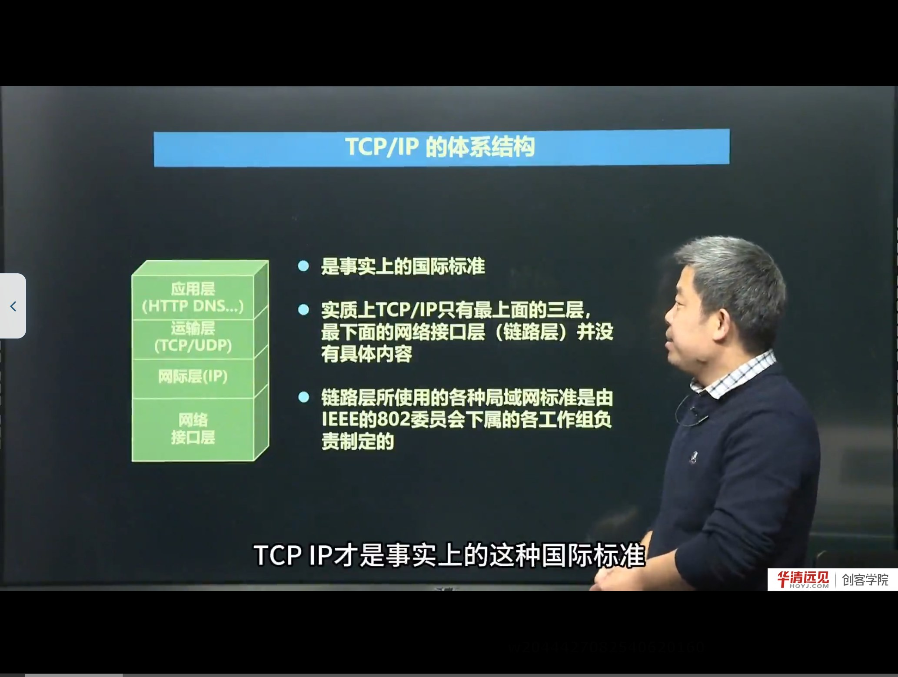

TCP/IP 把 OSI 的七层压缩成四层：

| TCP/IP 四层 | 对应 OSI | 说明 |
|---|---|---|
| 应用层 | 应用层 + 表示层 + 会话层 | 把高三层合并，具体功能由应用程序自己实现 |
| 运输层（传输层） | 传输层 | TCP / UDP |
| 网际层（IP 层） | 网络层 | IP 协议，负责寻址与转发 |
| 网络接口层 | 数据链路层 + 物理层 | TCP/IP 不规定具体内容，由各网络自己实现 |

课程强调了三句话：

1. **TCP/IP 才是事实上的国际标准**。因为全球互联网的内核就是“基于 IP 的网络层实现”，而它用的就是 TCP/IP。
2. **实质上 TCP/IP 只有最上面三层有具体内容**。最下面的网络接口层“并没有具体内容”——TCP/IP 不讨论底层网络（有线/无线/卫星）的细节。
3. **链路层使用的各种局域网标准由 IEEE 802 委员会下属工作组制定**。也就是说：上面三层由 IETF（RFC）管，下面两层由 IEEE 管，分工不同。

> **补充：为什么“网络接口层”是空的反而是一种优势**
> 正因为 TCP/IP 不对底层网络做规定，它才能跑在以太网、Wi-Fi、光纤、4G/5G、卫星链路上——**只要你能收发帧，就能承载 IP**。这就是 IP 能“以一统万”的原因，也是后面讲“IP over everything”的由来。

### 1.1 路由器为什么只实现到网络层

课程用一张“主机—路由器—主机”的图说明：**路由器的协议栈只到网络层，网络层以上就没有了**。

原因很直接：数据通信的真正端点是两台主机（端到端），路由器只是中间的**转发**设备。它不需要关心数据是微信消息还是视频流，也不需要做表示层/会话层的处理，只要**看目的 IP、查转发表、把分组从合适接口发出去**即可。

> **补充：端到端 vs 点到点**
> - **端到端（end-to-end）**：传输层关注的是“源主机进程 ↔ 目的主机进程”，中间网络对它是透明的；
> - **点到点（point-to-point）**：数据链路层关注的是“相邻两个节点之间”的一跳传输。
>
> 这个区分在讲 TCP 与 IP 的分工时非常关键：TCP 负责端到端的可靠，IP 负责逐跳的转发。

---

## 二、TCP/IP 的另一种画法：沙漏模型

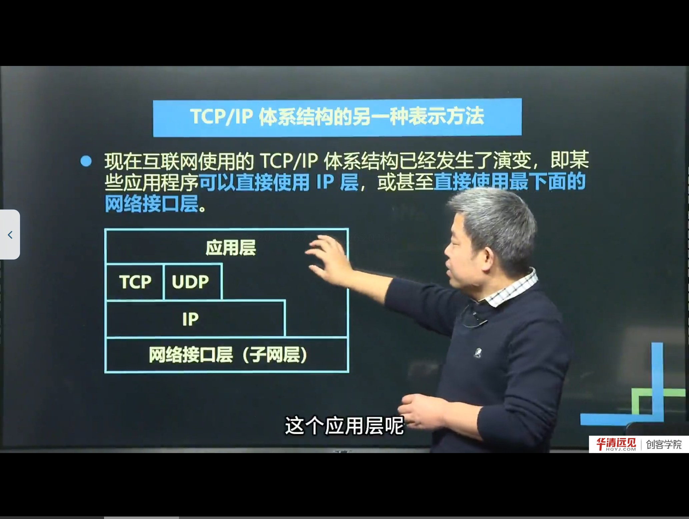

课程给出了一张“上宽下窄再宽”的图（俗称**沙漏模型**）：

- **上面宽**：应用层有很多协议（HTTP、DNS、SMTP、FTP……）；
- **中间窄**：网际层只有 **IP** 一个核心协议；
- **下面宽**：网络接口层支持各种局域网/广域网技术。

而且这张图还说明了一个容易被忽略的事实：**某些应用可以越过传输层，直接使用 IP 层，甚至直接使用网络接口层**。课程举的例子是 `ping`：

- `ping` 直接使用 **ICMP**（封装在 IP 里），不需要 TCP/UDP；
- 所以它“没有传输层”也能工作。

> **补充：沙漏模型的工程意义**
> 沙漏的“细腰”就是 **IP**。IP 之上，应用可以自由创新（HTTP/3、QUIC、WebSocket 都建立在 IP 之上）；IP 之下，链路技术可以自由替换（以太网、Wi-Fi、5G）。**IP 的稳定，换来了上下两层的繁荣**。这也是为什么说“互联网的核心是 IP”。

---

## 三、五层协议体系结构

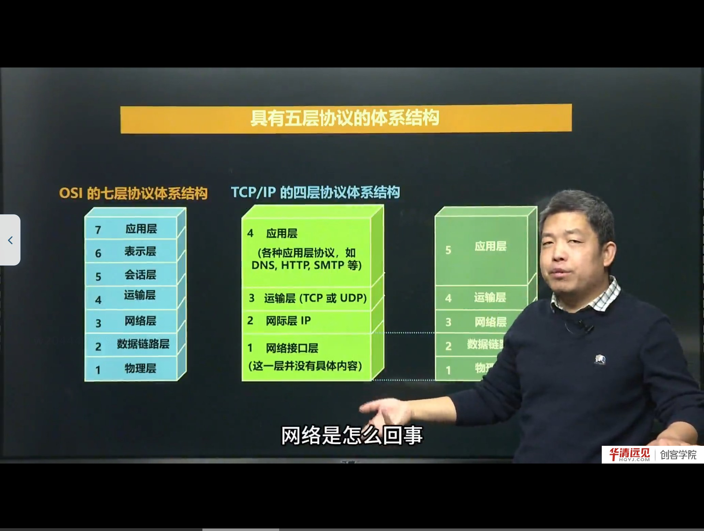

五层模型是在教学/工程中折中的产物：

| 5 层 | 名称 | 主要功能 | 典型协议 |
|---|---|---|---|
| 5 | 应用层 | 通过应用进程间的交互完成特定网络应用；定义进程间通信与交互的规则 | HTTP、DNS、SMTP、FTP、SSH |
| 4 | 运输层 | 向两台主机中**进程之间**的通信提供通用的数据传输服务；复用/分用 | TCP、UDP |
| 3 | 网络层 | 为分组交换网上的不同主机提供通信服务；路由选择 + 转发 | IP、ICMP、ARP、路由协议 |
| 2 | 数据链路层 | 实现**两个相邻节点**之间的可靠通信；帧同步、差错检测 | Ethernet、PPP、Wi-Fi |
| 1 | 物理层 | 实现比特（0/1）的传输；规定接口引脚、电气特性 | 双绞线、光纤、无线信道 |

课程说明：五层模型“来自民间”——大家在实践中发现四层不够用（经常要关心网卡、链路），七层又太细，于是总结出五层。七层（ISO）和四层（TCP/IP）是官方发布的，五层是教学与工程中约定俗成的折中。

### 3.1 应用层：定规则

应用层的任务是**实现某个具体的网络应用**，它的协议定义的是**应用进程间通信和交互的规则**。例如：

- DNS：域名解析——把域名翻译成 IP；
- HTTP：网页浏览——规定请求/响应的格式与方法；
- SMTP：邮件发送。

课程特别提醒：应用层协议**不考虑** 0/1 怎么传、IP 地址怎么寻址，那些是下面层的事。应用层只关心“我发什么格式的请求、对方回什么格式的响应”。

### 3.2 运输层：通用的数据传输服务

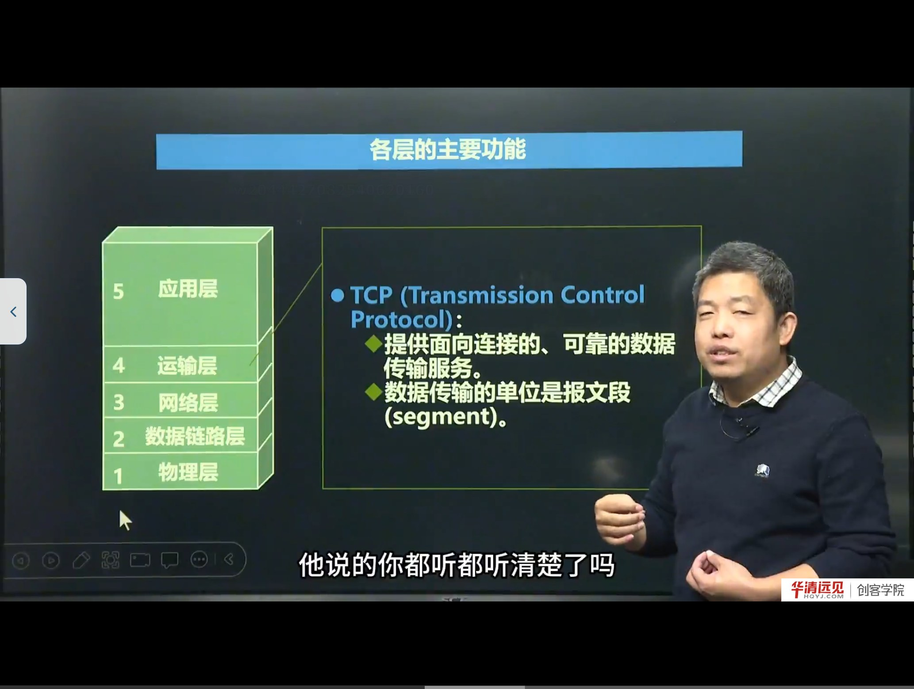

运输层**不关心应用层的规则**，它只提供“通用的数据传输服务”：你把数据交给我，我负责把它送到对方主机的对应进程。

它有两个主角：

| 协议 | 特点 | 数据单元 | 保证什么 |
|---|---|---|---|
| TCP | 面向连接、可靠 | 报文段（segment） | **准确性**：不丢、不重、按序 |
| UDP | 无连接、尽最大努力 | 用户数据报（datagram） | **时效性**：发了就不管，快 |

课程用“领导交代事情”的类比解释 TCP 的可靠：领导说了一堆，员工要一字不落复述一遍，才能确认“你真听清了”；TCP 的确认机制就是这样“死板”，但能保证准确。代价是**慢、开销大**。

UDP 则是“我把数据发出去就完事，你收没收到是你的事”。它不保证准确，但**简单、时延低**，适合视频流、音频流、实时游戏这类“丢一两帧看不出来、但卡顿很难受”的场景。

> **补充：TCP 与 UDP 的选择不是“好坏”，而是“取舍”**
> - 文件传输、网页、登录：必须准确 → TCP；
> - 直播、语音、DNS 查询（一次一问一答，丢了重发即可）：更看重时延 → UDP。
>
> 后面的 4.9、4.11 会分别用代码实现 UDP 与 TCP，并分析各自适用的场景。

### 3.3 网络层：路由选择与转发

网络层的任务是**为分组交换网上的不同主机提供通信服务**，具体有两件事：

1. **路由选择（routing）**：通过路由算法，在路由器上生成**转发表**（routing/forwarding table），回答“到某个目的网络，下一跳是谁”；
2. **转发（forwarding）**：路由器收到分组后，按转发表把分组从相应接口送到下一个路由器。

课程用“寄快递/坐公交”的类比：每个路由器只知道“我这一站能把包裹交给谁”，一站一站接力，最终到达目的主机。

互联网的网络层使用**无连接的网际协议 IP**，因此网络层也叫 **IP 层**或**网际层**。IP 分组也叫 **IP 数据报**，简称**数据报**。

> **补充：路由选择与转发的区别（高频考点）**
> - 路由选择是**控制平面**的事：跑路由协议（RIP/OSPF/BGP），算出表；
> - 转发是**数据平面**的事：每个分组到达时查表、发出去。
>
> 前者是“修路/画地图”，后者是“按地图开车”。一台路由器可以只转发不跑路由协议（静态路由），但那样就无法动态适应网络变化。

### 3.4 数据链路层：相邻节点之间的可靠通信

数据链路层实现**两个相邻节点之间**的通信。课程用“坐公交从 A 站到 C 站，中间经过 B 站”作类比：

- 网络层关心的是“从 A 到 C”的端到端路径；
- 数据链路层关心的是“A→B”“B→C”每一段怎么走。

链路层对差错的处理有两种设计思路：

| 思路 | 做法 | 类比 |
|---|---|---|
| 检错丢弃 | 发现比特错误就丢弃该帧，不纠正 | 生产车间的残次品直接扔掉，不返修 |
| 可靠传输 | 出错就请求重发（ARQ），保证每一跳都正确 | 像 TCP 一样确认+重传 |

有线链路通常用第一种（出错率低，丢弃+上层重传即可）；**无线链路**因为误码率高，常采用第二种（链路层本地重传，避免上层端到端重传带来的大时延）。

### 3.5 物理层：翻译 0 和 1

物理层实现**比特的传输**，规定连接电缆的插头有多少引脚、各引脚如何连接、电气特性如何。

课程特别澄清了一个易混点：

> 传输媒体（双绞线、同轴电缆、光缆、无线信道）**并不在物理层协议之内**，而在物理层协议的**下面**。

也就是说：物理层协议管的是“引脚连好之后，双方如何用电气信号表示 0/1、如何同步”，而“用哪种线、线怎么接”是物理媒体与接口的范畴。

---

## 四、一次通信的完整过程（五层视角）

以“微信发一条消息”为例，数据自上而下逐层封装，再自下而上逐层解封装：

```
应用层   微信消息（规定格式）
  ↓
运输层   加 TCP 首部 → 报文段（源端口/目的端口/序号…）
  ↓
网络层   加 IP 首部  → IP 数据报（源 IP/目的 IP/TTL…）
  ↓
链路层   加帧头帧尾 → 帧（源 MAC/目的 MAC/FCS）
  ↓
物理层   变成 0/1 比特流，经网线/无线发出
```

到达对端后逐层剥掉首部，最终把消息交给微信进程。中间经过路由器时，路由器只解到网络层，改 MAC、减 TTL、查表转发，**不会**解到 TCP 或应用层。

> **补充：为什么路由器不改端口号**
> 端口号属于传输层，路由器只处理到网络层，因此它看不到、也不修改端口号（NAT 是例外，属于网络层的地址转换）。这也解释了为什么“端口号是端到端的，MAC 地址是逐跳的”。

---

## 五、三种模型的对照与选择

| 对比项 | OSI 七层 | TCP/IP 四层 | 五层（教学） |
|---|---|---|---|
| 层数 | 7 | 4 | 5 |
| 发布方 | ISO（官方） | IETF/实际使用 | 民间/教材总结 |
| 是否落地 | 基本未落地 | 事实标准 | 教学模型 |
| 优点 | 分层清晰、职责分明 | 简洁、实用 | 兼顾理论与工程 |
| 缺点 | 过于复杂、实现困难 | 网络接口层过于笼统 | 非正式标准 |

课程的建议是：**理解用五层，考试/面试用 OSI 七层，工程实现看 TCP/IP 四层**。

---

## 六、本节易错点与纠错

| 容易说错/写错 | 正确说法 | 说明 |
|---|---|---|
| 网继层 / 网绩层 | 网际层（IP 层） | 同音字，ASR 错误 |
| 附用 / 分用 | 复用 / 分用 | 同音字 |
| 暴文段 | 报文段（segment） | 同音字 |
| 实效性 | 时效性 | 同音字 |
| 真 / 帧 | 帧（frame） | ASR 把“帧”识别成“真” |
| TCP/IP 是 OSI 的实现 | 二者是并行的两套体系结构 | TCP/IP 先有实现后有标准 |
| 路由器实现了全部七层 | 路由器只到网络层 | 转发设备不需要高层 |
| 物理层协议包括网线 | 传输媒体在物理层协议之下 | 协议管信号，不管介质 |

---

## 七、小结与自测

**一句话总结**：OSI 七层是“教科书”，TCP/IP 四层是“真家伙”，五层是“折中版”；三者的共同思想是分层，而 TCP/IP 的精髓是**沙漏模型**——以 IP 为细腰，上承万种应用，下接万种链路。

**自测题**

1. 画出 OSI 七层、TCP/IP 四层、五层模型的对应关系。
2. “TCP/IP 实质上只有上面三层有具体内容”是什么意思？网络接口层为什么可以“空着”？
3. 沙漏模型的“细腰”是哪一层？它带来什么好处？
4. TCP 与 UDP 的本质区别是什么？各举两个适用场景。
5. 路由选择和转发分别是什么？在路由器上谁依赖谁？
6. 数据链路层说的“相邻节点”怎么理解？为什么无线链路更倾向做可靠传输？
7. `ping` 命令用到了哪几层？为什么说它“不需要传输层”？

**下一节预告**：分层讲完，接下来进入“地址”。IP 地址如何标识一台主机？为什么要有端口号？分类 IP、CIDR、子网掩码、IPv6 分别解决什么问题？这就是第 04 节的内容。

<!-- pagebreak -->

# 第 04 节　IP 地址与端口号

> 对应视频：4.4《IP地址与端口号》，含五个子视频：
> ① 分类 IP（22:00）　② 无分类编址 CIDR（8:00）　③ 子网掩码（5:00）　④ IPv6 的表示方式（6:00）　⑤ 协议端口号（18:00）
>
> 上一节说“网络层负责逻辑地址寻址”，本节就把“逻辑地址”讲透：IPv4 地址怎么编、怎么划、怎么算网络号，IPv6 长什么样，以及为什么还需要端口号。

## 学习目标

1. 说清 IPv4 地址的 32 位结构与“点分十进制”表示，能手算二进制/十进制互换。
2. 掌握 A/B/C/D/E 五类地址的起止范围、网络号位数、可用主机数。
3. 理解分类编址的浪费问题，以及子网划分、CIDR 各自解决什么问题。
4. 会用子网掩码做“与运算”求网络地址，能看懂 `192.168.1.10/24` 这类写法。
5. 记住 IPv6 的 128 位、冒号十六进制、零压缩规则。
6. 理解端口号的作用、范围划分，以及“IP + 端口”如何唯一标识一个通信端点。

---

## 一、IP 地址是什么：32 位、两级结构

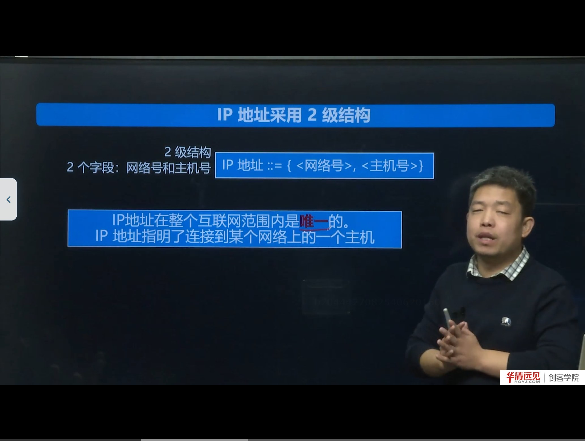

IPv4 地址在计算机内部是一个 **32 位二进制数**，也就是 **4 个字节**。为了人读方便，把它按每 8 位一组、转成十进制、用点分开，就是**点分十进制**（dotted decimal）：

```
11000000 10101000 00000001 01100100
  192      168       1        100
```

结构上，IP 地址是**两级**的：

```
IP 地址 ::= { <网络号>, <主机号> }
```

- **网络号**：标识这台主机所在的网络；
- **主机号**：标识该网络内的具体主机。

寻址逻辑就是“先找网络，再找主机”——这与互联网“网络通过网络互联”的结构完全对应。

课程强调：**IP 地址在整个互联网范围内是唯一的**。有同学会问“为什么我家的 `192.168.1.100` 和老师家的一样？”——因为那是**私有地址**，只在一个局域网内部有效；局域网对外通信时，经过 NAT 转换成公网地址，所以在公网上看到的并不是 `192.168.1.100`。

> **补充：二进制敏感度**
> 课程要求记住几个关键值：
> - `11111111` = 255
> - `10000000` = 128
> - `11000000` = 192（128+64）
> - `11100000` = 224（128+64+32）
>
> 这几个数正好对应 A/B/C/D 类的首字节边界，记住它们，判断地址类别和算掩码都会快很多。

---

## 二、分类 IP：A、B、C、D、E

早期的做法是把 32 位地址的前几位固定，用“首字节范围”区分五类：

| 类别 | 首字节范围 | 固定前缀 | 网络号位数 | 主机号位数 | 用途 |
|---|---|---|---|---|---|
| A | 0 ～ 127 | 0 | 8 | 24 | 单播，超大网络 |
| B | 128 ～ 191 | 10 | 16 | 16 | 单播，中型网络 |
| C | 192 ～ 223 | 110 | 24 | 8 | 单播，小型网络 |
| D | 224 ～ 239 | 1110 | — | — | 组播（多播） |
| E | 240 ～ 255 | 1111 | — | — | 保留 |

- **A/B/C 是单播地址**：一个发送方对应一个接收方；
- **D 类是组播地址**：一个发送方，多个接收方同时接收（如视频会议、IPTV）；
- **E 类保留**，暂未分配。

判断举例：`10.14.1.8` 首字节 10，在 0～127 → A 类，网络号是 `10`，主机号是 `14.1.8`。

### 2.1 每类能容纳多少主机

| 类别 | 主机号位数 | 理论主机数 | 实际可用（减 2） |
|---|---|---|---|
| A | 24 | 2²⁴ = 16,777,216 | 16,777,214 |
| B | 16 | 2¹⁶ = 65,536 | 65,534 |
| C | 8 | 2⁸ = 256 | 254 |

**为什么要减 2？** 因为一个网络里有两个地址不能分配给主机：

- **主机号全 0**：代表“本网络”本身；
- **主机号全 1**：代表“本网络上的广播地址”。

### 2.2 一般不使用的特殊 IP

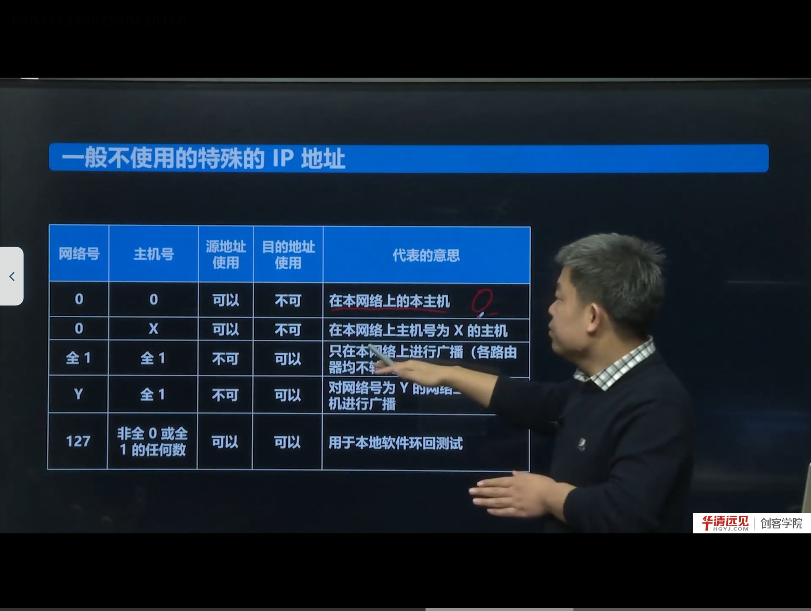

| 网络号 | 主机号 | 含义 |
|---|---|---|
| 0 | 0 | 在本网络上的本主机（`0.0.0.0`，常用于表示“任意/本机”） |
| 0 | X | 本网络上主机号为 X 的主机 |
| 全 1 | 全 1 | 只在本网络上广播（`255.255.255.255`，路由器不转发） |
| Y | 全 1 | 对网络号为 Y 的网络进行广播（定向广播） |
| 127 | 非全 0/全 1 | 本地软件环回测试（`127.0.0.1` 就是本机） |

> **补充：`0.0.0.0` 在编程中的两个常见含义**
> 1. `bind(0.0.0.0, port)`：绑定本机所有网卡，任意地址来的连接都接收；
> 2. `connect` 前的占位、或表示“由内核选择源地址”。
>
> 这两个用法在后面 socket 编程中会反复出现，看到 `0.0.0.0` 不要慌，它表示“本机/任意”。

### 2.3 分类编址的致命缺点

分类编址**管理简单、转发迅速**（看一眼首字节就知道网络号），但会造成巨大的浪费：

- 一个只有 1000 台主机的组织，C 类（254 个地址）不够，只能申请 B 类（65,534 个地址），**浪费 6 万多个地址**；
- 而 A 类一个网络就有 1600 多万个地址，几乎没有组织能用完。

随着 20 世纪 90 年代互联网商业化、用户爆炸式增长，地址迅速枯竭。IETF 先后提出两种补救：

1. **划分子网（subnetting）**：在主机号里再切出一段“子网号”，把一个大网络分成若干小网络；
2. **CIDR（无分类编址）**：彻底取消 A/B/C 类边界，按需分配任意长度的前缀。

> **补充：私有地址范围（RFC 1918）**
> - A 类：`10.0.0.0/8`
> - B 类：`172.16.0.0/12`（即 172.16.0.0～172.31.255.255）
> - C 类：`192.168.0.0/16`
>
> 这些地址不会在公网路由，家庭/企业内网随便用，出口处由 NAT 转换。这就是“我家和老师家都是 192.168.1.100”却不冲突的原因。

---

## 三、CIDR：无分类编址

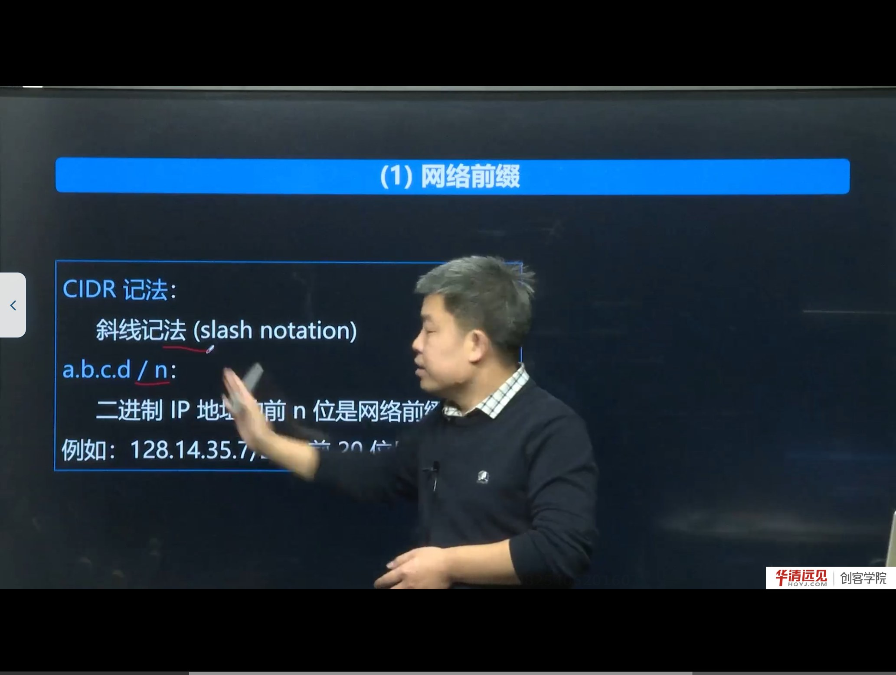

CIDR（Classless Inter-Domain Routing，无分类域间路由选择）**消除了 A/B/C 类和划分子网的概念**，回到“网络前缀 + 主机号”的两段结构，但前缀长度 **n 不再固定**，可以按需取 0～32 任意值。

写法就是**斜线记法**（slash notation）：

```
a.b.c.d / n
```

含义：二进制 IP 地址的**前 n 位是网络前缀**，剩下的 `32 - n` 位是主机号。

例如 `128.14.35.7/20`：

- 前 20 位是网络前缀，后 12 位是主机号；
- 把后 12 位清零，得到**网络前缀** `128.14.32.0/20`；
- 这个地址块包含 `2¹² = 4096` 个地址，可分配给主机的有 `4096 - 2 = 4094` 个（去掉网络地址和广播地址）。

> **补充：CIDR 地址块的三要素**
> 对 `a.b.c.d/n` 这个地址块：
> - **最小地址** = 主机号全 0（网络地址）；
> - **最大地址** = 主机号全 1（广播地址）；
> - **地址总数** = 2^(32-n)。
>
> 聚合（route summarization）也靠它：把多个连续的小前缀合并成一个大前缀，减少路由表条目。例如 `128.14.32.0/20` 可以覆盖 16 个 `/24`。

---

## 四、子网掩码：让计算机“算得快”

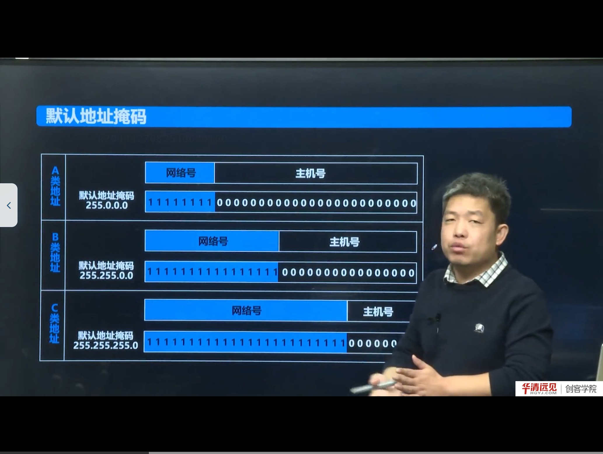

人可以从 `/20` 看出前缀长度，但计算机怎么做？答案是**子网掩码**（subnet mask，也叫地址掩码）：

> 网络前缀对应的位全为 **1**，主机号对应的位全为 **0**。

例如 `/20` 的掩码是：

```
11111111 11111111 11110000 00000000
   255      255      240       0
```

即 `255.255.240.0`。

**求网络地址的方法：IP 地址与子网掩码逐位做“与（AND）”运算。**

```
  128.14.35.7   → 10000000 00001110 00100011 00000111
& 255.255.240.0 → 11111111 11111111 11110000 00000000
= 128.14.32.0   → 10000000 00001110 00100000 00000000
```

因为掩码的主机号部分全是 0，与运算后必然为 0；网络前缀部分原样保留——这就是“与运算能快速求网络号”的原理。

### 4.1 默认掩码

虽然 CIDR 从概念上取消了分类，但 A/B/C 类地址仍在大量使用，所以有“默认掩码”：

| 类别 | 默认掩码 | 前缀长度 |
|---|---|---|
| A | 255.0.0.0 | /8 |
| B | 255.255.0.0 | /16 |
| C | 255.255.255.0 | /24 |

> **补充：子网划分的算法**
> 若要把一个 B 类网络（/16）划分成能容纳 1000 台主机的子网：
> - 2¹⁰ = 1024 ≥ 1002（1000+2），所以主机号留 **10 位**；
> - 子网号占 16 - 10 = **6 位**，可划分 2⁶ = 64 个子网；
> - 子网掩码为 `/26`，即 `255.255.255.192`。
>
> 这就是“借位”的思想：从主机号高位借位当子网号，借几位，子网数就是 2 的几次方。

---

## 五、IPv6 的表示方式

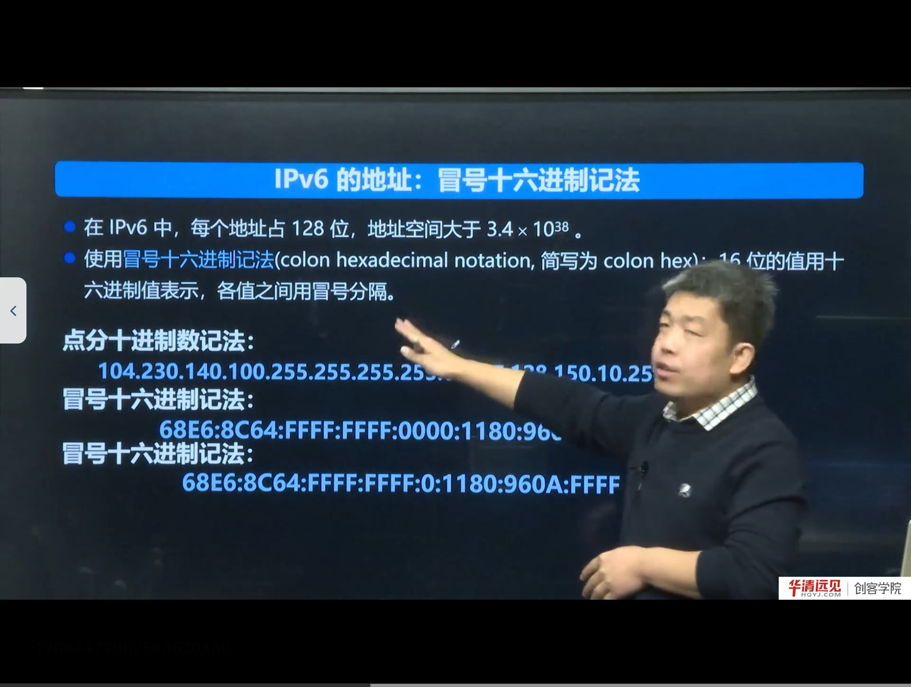

IPv4 只有 32 位，地址枯竭是必然。IPv6 把地址扩大到 **128 位**，地址空间大于 `3.4 × 10³⁸`——号称“能给地球上的每一粒沙子分配一个地址”。

表示方法：

1. **冒号十六进制**（colon hexadecimal）：每 16 位（2 字节）用 4 个十六进制数表示，各组之间用冒号分隔。
   ```
   68E6:8C64:FFFF:FFFF:0000:1180:960A:FFFF
   ```
2. **零压缩**：把连续的一串 0 用 `::` 表示，但**一个地址中只能使用一次**。
   ```
   68E6:8C64:FFFF:FFFF::1180:960A:FFFF
   ```
3. **点分十进制后缀**：在 IPv4 兼容地址中，最后 32 位可以写成点分十进制，如 `::192.168.1.1`。

特殊地址：

- `::1`：环回地址（相当于 IPv4 的 `127.0.0.1`）；
- `::`：全零地址（未指定地址）；
- `FF00::/8`：组播地址。

> **补充：IPv6 的现状**
> 课程说得很客观：IPv6 是趋势，但当下主流仍是 IPv4。国内三大运营商和大型互联网公司已大规模双栈部署，家庭宽带多数也支持 IPv6。写程序时用 `AF_INET6` 即可支持，但本课程后续代码仍以 IPv4 为主，先把 IPv4 的 socket 编程学扎实。

---

## 六、端口号：一台主机上的“门牌号”

IP 地址只能把数据送到**主机**，但一台主机上同时跑着浏览器、微信、QQ、SSH……数据到底交给哪个进程？这就要靠**端口号（port number）**。

### 6.1 端口号是什么

- 端口号是一个 **16 位**的无符号整数，范围 **0～65535**；
- 它由**传输层**（TCP/UDP）使用，用来标识主机上的一个进程（更准确说，是标识一个通信端点）；
- **IP 地址 + 端口号**才能唯一标识互联网上的一个通信端点，常写作 `IP:Port`。

### 6.2 端口号的划分

| 范围 | 名称 | 说明 |
|---|---|---|
| 0 ～ 1023 | 熟知端口（well-known） | 分配给常见服务，如 HTTP 80、HTTPS 443、FTP 21、SSH 22、DNS 53；普通用户程序绑定需要 root 权限 |
| 1024 ～ 49151 | 登记端口（registered） | 由 IANA 登记，供普通应用使用，如 MySQL 3306、Redis 6379 |
| 49152 ～ 65535 | 动态/私有端口（ephemeral） | 客户端临时使用，由内核自动分配 |

> **补充：为什么客户端一般不 bind 固定端口**
> 客户端调用 `connect` 时，内核会自动从 ephemeral 范围选一个空闲端口作为源端口。如果客户端也 `bind` 固定端口，同一台机器上就只能有一个客户端实例能连服务器（端口冲突）。服务器才需要 `bind` 知名端口。

### 6.3 套接字与四元组

一个 TCP 连接由**四元组**唯一确定：

```
(源 IP, 源端口, 目的 IP, 目的端口)
```

所以“同一个服务器 80 端口可以同时服务成千上万个客户端”并不矛盾：目的 IP/端口相同，但源 IP/端口不同，四元组不同，就是不同的连接。

> **补充：端口号与进程的关系**
> 一个进程可以绑定多个端口（多个 socket），一个端口在同一时刻通常只能被一个进程绑定（除非设置 `SO_REUSEADDR/SO_REUSEPORT`）。这也是后面写服务器时 `bind` 报 `Address already in use` 的原因——上一个进程还没释放端口，或者用了 `TIME_WAIT` 状态。

---

## 七、本节易错点与纠错

| 容易说错/写错 | 正确说法 | 说明 |
|---|---|---|
| 字网掩码 / 子网掩码 | 子网掩码 | 同音字 |
| 语运算 | 与运算（AND） | 同音字 |
| 多拨 / 组拨 | 组播（多播） | 同音字 |
| 环回 / 还回 | 环回（loopback） | 同音字 |
| A 类地址首字节 1～127 | 0～127 | 0 和 127 有特殊用途，实际可分配从 1 开始 |
| 主机数 = 2^n | 2^n - 2 | 去掉网络地址与广播地址 |
| `192.168.1.100` 全球唯一 | 私有地址，仅局域网内唯一 | 公网需 NAT |
| IPv6 的 `::` 可多次使用 | 一个地址只能用一次 | 否则无法还原 |

---

## 八、小结与自测

**一句话总结**：IP 地址用“网络号 + 主机号”定位主机，分类编址简单但浪费，CIDR 按需分配前缀，子网掩码用与运算快速求网络号，IPv6 把地址扩到 128 位；而端口号在传输层进一步定位到进程，`IP:Port` 才是完整的通信端点。

**自测题**

1. 把 `192.168.10.130` 写成二进制，并指出它属于哪一类地址、网络号和主机号各是多少。
2. 一个 B 类网络要划分 20 个子网，子网号至少借几位？子网掩码是多少？
3. `172.16.5.10/20` 的网络地址、广播地址、可用主机数分别是多少？
4. 为什么主机号全 0 和全 1 不能分配给主机？
5. IPv6 地址 `2001:0DB8:0000:0000:0000:0000:1428:57AB` 用零压缩怎么写？
6. 端口号范围如何划分？为什么客户端通常不 bind 固定端口？
7. 用四元组解释“一个 Web 服务器如何同时服务多个客户端”。

**下一节预告**：IP 地址在程序里怎么表示？为什么 `inet_addr("192.168.1.1")` 得到的值看起来是反的？这就是**字节序**与 **IP 地址转换函数**要解决的问题。

<!-- pagebreak -->

# 第 06 节　socket 套接字及 TCP 的实现框架

> 对应视频：4.6《socket套接字及TCP的实现框架》，含两个子视频：
> ① socket 套接字（27:00）　② TCP 通信的实现过程（17:00）
>
> 从这一节开始进入编程。核心只有一句话：**TCP 通信分三步——建立连接、传输数据、释放连接**；Linux 用一组 socket API 把这三步映射成固定的函数调用顺序。

## 学习目标

1. 理解 socket 是什么：为什么说它是“文件描述符”，为什么能用 `read/write` 操作。
2. 记住 `struct sockaddr_in` 的字段，理解为什么 `bind/connect/accept` 都要把它强转成 `struct sockaddr *`。
3. 背下 TCP 服务器与客户端的函数调用顺序，并能说清每个函数的作用与返回值。
4. 理解 `listen` 的 backlog 队列、`accept` 的“出队 + 新 fd”机制。
5. 能解释“为什么客户端不需要 bind”。

---

## 一、socket 是什么

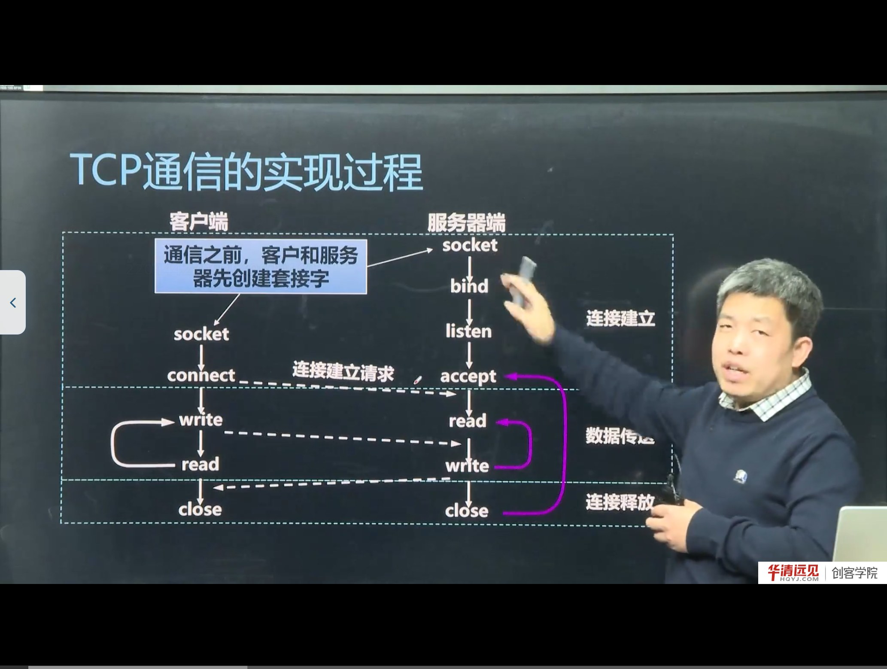

在 Linux 的“一切皆文件”设计下，**socket 也是一个文件描述符（fd）**。创建一个 socket，内核返回一个非负整数，之后就可以像读写文件一样用 `read/write` 收发数据，最后用 `close` 关闭。

但 socket 与普通文件不同：

- 普通文件的 fd 指向磁盘上的文件；
- socket 的 fd 指向内核里的一个**通信端点**，它绑定了协议族、类型、本地地址/端口、远端地址/端口等状态。

> **补充：socket 的本质是“五元组 + 状态机”**
> 一个 TCP socket 在内核里对应一条连接的状态（LISTEN、SYN_SENT、ESTABLISHED、TIME_WAIT…）。你在应用层看到的只是 fd，真正干活的是内核协议栈。这也是为什么 `read` 在没数据时会阻塞——它在等内核把数据放进接收缓冲区。

---

## 二、地址结构：sockaddr_in

要 bind 或 connect，必须告诉内核“哪个 IP、哪个端口”。IPv4 用 `struct sockaddr_in`：

```c
struct sockaddr_in {
    sa_family_t    sin_family;   // 地址族：AF_INET
    in_port_t      sin_port;     // 端口号（网络字节序）
    struct in_addr sin_addr;     // IP 地址（网络字节序）
    char           sin_zero[8];  // 填充，使结构体与 sockaddr 等长
};
```

三个要点：

1. **`sin_family = AF_INET`**：表示 IPv4；
2. **端口和 IP 必须是网络字节序**：端口用 `htons()`，IP 用 `htonl()` 或 `inet_addr()/inet_pton()`；
3. **`sin_zero[8]` 只是填充**：让 `sockaddr_in` 与通用的 `struct sockaddr` 大小一致，通常用 `memset` 清零。

### 2.1 为什么要强制类型转换

`bind`、`connect`、`accept` 的第二个参数类型是 `struct sockaddr *`（通用地址结构），而 IPv4 用的是 `sockaddr_in`。C 语言没有继承，只能靠**强制转换**：

```c
bind(fd, (struct sockaddr *)&addr, sizeof(addr));
```

内核通过 `sa_family` 字段判断实际是哪种地址结构，再按对应格式解析。这就是“通用接口 + 具体结构”的经典设计。

> **补充：IPv6 与 UNIX 域 socket**
> - IPv6 用 `struct sockaddr_in6`（`AF_INET6`）；
> - UNIX 域套接字用 `struct sockaddr_un`（`AF_UNIX`）。
>
> 它们都强转成 `struct sockaddr *` 传给同一套 API。第 13 节会专门讲 `sockaddr_un`。

---

## 三、TCP 服务器：socket → bind → listen → accept

### 3.1 socket：创建套接字

```c
int fd = socket(AF_INET, SOCK_STREAM, 0);
```

三个参数：

| 参数 | 取值 | 含义 |
|---|---|---|
| domain | `AF_INET` | IPv4 协议族 |
| type | `SOCK_STREAM` | 流式套接字，对应 TCP |
| protocol | `0` | 默认协议（TCP） |

返回值：成功返回 **大于 0 的 fd**，失败返回 -1 并设置 `errno`。

> **易错点：创建 socket 不能用 `open()`**
> 这是选择题高频陷阱。`open()` 只能打开文件/设备，不能创建网络通信端点；创建套接字必须用 `socket()`。

### 3.2 bind：绑定本地地址

```c
struct sockaddr_in addr;
memset(&addr, 0, sizeof(addr));
addr.sin_family = AF_INET;
addr.sin_port = htons(8888);              // 端口转网络字节序
addr.sin_addr.s_addr = htonl(INADDR_ANY); // 或 inet_addr("192.168.1.10")
bind(fd, (struct sockaddr *)&addr, sizeof(addr));
```

- `INADDR_ANY`（即 `0.0.0.0`）表示绑定本机所有网卡；
- 端口建议用 1024 以上（<1024 需要 root）；
- 若端口被占用，`bind` 返回 -1，`errno = EADDRINUSE`。

### 3.3 listen：把套接字设为被动，维护连接队列

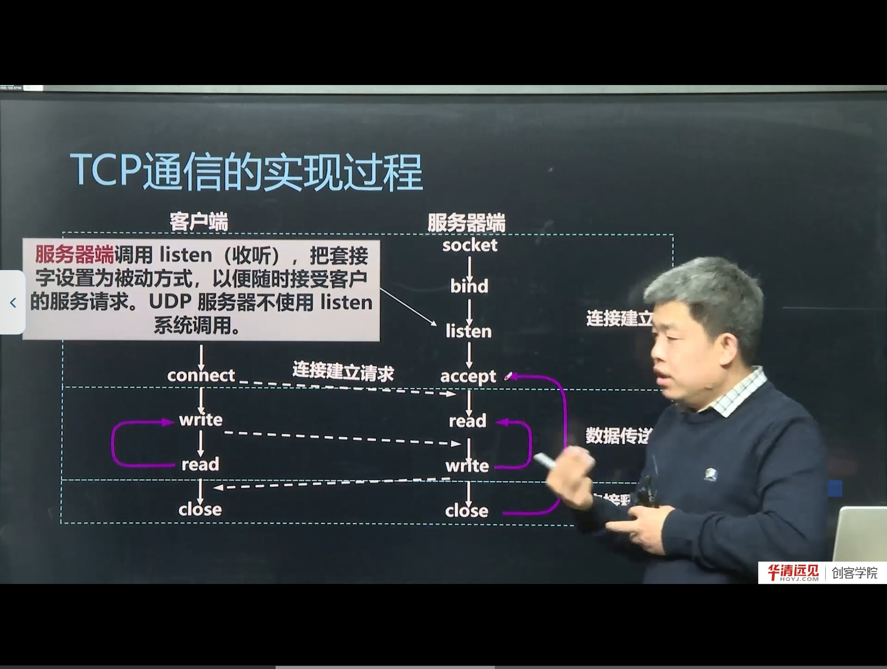

```c
listen(fd, 5);
```

`listen` 做两件事：

1. 把主动套接字变为**被动套接字**，准备接受连接请求；
2. 维护一个**连接队列**，`backlog` 指定队列的最大长度。

> **补充：backlog 到底是什么**
> 内核为监听套接字维护两个队列：
> - **未完成连接队列**（收到 SYN，尚未完成三次握手）；
> - **已完成连接队列**（三次握手完成，等待 accept 取走）。
>
> `backlog` 影响的是“已完成队列”的长度上限（具体实现会做一定调整）。队列满了之后，新的连接请求可能被丢弃或收到 RST——这就是高并发服务器要调大 backlog、并及时 accept 的原因。

> **注意：UDP 服务器不需要 listen**（UDP 无连接）。

### 3.4 accept：从队列取出一个连接

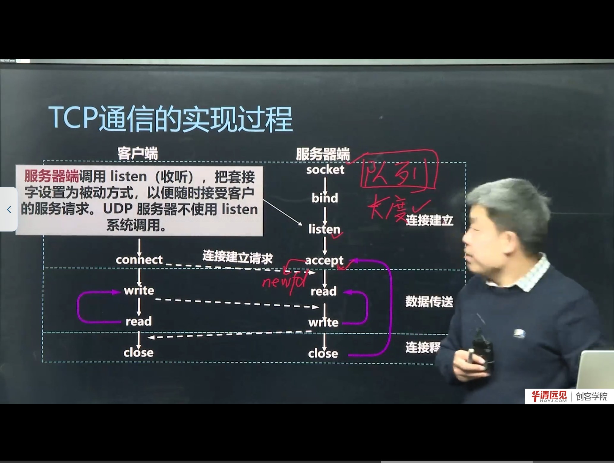

```c
struct sockaddr_in cli;
socklen_t len = sizeof(cli);
int newfd = accept(fd, (struct sockaddr *)&cli, &len);
```

`accept` 做三件事：

1. 从**已完成连接队列**中取出一个客户端（若队列为空则阻塞）；
2. 创建一个**新的套接字 newfd**，它专门与这个客户端一对一通信；
3. 通过第二个参数（**传出参数**）把客户端的 IP/端口写回 `cli`，第三个参数是它的长度指针。

关键区别：

| 套接字 | 作用 |
|---|---|
| `fd`（监听套接字） | 只负责“接客”，不用于收发数据 |
| `newfd`（连接套接字） | 与某个客户端一对一收发数据 |

> **易错点**：用 `fd` 去 `read/write` 是错的，数据要在 `newfd` 上读写。这也是“一个服务器如何服务多个客户端”的关键：每个客户端一个 newfd，互不干扰。

### 3.5 read/write/close

```c
char buf[1024];
int n = read(newfd, buf, sizeof(buf));   // 读客户端发来的数据
write(newfd, "hello", 5);                // 回数据给客户端
close(newfd);                            // 关闭这个连接
```

`read` 返回 0 表示对端关闭了连接（EOF），返回 -1 表示出错。

---

## 四、TCP 客户端：socket → connect

客户端简单得多：

```c
int fd = socket(AF_INET, SOCK_STREAM, 0);

struct sockaddr_in srv;
memset(&srv, 0, sizeof(srv));
srv.sin_family = AF_INET;
srv.sin_port = htons(8888);
srv.sin_addr.s_addr = inet_addr("127.0.0.1");

connect(fd, (struct sockaddr *)&srv, sizeof(srv));
write(fd, "hello", 5);
read(fd, buf, sizeof(buf));
close(fd);
```

### 4.1 为什么客户端不需要 bind

课程的解释很到位：**客户端只需要知道服务端的地址，自己的地址由系统分配即可**。

- 客户端调用 `connect` 时，内核会自动为它选择一块网卡、分配一个**临时端口**（ephemeral port，49152～65535）；
- 如果客户端也 bind 固定端口，同一台机器上就只能起一个客户端实例（端口冲突）。

> **补充：connect 做了什么**
> `connect` 触发三次握手：发送 SYN → 收到 SYN+ACK → 发送 ACK，连接建立后返回。如果服务端没开、端口没监听，`connect` 会返回 -1，`errno = ECONNREFUSED`。

---

## 五、完整调用顺序与常见错误

### 5.1 顺序图

```
服务器                                客户端
socket()                              socket()
bind()                                  |
listen()                                |
accept()  ←──── 三次握手 ────→        connect()
read()    ←──── 数据 ────────→        write()
write()   ───── 数据 ────────→        read()
close()                               close()
```

### 5.2 常见错误清单

| 错误 | 现象 | 正确做法 |
|---|---|---|
| 用 `open()` 创建 socket | 编译/运行失败 | 用 `socket()` |
| 端口没 `htons()` | 绑定到错误端口（如 8888 变成 22528） | 端口一律 `htons()` |
| `bind` 的 addrlen 写成 0 | `EINVAL` | `sizeof(struct sockaddr_in)` |
| 用监听 fd 读写 | 读到的是连接请求，数据错乱 | 用 `accept` 返回的 newfd |
| `accept` 的 addrlen 传值而非指针 | 编译警告/运行异常 | 传 `&len` |
| 客户端 bind 固定端口 | 只能起一个实例 | 客户端不 bind |
| 忘记 `close` | fd 泄漏，端口占用 | 每个 fd 都要 close |

---

## 六、本节易错点与纠错

| 容易说错/写错 | 正确说法 | 说明 |
|---|---|---|
| 套捷字 / 套件字 | 套接字 | 同音字 |
| sockadd2-1 | `sockaddr_in` | 结构体名 |
| 雷森 / 勒塞 | listen | 音译 |
| asap / 塞普特 | accept | 音译 |
| backlog 是“连接数上限” | 是**已完成连接队列**的长度 | 不是并发连接总数 |
| accept 返回监听 fd | 返回**新的连接 fd** | 关键区别 |

---

## 七、小结与自测

**一句话总结**：TCP 服务器“创建→绑定→监听→接受→读写→关闭”，客户端“创建→连接→读写→关闭”；`sockaddr_in` 描述地址，`htons` 处理字节序，`accept` 返回的新 fd 才是真正用来通信的句柄。

**自测题**

1. 为什么 socket 可以用 `read/write` 操作？它和普通文件 fd 有何不同？
2. `sockaddr_in` 有哪些字段？为什么端口要 `htons`？
3. 为什么 `bind/connect/accept` 的地址参数要强转成 `struct sockaddr *`？
4. `listen` 的 backlog 限制的是什么队列？队列满了会怎样？
5. `accept` 的三个参数分别是什么？哪个是传出参数？
6. 为什么客户端不需要 bind？它的端口从哪来？
7. 用监听 fd 调 `read` 会发生什么？为什么？

**下一节预告**：本节只讲了“框架”，下一节把服务器和客户端的代码一行行写出来，包括错误处理、循环收发、以及第一次运行会遇到的 `Address already in use`、`Connection refused` 等问题。