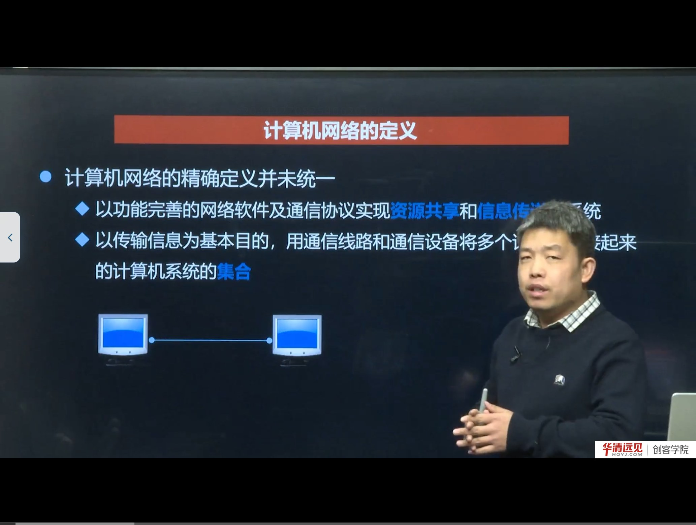
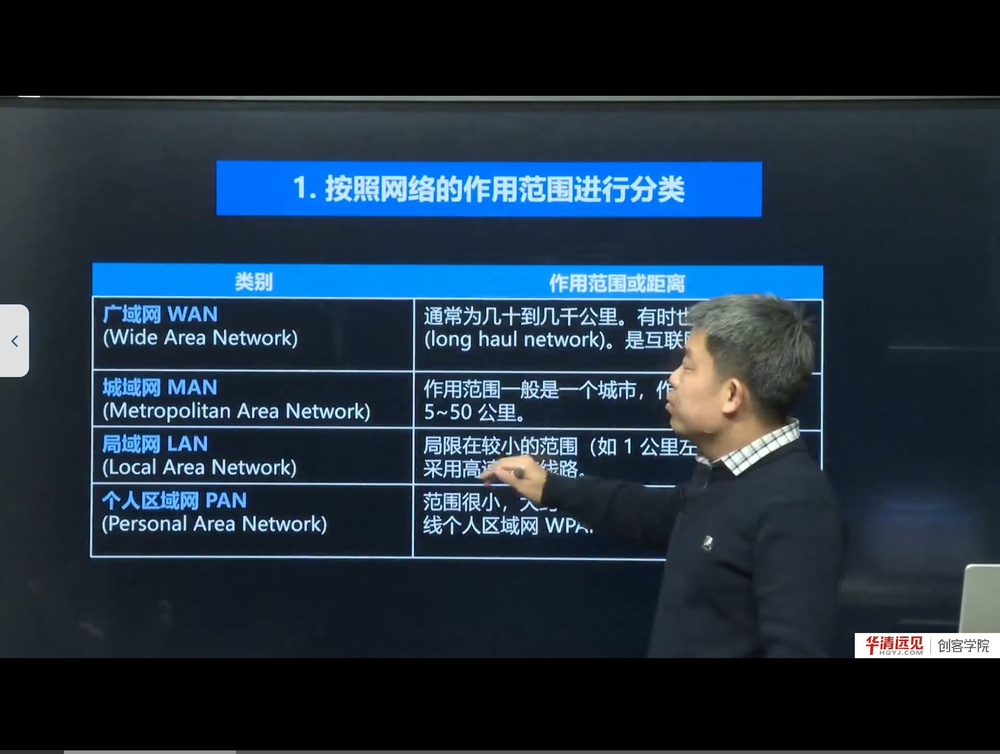
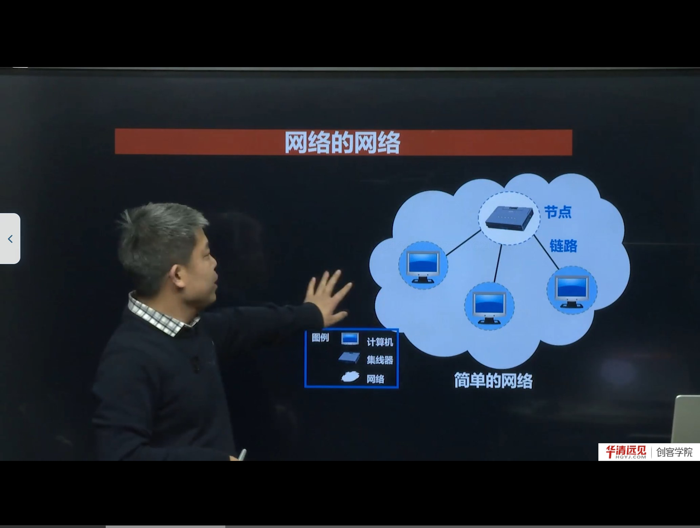
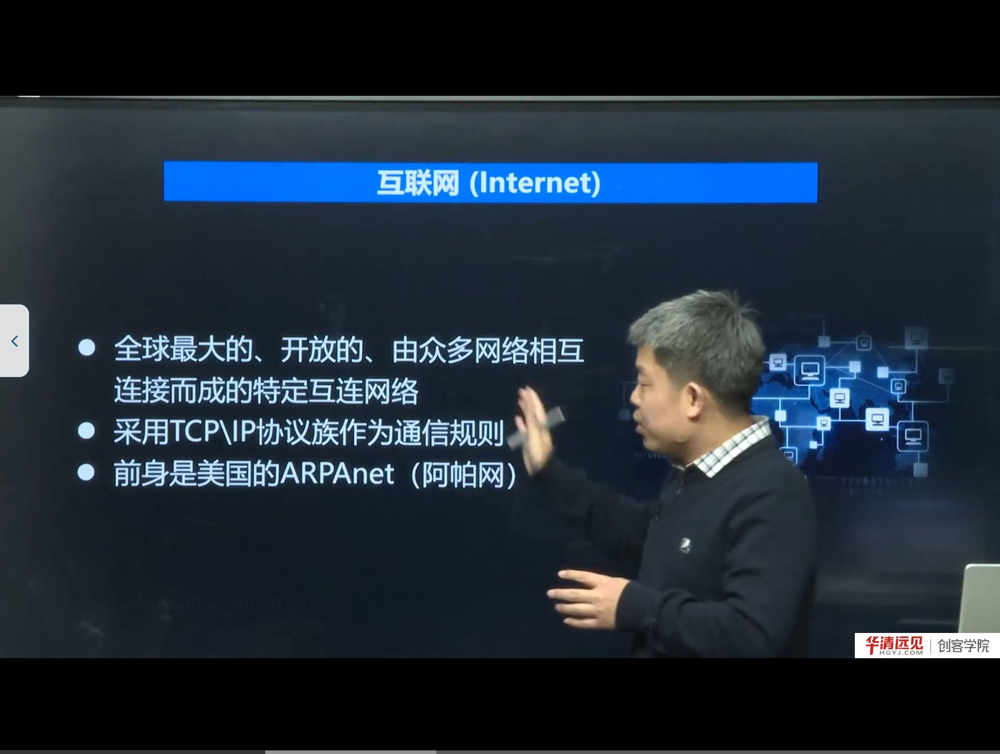
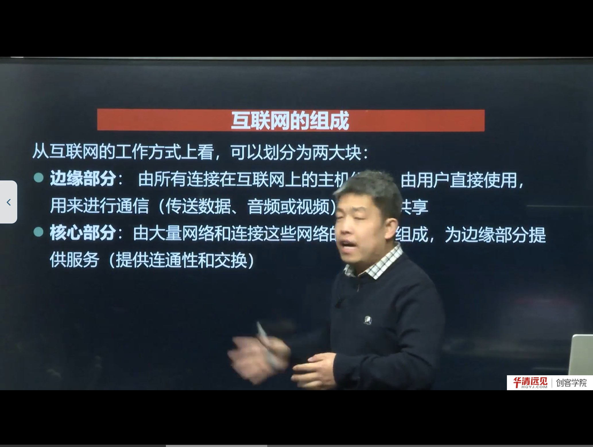
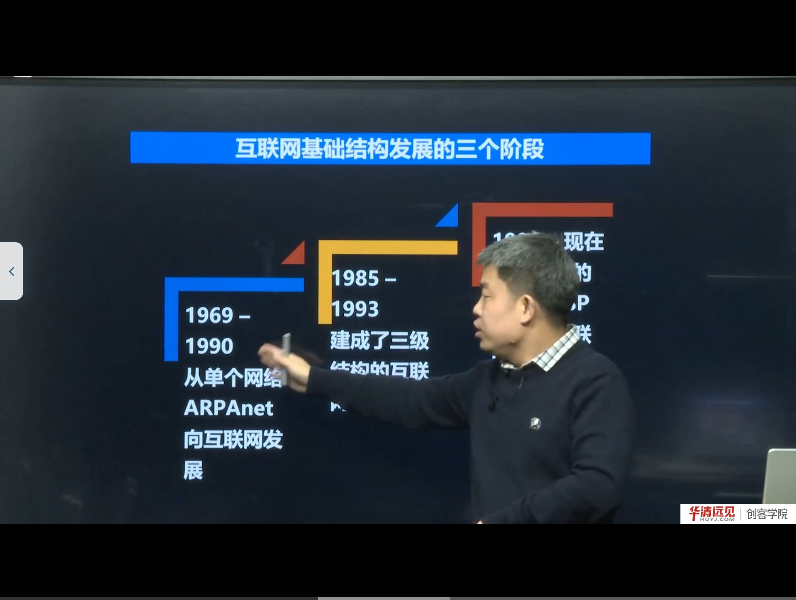
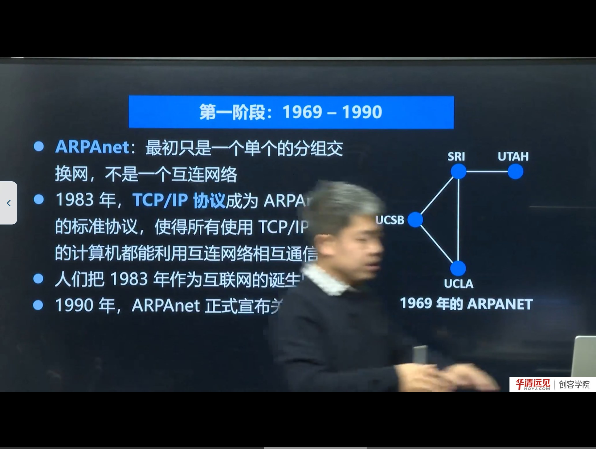
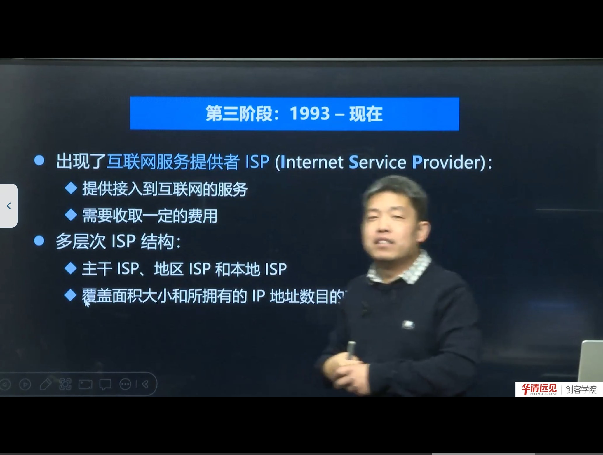

# 第 01 节　什么是互联网？

> 对应视频：4.1《什么是互联网？》（23:18）
> 本节是整门课的“地图”：先建立**计算机网络 / 互联网 / 端系统 / ISP** 这几个最基本的概念，后面所有 socket 编程、TCP/UDP、抓包实验都建立在这些概念之上。

## 学习目标

学完本节，应当能回答：

1. 计算机网络的定义有哪两种常见表述？各自强调什么？
2. 按作用范围、按使用者，网络分别怎么分类？边界大概是多少？
3. 为什么说互联网是“网络的网络”？路由器和主机（端系统）的区别是什么？
4. 互联网的“边缘部分”和“核心部分”分别由什么组成、各自负责什么？
5. 互联网基础结构发展的三个阶段，各阶段的标志性事件和结构特征是什么？
6. ISP、IXP、内容提供者（ICP）在今天的互联网里各自扮演什么角色？

---

## 一、计算机网络的定义

老师先给了一个很重要的前提：**计算机网络的“精确定义”并没有统一**，不同时期人们的认识并不相同。课程里给出了两种常见表述：

- **表述一（从功能出发）**：以功能完善的网络软件及通信协议，实现**资源共享**和**信息传递**的系统。
- **表述二（从构成出发）**：以传输信息为基本目的，用通信线路和通信设备将多个计算机连接起来的**计算机系统的集合**。

这两种表述其实是同一件事的两个侧面：表述二说“长什么样”（计算机 + 通信线路 + 通信设备），表述一说“靠什么工作、用来干什么”（软件 + 协议，资源共享 + 信息传递）。

> **补充：为什么一定要强调“协议”**
> 只把两台计算机用一根网线连起来，严格说只是一个“能通电的连接”，还不构成可用的计算机网络。双方必须约定好**怎么表示数据、谁先发、出错怎么办**，这些约定就是协议。所以“有连接”只是必要条件，“有协议”才是充分条件。这也是后面课程要花大量篇幅讲 TCP/IP、讲 socket 接口的原因。

老师用一张“两台计算机 + 一条线”的图做了最简说明：这是网络的**最小形态**；把规模扩大、把多个这样的网络再连起来，就得到互联网。

---

## 二、计算机网络的分类

课程按两种方式分类。

### 2.1 按作用范围（覆盖距离）

| 类别 | 英文 | 典型覆盖范围 | 备注 |
|---|---|---|---|
| 广域网 | WAN（Wide Area Network） | 几十到几千公里 | 也叫远程网（long haul network）；互联网的核心部分属于广域网范畴 |
| 城域网 | MAN（Metropolitan Area Network） | 一个城市，约 5～50 公里 | 早期用于城市范围内的骨干连接 |
| 局域网 | LAN（Local Area Network） | 约 1 公里以内 | 学校机房、办公室、家庭网络；采用高速线路 |
| 个人区域网 | PAN（Personal Area Network） | 约 10 米 | 手机热点、蓝牙耳机等，常称无线个人区域网 WPAN |

> **纠错：ASR 把“城域网”识别成了“成域网”**，把“集线器”识别成了“极限器”。本节统一用“城域网”“集线器”。

### 2.2 按使用者

- **公用网（公众网）**：按规定交纳费用的人都可以使用，例如运营商面向公众提供的网络。
- **专用网**：为特殊业务需要而建造，只对特定单位/人员开放，例如军队、银行、企业内部网络。

> **补充：还有别的分法**
> 实际教材里还会按**拓扑结构**（总线、星型、环型、网状）、按**交换方式**（电路交换、报文交换、分组交换）、按**传输介质**（有线、无线）来分类。本节只需要记住“范围”和“使用者”这两条主线，因为后面讲 IP、讲路由时最常用的是“范围”这一维度。

---

## 三、网络的网络：互联网的本质

### 3.1 最简单的网络

一个简单网络由两类元素构成：

- **节点（node）**：可以是计算机，也可以是集线器、交换机、路由器；
- **链路（link）**：连接节点的通信线路。

图中是 4 个节点、3 条链路的例子。注意“节点”不等于“主机”：节点是拓扑概念，主机是端到端通信的概念。

### 3.2 从“网络”到“网络的网络”

把若干个这样的网络，**用路由器连接起来**，就形成了范围更大的**互联网络（internetwork）**，也就是“网络的网络”。

老师给了一个非常精炼的对照：

> 网络：把许多**计算机**连在一起；
> 互联网络：把许多**网络**通过**路由器**连在一起。

### 3.3 主机与路由器的区别（易错点）

与网络相连的计算机称为**主机（host）**。老师特别提醒：

- 路由器本质上也是一台计算机（有 CPU、内存、操作系统），**但它不算主机**；
- 原因是：数据传输是“主机到主机”，也就是从网络边缘的一台计算机到另一台计算机；路由器在中间只承担**转发**职责，是“中转站”，不是通信的端点。

> **补充：端系统（end system）**
> 处在互联网边缘、真正发起和接收通信的那些设备，在教材里称为**端系统**。端系统可大可小：
> - 小的：PC、手机、网络摄像头、智能音箱；
> - 大的：服务器、超级计算机。
>
> 端系统的拥有者可以是个人、单位，也可以是 ISP。理解“端系统”很重要：后面写 socket 程序时，你写的程序永远运行在某个端系统上，而路由器上跑的是转发程序，不是你写的应用。

---

## 四、互联网（Internet）的定义

课程给出的定义是：

> 互联网是**全球最大的、开放的、由众多网络相互连接而成的特定互连网络**，它采用 **TCP/IP 协议族**作为通信规则，前身是美国的 **ARPANET（阿帕网）**。

这里有三个关键词：

1. **最大**：规模上覆盖全球；
2. **开放**：任何遵循 TCP/IP 的网络都可以接入（这是它能“滚雪球”的根本原因）；
3. **特定**：不是随便一个互连网络都叫 Internet，只有使用 TCP/IP 协议族、全球互联的那一个才叫 Internet。

> **纠错：ASR 里的“APA 网 / APPLE NAT / ARPOP 网”都是 ARPANET（阿帕网）**；“TCPIP 协议组”规范说法是“TCP/IP 协议族（protocol suite）”。

> **概念辨析：internet 与 Internet**
> 小写 **internet**（互连网络）是通用名词，指任何把多个网络互连起来的网络；大写 **Internet**（互联网/因特网）是专有名词，特指我们日常使用的这个全球互联网。教材和 RFC 里对大小写区分很严格。

---

## 五、互联网的组成：边缘部分与核心部分

从**工作方式**看，互联网可以分成两大块：

| 部分 | 组成 | 作用 |
|---|---|---|
| 边缘部分 | 所有连接在互联网上的主机（端系统） | 由用户直接使用，用来通信（传数据、音频、视频），实现资源共享 |
| 核心部分 | 大量网络 + 连接这些网络的路由器 | 为边缘部分提供服务：**连通性**和**交换** |

这个划分方式非常重要，因为它对应了后面课程的两条主线：

- 边缘部分 → 你写的应用程序（socket 编程、客户端/服务器模型）；
- 核心部分 → IP 协议、路由与转发、以太网（后面 4.10～4.12 的内容）。

> **补充：边缘部分的两种通信方式**
> 老师本节没有展开，但这是后面“TCP 并发”一节的伏笔：
> - **C/S（客户/服务器）方式**：客户端主动请求，服务器被动等待并响应。后面写的 TCP 服务器/客户端就是这种模型。
> - **P2P（对等）方式**：每个节点既是客户端又是服务器，彼此直接交换数据（如 BitTorrent）。
>
> 这两种方式的差别，决定了程序里“谁先 bind、谁先 connect、谁阻塞在 accept”的顺序。

---

## 六、互联网基础结构发展的三个阶段

| 阶段 | 时间 | 标志 | 结构特征 |
|---|---|---|---|
| 第一阶段 | 1969 — 1990 | 从单个分组交换网 ARPANET 起步；1983 年 TCP/IP 成为 ARPANET 的标准协议 | 从“一个网络”走向“互联网” |
| 第二阶段 | 1985 — 1993 | 美国国家科学基金网 NSFNET 建成 | 三级结构：主干网 → 地区网 → 校园网 |
| 第三阶段 | 1993 — 现在 | 出现 ISP（互联网服务提供者），商业化运营 | 多层次 ISP 结构：主干 ISP / 地区 ISP / 本地 ISP |

### 6.1 第一阶段：ARPANET 与 TCP/IP

- 1969 年的 ARPANET 只有 **4 个节点**（UCLA、SRI、UCSB、UTAH），最初只是一个**单个的分组交换网**，还不是互联网络；
- 1983 年，**TCP/IP 协议成为 ARPANET 上的标准协议**，所有使用 TCP/IP 的计算机都能通过互连网络相互通信——正因如此，人们把 **1983 年**视为互联网的诞生时间；
- 1990 年，ARPANET 完成历史使命，正式关闭。

> **补充：什么是“分组交换”**
> 老师用“把一大段数据切成一小段一小段发送、到对端再组装”来解释。严格说：
> - 发送前把报文划分成**分组（packet）**，每个分组带上目的地址等控制信息；
> - 每个分组可以**独立选择路径**，经不同链路转发；
> - 到达目的端后再按序号重组。
>
> 与它相对的是**电路交换**（打电话：先建立独占通路，再通话，最后释放）。分组交换不独占线路、线路利用率高、更抗毁坏，这是互联网选择它的根本原因。代价是会出现**乱序、丢包、时延抖动**——这正是后面 TCP 要解决可靠传输的原因。

### 6.2 第二阶段：NSFNET 的三级结构

- 1985 年起，美国国家科学基金会（NSF）组建 NSFNET，用于科研教育；
- 结构是**三级**：主干网（backbone）→ 地区网（regional）→ 校园网（campus）；
- 它覆盖了全美主要大学和研究所，为互联网走出军营、走向学术界和商业界奠定了基础。

> **注意**：这里的“国家”指美国，不是中国。互联网是从美国的 ARPANET 发展起来的。

### 6.3 第三阶段：ISP 与多层次结构

1993 年起，互联网进入商业化阶段：

- 美国政府逐渐淡出互联网的运营；
- 出现**互联网服务提供者 ISP（Internet Service Provider）**，提供接入互联网的服务并收取费用；
- 形成**多层次 ISP 结构**：
  - **主干 ISP**：覆盖范围最大、拥有 IP 地址最多、速率最高，全球只有十几家；
  - **地区 ISP**：覆盖一个地区，全球有十几万个；
  - **本地 ISP**：直接面向最终用户（家庭、企业）。

判断 ISP 层级的两个维度：**覆盖面积**和**拥有的 IP 地址数量**。

> **补充：ISP 之间怎么结算**
> 用户向本地 ISP 付费；本地 ISP 向地区 ISP 付费；地区 ISP 向主干 ISP 付费。越往上，覆盖面越大、单价越低但总量越大。这也是为什么“跨网访问”有时会慢——数据要绕到更高的层级再下来。

### 6.4 IXP：互联网交换点

课程还讲了一个关键设施——**IXP（Internet Exchange Point，互联网交换点）**：

- 作用：让**地区网络与网络之间直接交换流量**；
- 没有 IXP 时：主机 A → 本地 ISP → 地区 ISP → 主干 ISP → 地区 ISP → 本地 ISP → 主机 B，绕一大圈；
- 有了 IXP：两个本地/地区 ISP 直接在交换点互联，**不必经过主干 ISP**。

好处有两点：**提高速率（减少绕行）**、**降低成本（少付主干 ISP 的流量费）**。

### 6.5 内容提供者（ICP）

最后一个角色是**内容提供者**，例如抖音这类拥有大量视频内容的公司：

- 视频多 → 需要大量服务器存储；
- 用户多 → 需要庞大的内部网络来承载输入/输出流量；
- 为了提高效率，内容提供商会**尽可能靠近用户**，直接与本地 ISP、地区 ISP 甚至主干 ISP 互联，互联点越多、越靠近用户，访问越快、体验越好。

> **补充**：这就是今天常说的 **CDN（内容分发网络）** 的雏形——把内容缓存到离用户更近的节点，减少骨干网压力。后面讲 HTTP 服务器时还会遇到“就近访问”的思路。

---

## 七、万维网与互联网的爆发

课程最后提到：在**万维网（WWW）**出现之前，互联网上传输的数据比较单调；万维网出现后，图片、声音、视频都可以传输，互联网内容变得丰富，用户数量随之爆发式增长。

- 万维网是 20 世纪 90 年代的产物；
- 它被老师称为互联网**指数级增长的主要动力之一**；
- 课程给了一组数据：2001 年网民约 22.67 亿，2020 年 6 月约 46.48 亿（老师也说明这个数据并非十分精确，重点在趋势）。

> **概念辨析：互联网 ≠ 万维网**
> - **互联网（Internet）** 是底层的网络基础设施（TCP/IP、路由器、链路）；
> - **万维网（WWW）** 是运行在互联网之上的一种应用（HTTP + HTML + 浏览器 + 超链接）。
>
> 类似地，电子邮件、FTP、即时通信也都是互联网上的应用。把“上网”等同于“打开网页”是常见的误解。

---

## 八、本节易错点汇总

| 容易说错/写错 | 正确说法 | 说明 |
|---|---|---|
| 成域网 | 城域网（MAN） | 同音字，ASR 高频错误 |
| 极限器 | 集线器（hub） | 同音字 |
| APA 网 / APPLE NAT / ARPOP 网 | ARPANET（阿帕网） | 音译 + 连读导致 |
| TCPIP 协议组 | TCP/IP 协议族 | 规范术语 |
| 路由器也是主机 | 路由器是转发设备，不是主机 | 主机是通信端点 |
| 互联网就是万维网 | 互联网是基础设施，万维网是应用 | 层级不同 |
| 1983 年 ARPANET 诞生 | 1969 年 ARPANET 建成；1983 年 TCP/IP 成为标准，被视为互联网诞生 | 两个时间点不要混 |

---

## 九、小结与自测

**一句话总结**：本节从“两台计算机连起来就是网络”讲起，逐层放大到“网络通过网络互联成为互联网”，再给出互联网的边缘/核心两分法和三阶段发展史，最后落到 ISP、IXP、内容提供者这些今天互联网的真实角色。

**自测题**

1. 用一句话区分“网络”和“互联网络”。
2. WAN、MAN、LAN、PAN 的覆盖范围大致是多少？各举一个例子。
3. 为什么说路由器不算主机？如果一台路由器上跑了 Web 服务，它算主机吗？（提示：从“是否作为通信端点”判断）
4. 互联网发展三阶段各自的标志事件是什么？
5. IXP 解决了什么问题？没有 IXP 时数据是怎么走的？
6. 互联网与万维网是什么关系？

**下一节预告**：有了“网络的网络”这个直观认识后，下一节要回答一个更工程化的问题——这么多网络和主机，靠什么规则协同工作？这就是**网络体系结构与 OSI 七层模型**。
