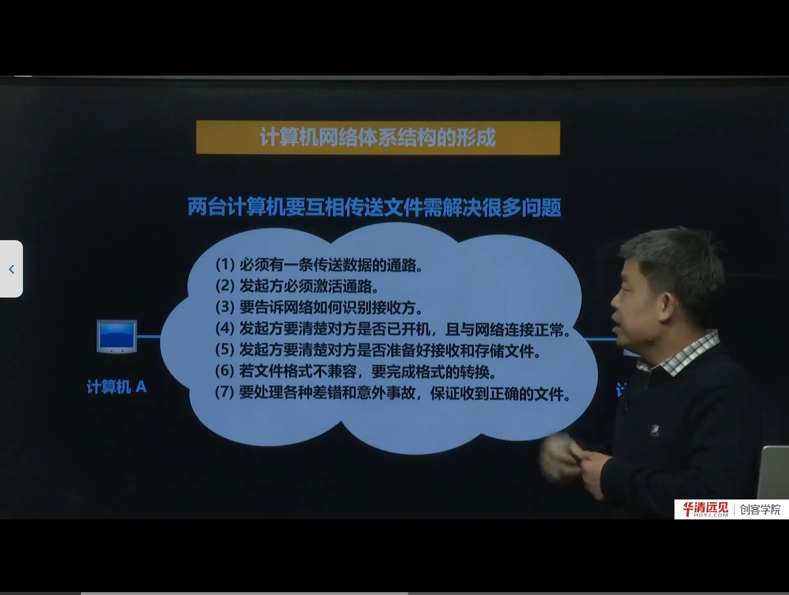
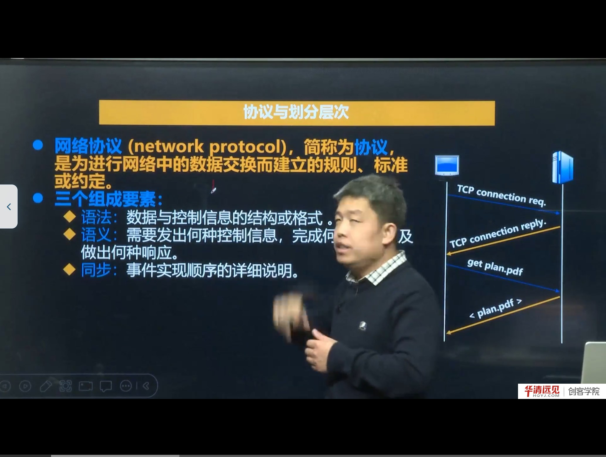
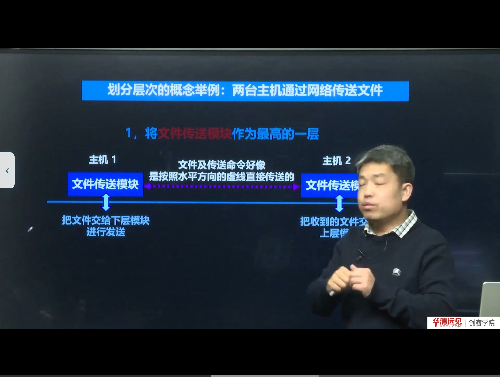
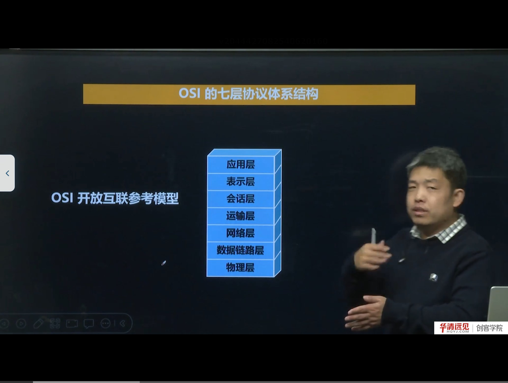
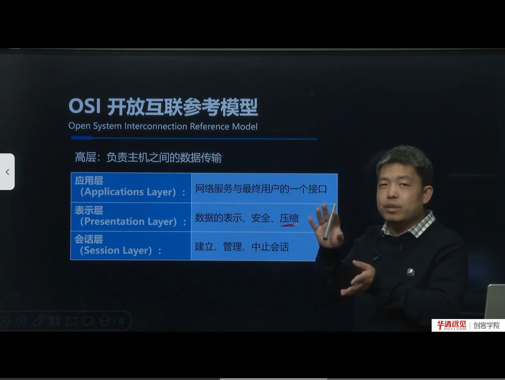
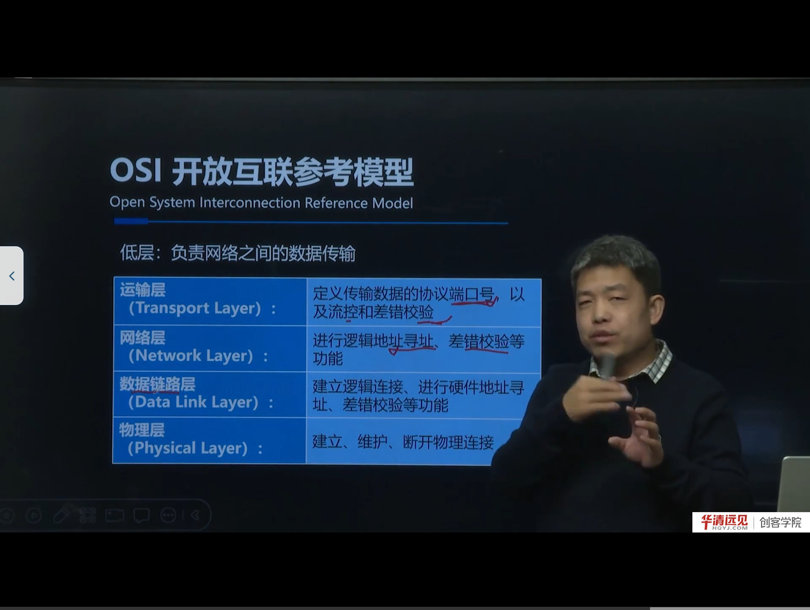

# 第 02 节　OSI 七层体系结构

> 对应视频：4.2《OSI七层体系结构》，含三个子视频：
> ① 网络体系结构的形成（10:00）　② 协议与划分层次（19:00）　③ OSI 七层体系结构（19:00）
>
> 本节回答一个核心问题：**两台计算机要通信，为什么必须“分层”？分层的依据是什么？** 最后给出 OSI 七层模型这张“网络世界的总图”。

## 学习目标

1. 说清两台计算机通信要解决的至少 7 个问题，理解“分层”是对付复杂性的手段。
2. 掌握网络协议的定义与三要素（语法、语义、同步），能各举一例。
3. 理解“对等层通信”“透明传输”“封装/解封装”三个概念。
4. 记住体系结构 = 各层 + 协议的集合，并区分“体系结构（抽象）”与“实现（具体）”。
5. 背下 OSI 七层的名称、顺序，以及每层的主要功能。

---

## 一、为什么需要分层：从“两台计算机传文件”说起

课程先不谈协议，而是把“计算机 A 给计算机 B 传一个文件”拆成若干具体问题：

1. **必须有一条传送数据的通路**——物理上得连起来；
2. **发起方必须激活通路**——发指令让线路进入可传输状态；
3. **要告诉网络如何识别接收方**——数据发给谁？怎么标识那台计算机？
4. **发起方要清楚对方是否已开机，且与网络连接正常**；
5. **发起方要清楚对方是否准备好接收和存储文件**——对方缓冲区满了还猛发，就会丢数据；
6. **文件格式不兼容时要完成格式转换**——例如 Linux 与 Windows 的文本换行、编码差异；
7. **要处理各种差错和意外事故**——中间路由器故障、比特翻转（0010 变成 0100）等，保证最终收到正确文件。

这 7 个问题覆盖了从“插上网线”到“文件语义”的全部层次。如果写一个程序时把这些逻辑全揉在一起，代码将无法维护、无法复用，换一种介质或换一种应用就得重写。

> **补充：分层的本质是“关注点分离”**
> ARPANET 在设计时提出分层：把庞大而复杂的问题分解成若干较小的局部问题，**每一层只解决一类问题，并且只使用下一层提供的服务、只向上层提供服务**。这样：
> - 某一层内部实现变化（比如把网线换成光纤），不影响上层；
> - 不同厂商只要遵守同一层的接口，就能互通。
>
> 这就是“分层”能成为网络体系结构基础的根本原因。

---

## 二、网络协议与它的三要素

**网络协议**（network protocol）的定义：

> 为进行网络中的**数据交换**而建立的**规则、标准或约定**。

老师用“两个人说话”作类比：双方必须使用彼此能听懂的语言、遵守共同的表达习惯，才能交流。协议就是计算机之间的“共同语言”。

协议由**三个要素**组成：

| 要素 | 含义 | 通俗解释 | 例子 |
|---|---|---|---|
| 语法 | 数据与控制信息的**结构或格式** | 话怎么说、句子怎么组织 | 报文首部哪些字节表示类型、哪些表示长度 |
| 语义 | 需要发出何种控制信息、完成何种动作、做出何种响应 | 这句话是什么意思、要对方做什么 | “1”代表文件名、“2”代表文件内容 |
| 同步 | **事件实现顺序**的详细说明 | 谁先说、谁后说、说到哪一步 | 先发文件名和大小，对方准备好后再发内容 |

课程举了一个很直观的例子：传文件前先发一个字节的类型标志，`1` 表示“接下来是文件名”，`2` 表示“接下来是文件内容”。**这个“1 字节标志 + 内容”的格式就是语法；“1 代表文件名”就是语义；“先告诉对方文件名/大小、等对方开辟好内存再发内容”就是同步。**

> **纠错**：ASR 把“会话层”识别成“汇化层/绘画层”，把“差错”识别成“插错”，把“校验”识别成“教验”，把“应用层”识别成“营运层”。本节统一使用规范术语。

> **补充：协议有两种存在形式**
> - **文字描述**：RFC、国家标准，给人看、给厂商实现用；
> - **程序代码**：操作系统内核或库里的实现，给机器执行用。
>
> 二者是“规范”与“实现”的关系。考试常考“协议的三要素”，而工程里更常问“这个字段在报文里的偏移是多少”——前者是语法，后者是实现细节。

---

## 三、分层、对等层通信与透明传输

课程用“两台主机传文件”举例，把任务分成三层：

| 层次 | 角色（类比） | 负责的事 |
|---|---|---|
| 文件传送模块（最高层） | 微信/QQ | 文件的名字、大小、格式、内容组织 |
| 通信服务模块（中间层） | 快递公司 | 数据发给谁（地址）、可靠地把数据送到 |
| 网络接入模块（最底层） | 快递员/运输工具 | 通过网卡真正把比特发出去、收进来 |

关键点：

- **每一层只把数据交给下一层去“发送”，自己并不直接对物理线路操作**；
- 从上层看，数据像是沿着水平虚线“直接”到达对方同一层——这叫**对等层通信**（peer-to-peer，逻辑上的通信）；
- 实际上数据是**垂直向下**逐层传递、再经物理介质传到对方、再**垂直向上**逐层递交的；
- 下层对上层**隐藏**了自己的实现细节，上层感觉不到下层的存在——这就是**透明传输**。

> **补充：封装与解封装**
> 数据每向下一层，就会被加上该层的控制信息（首部，有时还有尾部），这叫**封装（encapsulation）**：
> - 应用数据 →（传输层加 TCP/UDP 首部）→ 报文段/用户数据报；
> - →（网络层加 IP 首部）→ IP 数据报/分组；
> - →（数据链路层加帧首部与帧尾）→ 帧；
> - →（物理层）→ 比特流。
>
> 到达对方后逐层剥掉首部，叫**解封装**。后面讲 TCP/IP 五层结构、讲抓包时，看到的“每一层包头”就是封装的结果。

---

## 四、各层要完成的主要功能

课程把“每一层都可能要做的事”归纳为五类，这些词在后面每一层都会反复出现：

| 功能 | 含义 | 典型位置 |
|---|---|---|
| 差错控制 | 使对等方的通信更可靠：检错、纠错、重传 | 数据链路层（帧校验）、传输层（TCP 重传） |
| 流量控制 | 发送端速率要让接收端来得及接收 | 传输层（滑动窗口）、数据链路层 |
| 分段与重装 | 大块数据切成小段发送，到对端再按序组装 | 传输层（TCP 分段）、网络层（IP 分片） |
| 复用与分用 | 多个上层应用共用一条下层连接（复用）；一条连接把数据分给多个上层应用（分用） | 传输层（端口号） |
| 连接的建立与释放 | 传数据前建立逻辑连接，传完释放 | 传输层（TCP 三次握手/四次挥手） |

> **理解“复用/分用”的小技巧**
> 老师用“一支笔很多人用”解释复用：**多个上层实体共用同一个下层实体**。反过来，**一个下层实体把数据分发给多个上层实体**就是分用。传输层用**端口号**实现这件事：多个应用（微信、QQ、浏览器）复用同一个 IP 地址的 TCP 连接；收到的数据再按端口号分用给对应进程。这正是后面 socket 编程中 `bind(port)` 的意义。

---

## 五、什么是“网络体系结构”

课程给了一个很容易被忽略但很重要的定义：

> **计算机网络体系结构 = 计算机网络各层及其协议的集合。**

并且强调：

- **体系结构是抽象的**，是一种“定义/规范”，回答“分几层、每层做什么、层间接口是什么”；
- **实现是具体的**，是真正运行在计算机上的硬件和软件（比如 Linux 内核里的 TCP/IP 协议栈、网卡驱动）。
- 同一个体系结构可以有多种实现；同一份协议文字，可以被不同厂商写成不同的代码。

这就解释了一个常见困惑：**“OSI 七层”是体系结构，不是一套具体软件**。你电脑里跑的并不是“OSI 协议栈”，而是 TCP/IP 协议栈。

---

## 六、OSI 七层参考模型

OSI/RM（Open Systems Interconnection Reference Model，开放系统互连参考模型）由 ISO 提出，1983 年形成 **ISO 7498** 国际标准，即七层协议体系结构。

课程特别说明了两点：

1. OSI **并没有真正完全落地实现**，事实上被广泛使用的是 **TCP/IP**；
2. 但 OSI 仍有很强的**参考价值**：局域网、无线网络在讲自己的分层时，仍会对照 OSI；面试也几乎必问“OSI 七层是哪七层”。

### 6.1 记忆口诀

自下而上：**物、数、网、传、会、表、应**（物理层、数据链路层、网络层、传输层、会话层、表示层、应用层）。

> 注意：第 4 层有人叫“传输层”，也有人叫“运输层”，指的是同一层（Transport Layer），不同教材译法不同，不要当成两层。

### 6.2 高层三层：面向“数据处理”

| 层次 | 主要功能 | 课程中的例子 |
|---|---|---|
| 应用层（Application） | 网络服务与最终用户的接口 | 微信聊天、抖音刷视频、浏览器看网页 |
| 表示层（Presentation） | 数据的表示、安全、压缩 | 文字/视频的不同表示；压缩与解压缩；加密与解密 |
| 会话层（Session） | 建立、管理、中止会话 | 两个应用之间的一次“会话”（如微信支付跳转到其他支付应用） |

课程用“上下层关注点不同”来解释表示层为什么存在：**上层只关心数据怎么方便表示，下层只关心数据怎么高效传输**，两者之间需要一个“翻译/压缩”的层次。

> **补充**：在 TCP/IP 模型中，表示层和会话层的功能被并入了应用层（由应用程序自己实现）。所以实际写代码时，你不会看到“表示层协议”这样的东西，但会遇到“序列化/反序列化”“压缩”“TLS 加密”这些属于表示层范畴的工作。

### 6.3 低层四层：面向“数据传输”

| 层次 | 主要功能 | 关键概念 |
|---|---|---|
| 传输层（Transport） | 定义传输数据的协议端口号，以及流控和差错校验 | 端口号、端到端、TCP/UDP |
| 网络层（Network） | 逻辑地址寻址、差错校验等 | IP 地址、路由、分组转发 |
| 数据链路层（Data Link） | 建立逻辑连接、硬件地址寻址、差错校验 | MAC 地址、帧、CSMA/CD |
| 物理层（Physical） | 建立、维护、断开物理连接 | 网线、光纤、无线信号、比特流 |

课程用“从北京去上海”的类比讲网络层与数据链路层的区别：

- **网络层**：解决“从北京（源主机）到上海（目的主机）”的**端到端**路径选择——对应 IP 地址与路由；
- **数据链路层**：解决“出门坐哪趟地铁/公交、这一站到下一站怎么走”——对应**每一段链路**上的帧传输与 MAC 地址。

> **补充：为什么传输层需要端口号，网络层不需要**
> 网络层只把数据送到“主机”，一台主机上可能同时跑微信、QQ、浏览器，必须再有一层用**端口号**区分“交给哪个进程”。这就是传输层“复用/分用”的由来，也是 socket 编程里 `IP:Port` 四元组定位一条连接的原因。

### 6.4 数据在各层的名字

| 层 | 数据单元名称 |
|---|---|
| 应用层 | 报文（message） |
| 传输层 | 报文段（segment，TCP）/ 用户数据报（datagram，UDP） |
| 网络层 | 分组/数据报（packet / datagram） |
| 数据链路层 | 帧（frame） |
| 物理层 | 比特（bit） |

> 这张表在后面的抓包实验（Wireshark）里会直接用到：你在 Wireshark 里点开一个包，看到的就是 Frame → Ethernet → IP → TCP → HTTP 的逐层解封装。

---

## 七、本节易错点与纠错

| 容易说错/写错 | 正确说法 | 说明 |
|---|---|---|
| 汇化层 / 绘画层 | 会话层（Session） | 同音字，ASR 高频错误 |
| 营运层 | 应用层（Application） | 同音字 |
| 插错控制 / 插错校验 | 差错控制 / 差错校验 | 同音字 |
| 教验 | 校验 | 同音字 |
| 传输层 = 运输层 | 同一层 | 不同教材译名不同 |
| OSI 七层是实际使用的协议栈 | 实际使用的是 TCP/IP，OSI 是参考模型 | 概念区分 |
| 数据是“水平直接传到对方同一层” | 逻辑上对等层通信，物理上垂直上下再经介质 | 透明传输的本质 |

---

## 八、小结与自测

**一句话总结**：两台计算机通信要解决的问题太多，所以用“分层”把大问题拆成小问题；每层靠**协议**（语法/语义/同步）与对等层通信，靠**封装/解封装**与上下层协作；OSI 七层是这套思想的标准化参考模型，虽然没落地，但仍是理解网络的分层地图。

**自测题**

1. 两台计算机传文件要解决哪些问题？至少说出 5 个。
2. 协议的三要素是什么？分别用“传文件”的例子说明。
3. 什么叫透明传输？下层是如何做到“透明”的？
4. “复用”和“分用”分别发生在发送端还是接收端？靠什么字段实现？
5. 体系结构与实现的区别是什么？
6. 默写 OSI 七层（自下而上），并各写一句话功能。
7. 网络层和数据链路层都做“地址寻址”，二者的地址分别是什么？范围有何不同？

**下一节预告**：OSI 是“参考”，真正跑在互联网上的是 **TCP/IP 协议族**。下一节把 OSI 七层“压缩”成五层，讲清 TCP/IP 的分层、各层协议族，以及为什么它赢了 OSI。
