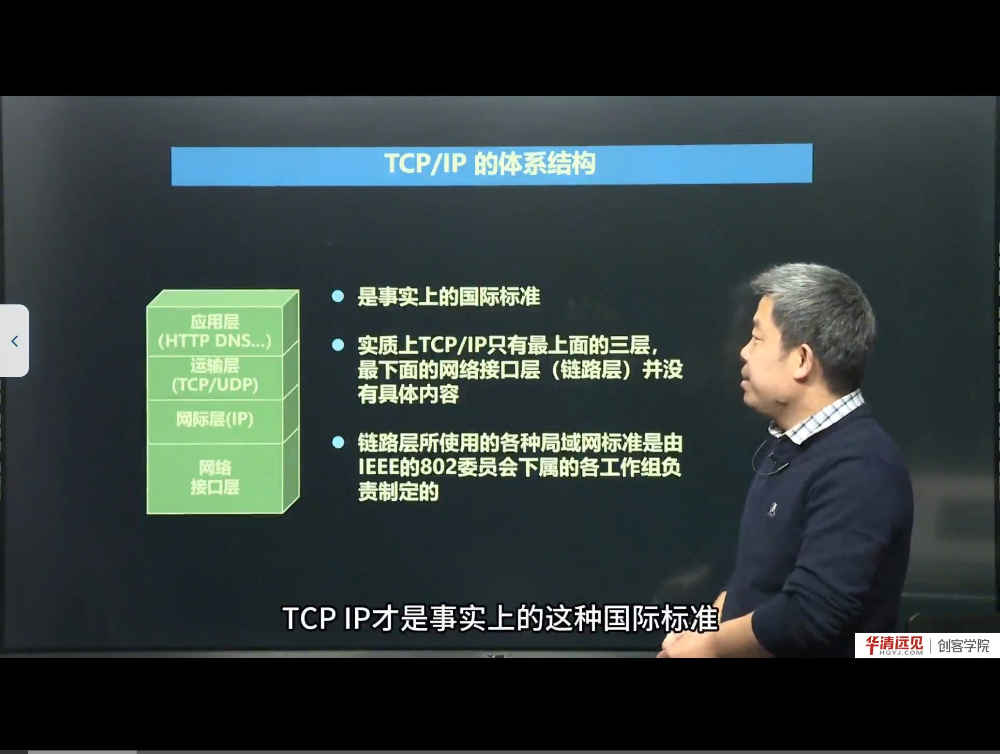
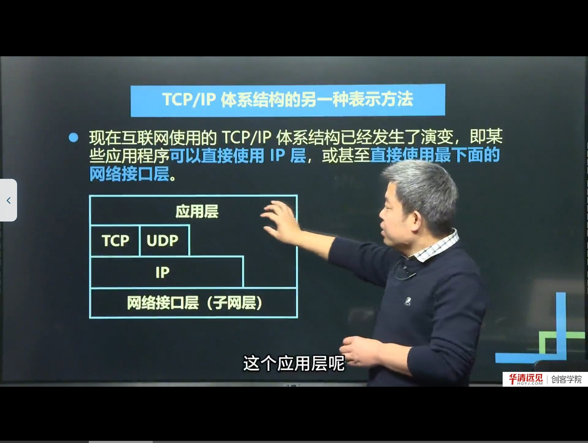
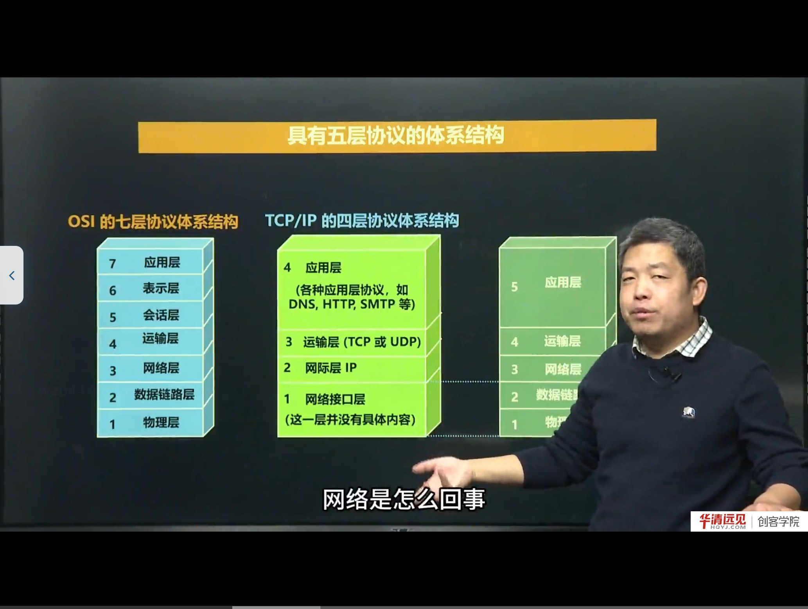
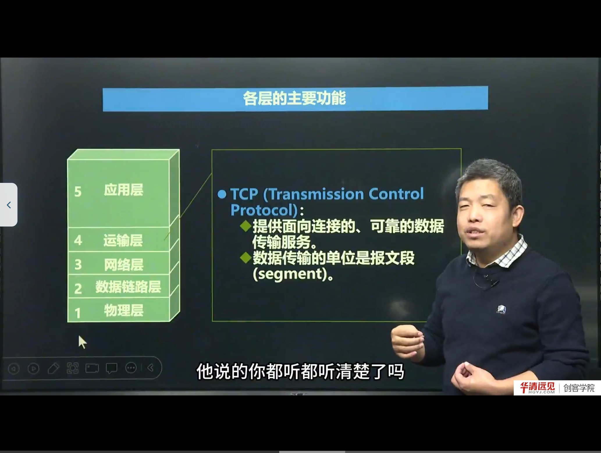

# 第 03 节　TCP/IP 协议与五层体系结构

> 对应视频：4.3《TCP/IP协议与五层体系结构》（37:00）
>
> 上一节的 OSI 七层是“参考模型”，本节讲的 **TCP/IP 四层**才是真正跑在互联网上的体系结构；为了教学与工程都方便，教材又在两者之间折中出**五层模型**。三种模型要能互相对照，不能混为一谈。

## 学习目标

1. 说出 TCP/IP 四层与 OSI 七层的对应关系，理解“为什么 TCP/IP 赢了”。
2. 解释“TCP/IP 实质上只有上面三层有具体内容”这句话的含义。
3. 理解沙漏模型：为什么 IP 层是互联网的核心，向上支持多种应用、向下兼容多种网络。
4. 掌握五层模型各层的主要功能，以及 TCP 与 UDP 的本质差别。
5. 能说清网络层“路由选择”和“转发”的区别，以及数据链路层“相邻节点”的含义。

---

## 一、从 OSI 七层到 TCP/IP 四层



TCP/IP 把 OSI 的七层压缩成四层：

| TCP/IP 四层 | 对应 OSI | 说明 |
|---|---|---|
| 应用层 | 应用层 + 表示层 + 会话层 | 把高三层合并，具体功能由应用程序自己实现 |
| 运输层（传输层） | 传输层 | TCP / UDP |
| 网际层（IP 层） | 网络层 | IP 协议，负责寻址与转发 |
| 网络接口层 | 数据链路层 + 物理层 | TCP/IP 不规定具体内容，由各网络自己实现 |

课程强调了三句话：

1. **TCP/IP 才是事实上的国际标准**。因为全球互联网的内核就是“基于 IP 的网络层实现”，而它用的就是 TCP/IP。
2. **实质上 TCP/IP 只有最上面三层有具体内容**。最下面的网络接口层“并没有具体内容”——TCP/IP 不讨论底层网络（有线/无线/卫星）的细节。
3. **链路层使用的各种局域网标准由 IEEE 802 委员会下属工作组制定**。也就是说：上面三层由 IETF（RFC）管，下面两层由 IEEE 管，分工不同。

> **补充：为什么“网络接口层”是空的反而是一种优势**
> 正因为 TCP/IP 不对底层网络做规定，它才能跑在以太网、Wi-Fi、光纤、4G/5G、卫星链路上——**只要你能收发帧，就能承载 IP**。这就是 IP 能“以一统万”的原因，也是后面讲“IP over everything”的由来。

### 1.1 路由器为什么只实现到网络层

课程用一张“主机—路由器—主机”的图说明：**路由器的协议栈只到网络层，网络层以上就没有了**。

原因很直接：数据通信的真正端点是两台主机（端到端），路由器只是中间的**转发**设备。它不需要关心数据是微信消息还是视频流，也不需要做表示层/会话层的处理，只要**看目的 IP、查转发表、把分组从合适接口发出去**即可。

> **补充：端到端 vs 点到点**
> - **端到端（end-to-end）**：传输层关注的是“源主机进程 ↔ 目的主机进程”，中间网络对它是透明的；
> - **点到点（point-to-point）**：数据链路层关注的是“相邻两个节点之间”的一跳传输。
>
> 这个区分在讲 TCP 与 IP 的分工时非常关键：TCP 负责端到端的可靠，IP 负责逐跳的转发。

---

## 二、TCP/IP 的另一种画法：沙漏模型



课程给出了一张“上宽下窄再宽”的图（俗称**沙漏模型**）：

- **上面宽**：应用层有很多协议（HTTP、DNS、SMTP、FTP……）；
- **中间窄**：网际层只有 **IP** 一个核心协议；
- **下面宽**：网络接口层支持各种局域网/广域网技术。

而且这张图还说明了一个容易被忽略的事实：**某些应用可以越过传输层，直接使用 IP 层，甚至直接使用网络接口层**。课程举的例子是 `ping`：

- `ping` 直接使用 **ICMP**（封装在 IP 里），不需要 TCP/UDP；
- 所以它“没有传输层”也能工作。

> **补充：沙漏模型的工程意义**
> 沙漏的“细腰”就是 **IP**。IP 之上，应用可以自由创新（HTTP/3、QUIC、WebSocket 都建立在 IP 之上）；IP 之下，链路技术可以自由替换（以太网、Wi-Fi、5G）。**IP 的稳定，换来了上下两层的繁荣**。这也是为什么说“互联网的核心是 IP”。

---

## 三、五层协议体系结构



五层模型是在教学/工程中折中的产物：

| 5 层 | 名称 | 主要功能 | 典型协议 |
|---|---|---|---|
| 5 | 应用层 | 通过应用进程间的交互完成特定网络应用；定义进程间通信与交互的规则 | HTTP、DNS、SMTP、FTP、SSH |
| 4 | 运输层 | 向两台主机中**进程之间**的通信提供通用的数据传输服务；复用/分用 | TCP、UDP |
| 3 | 网络层 | 为分组交换网上的不同主机提供通信服务；路由选择 + 转发 | IP、ICMP、ARP、路由协议 |
| 2 | 数据链路层 | 实现**两个相邻节点**之间的可靠通信；帧同步、差错检测 | Ethernet、PPP、Wi-Fi |
| 1 | 物理层 | 实现比特（0/1）的传输；规定接口引脚、电气特性 | 双绞线、光纤、无线信道 |

课程说明：五层模型“来自民间”——大家在实践中发现四层不够用（经常要关心网卡、链路），七层又太细，于是总结出五层。七层（ISO）和四层（TCP/IP）是官方发布的，五层是教学与工程中约定俗成的折中。

### 3.1 应用层：定规则

应用层的任务是**实现某个具体的网络应用**，它的协议定义的是**应用进程间通信和交互的规则**。例如：

- DNS：域名解析——把域名翻译成 IP；
- HTTP：网页浏览——规定请求/响应的格式与方法；
- SMTP：邮件发送。

课程特别提醒：应用层协议**不考虑** 0/1 怎么传、IP 地址怎么寻址，那些是下面层的事。应用层只关心“我发什么格式的请求、对方回什么格式的响应”。

### 3.2 运输层：通用的数据传输服务



运输层**不关心应用层的规则**，它只提供“通用的数据传输服务”：你把数据交给我，我负责把它送到对方主机的对应进程。

它有两个主角：

| 协议 | 特点 | 数据单元 | 保证什么 |
|---|---|---|---|
| TCP | 面向连接、可靠 | 报文段（segment） | **准确性**：不丢、不重、按序 |
| UDP | 无连接、尽最大努力 | 用户数据报（datagram） | **时效性**：发了就不管，快 |

课程用“领导交代事情”的类比解释 TCP 的可靠：领导说了一堆，员工要一字不落复述一遍，才能确认“你真听清了”；TCP 的确认机制就是这样“死板”，但能保证准确。代价是**慢、开销大**。

UDP 则是“我把数据发出去就完事，你收没收到是你的事”。它不保证准确，但**简单、时延低**，适合视频流、音频流、实时游戏这类“丢一两帧看不出来、但卡顿很难受”的场景。

> **补充：TCP 与 UDP 的选择不是“好坏”，而是“取舍”**
> - 文件传输、网页、登录：必须准确 → TCP；
> - 直播、语音、DNS 查询（一次一问一答，丢了重发即可）：更看重时延 → UDP。
>
> 后面的 4.9、4.11 会分别用代码实现 UDP 与 TCP，并分析各自适用的场景。

### 3.3 网络层：路由选择与转发

网络层的任务是**为分组交换网上的不同主机提供通信服务**，具体有两件事：

1. **路由选择（routing）**：通过路由算法，在路由器上生成**转发表**（routing/forwarding table），回答“到某个目的网络，下一跳是谁”；
2. **转发（forwarding）**：路由器收到分组后，按转发表把分组从相应接口送到下一个路由器。

课程用“寄快递/坐公交”的类比：每个路由器只知道“我这一站能把包裹交给谁”，一站一站接力，最终到达目的主机。

互联网的网络层使用**无连接的网际协议 IP**，因此网络层也叫 **IP 层**或**网际层**。IP 分组也叫 **IP 数据报**，简称**数据报**。

> **补充：路由选择与转发的区别（高频考点）**
> - 路由选择是**控制平面**的事：跑路由协议（RIP/OSPF/BGP），算出表；
> - 转发是**数据平面**的事：每个分组到达时查表、发出去。
>
> 前者是“修路/画地图”，后者是“按地图开车”。一台路由器可以只转发不跑路由协议（静态路由），但那样就无法动态适应网络变化。

### 3.4 数据链路层：相邻节点之间的可靠通信

数据链路层实现**两个相邻节点之间**的通信。课程用“坐公交从 A 站到 C 站，中间经过 B 站”作类比：

- 网络层关心的是“从 A 到 C”的端到端路径；
- 数据链路层关心的是“A→B”“B→C”每一段怎么走。

链路层对差错的处理有两种设计思路：

| 思路 | 做法 | 类比 |
|---|---|---|
| 检错丢弃 | 发现比特错误就丢弃该帧，不纠正 | 生产车间的残次品直接扔掉，不返修 |
| 可靠传输 | 出错就请求重发（ARQ），保证每一跳都正确 | 像 TCP 一样确认+重传 |

有线链路通常用第一种（出错率低，丢弃+上层重传即可）；**无线链路**因为误码率高，常采用第二种（链路层本地重传，避免上层端到端重传带来的大时延）。

### 3.5 物理层：翻译 0 和 1

物理层实现**比特的传输**，规定连接电缆的插头有多少引脚、各引脚如何连接、电气特性如何。

课程特别澄清了一个易混点：

> 传输媒体（双绞线、同轴电缆、光缆、无线信道）**并不在物理层协议之内**，而在物理层协议的**下面**。

也就是说：物理层协议管的是“引脚连好之后，双方如何用电气信号表示 0/1、如何同步”，而“用哪种线、线怎么接”是物理媒体与接口的范畴。

---

## 四、一次通信的完整过程（五层视角）

以“微信发一条消息”为例，数据自上而下逐层封装，再自下而上逐层解封装：

```
应用层   微信消息（规定格式）
  ↓
运输层   加 TCP 首部 → 报文段（源端口/目的端口/序号…）
  ↓
网络层   加 IP 首部  → IP 数据报（源 IP/目的 IP/TTL…）
  ↓
链路层   加帧头帧尾 → 帧（源 MAC/目的 MAC/FCS）
  ↓
物理层   变成 0/1 比特流，经网线/无线发出
```

到达对端后逐层剥掉首部，最终把消息交给微信进程。中间经过路由器时，路由器只解到网络层，改 MAC、减 TTL、查表转发，**不会**解到 TCP 或应用层。

> **补充：为什么路由器不改端口号**
> 端口号属于传输层，路由器只处理到网络层，因此它看不到、也不修改端口号（NAT 是例外，属于网络层的地址转换）。这也解释了为什么“端口号是端到端的，MAC 地址是逐跳的”。

---

## 五、三种模型的对照与选择

| 对比项 | OSI 七层 | TCP/IP 四层 | 五层（教学） |
|---|---|---|---|
| 层数 | 7 | 4 | 5 |
| 发布方 | ISO（官方） | IETF/实际使用 | 民间/教材总结 |
| 是否落地 | 基本未落地 | 事实标准 | 教学模型 |
| 优点 | 分层清晰、职责分明 | 简洁、实用 | 兼顾理论与工程 |
| 缺点 | 过于复杂、实现困难 | 网络接口层过于笼统 | 非正式标准 |

课程的建议是：**理解用五层，考试/面试用 OSI 七层，工程实现看 TCP/IP 四层**。

---

## 六、本节易错点与纠错

| 容易说错/写错 | 正确说法 | 说明 |
|---|---|---|
| 网继层 / 网绩层 | 网际层（IP 层） | 同音字，ASR 错误 |
| 附用 / 分用 | 复用 / 分用 | 同音字 |
| 暴文段 | 报文段（segment） | 同音字 |
| 实效性 | 时效性 | 同音字 |
| 真 / 帧 | 帧（frame） | ASR 把“帧”识别成“真” |
| TCP/IP 是 OSI 的实现 | 二者是并行的两套体系结构 | TCP/IP 先有实现后有标准 |
| 路由器实现了全部七层 | 路由器只到网络层 | 转发设备不需要高层 |
| 物理层协议包括网线 | 传输媒体在物理层协议之下 | 协议管信号，不管介质 |

---

## 附：本节视频索引

| 视频 | 时长 | 关键内容 | 起始时间 |
|---|---|---|---|
| TCP/IP协议与五层体系结构 | 37:00 | TCP/IP 四层；事实标准；沙漏模型；五层模型；各层功能；TCP/UDP 取舍 | 0:00 |

> 起始时间指该视频在所在小节播放列表中的位置；单视频小节从 0:00 开始。截图文件名中的秒数即该视频内容时间。

## 七、小结与自测

**一句话总结**：OSI 七层是“教科书”，TCP/IP 四层是“真家伙”，五层是“折中版”；三者的共同思想是分层，而 TCP/IP 的精髓是**沙漏模型**——以 IP 为细腰，上承万种应用，下接万种链路。

**自测题**

1. 画出 OSI 七层、TCP/IP 四层、五层模型的对应关系。
2. “TCP/IP 实质上只有上面三层有具体内容”是什么意思？网络接口层为什么可以“空着”？
3. 沙漏模型的“细腰”是哪一层？它带来什么好处？
4. TCP 与 UDP 的本质区别是什么？各举两个适用场景。
5. 路由选择和转发分别是什么？在路由器上谁依赖谁？
6. 数据链路层说的“相邻节点”怎么理解？为什么无线链路更倾向做可靠传输？
7. `ping` 命令用到了哪几层？为什么说它“不需要传输层”？

**下一节预告**：分层讲完，接下来进入“地址”。IP 地址如何标识一台主机？为什么要有端口号？分类 IP、CIDR、子网掩码、IPv6 分别解决什么问题？这就是第 04 节的内容。
