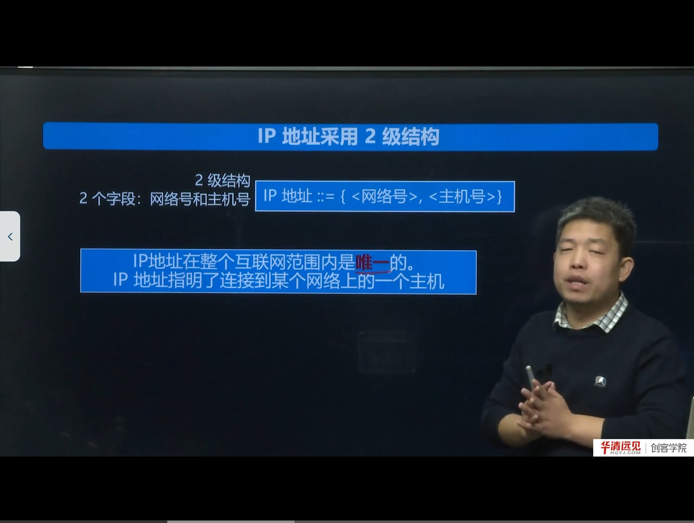
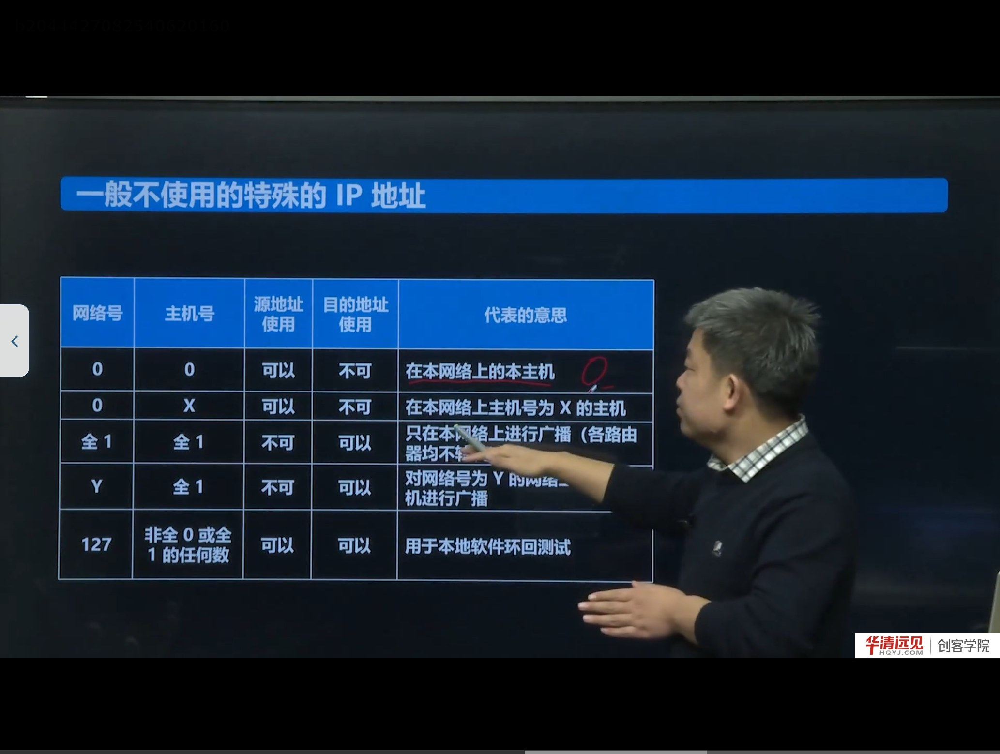
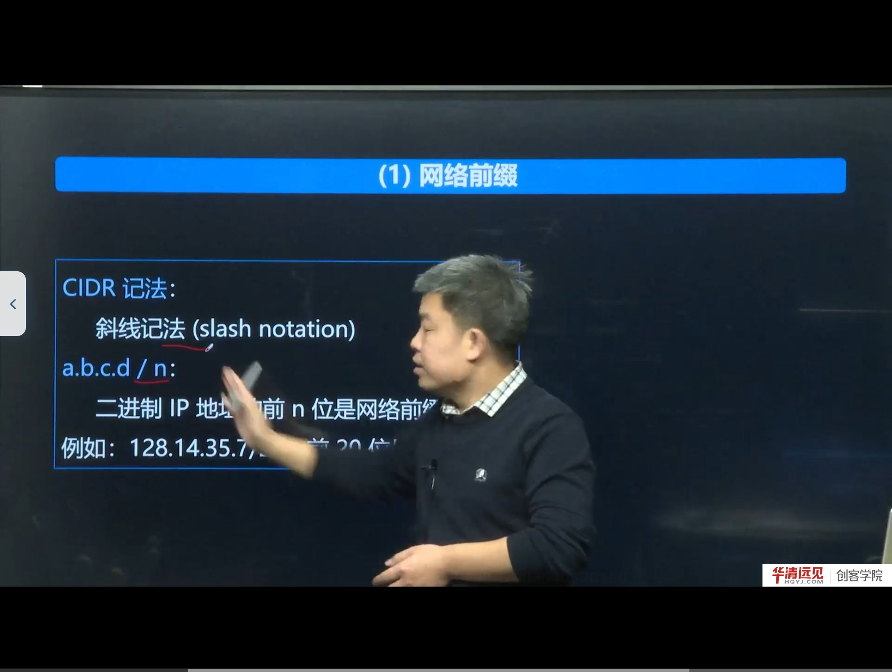
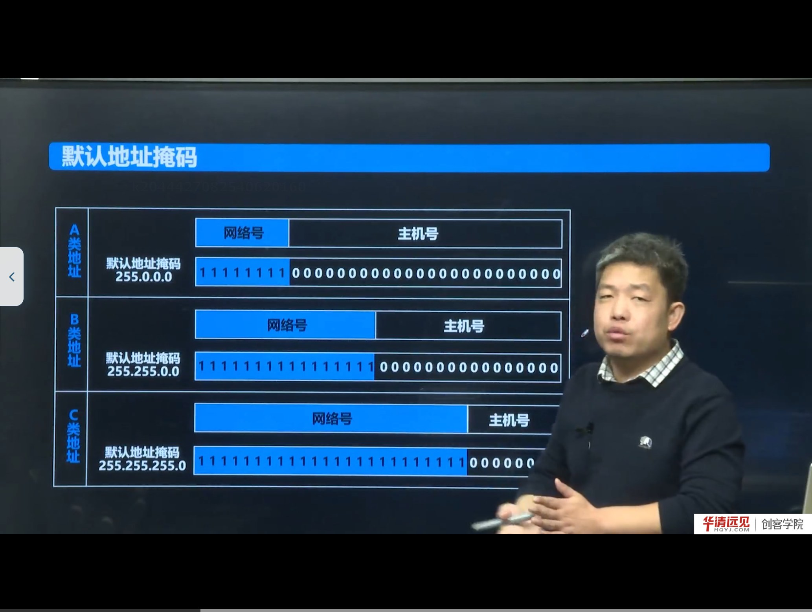
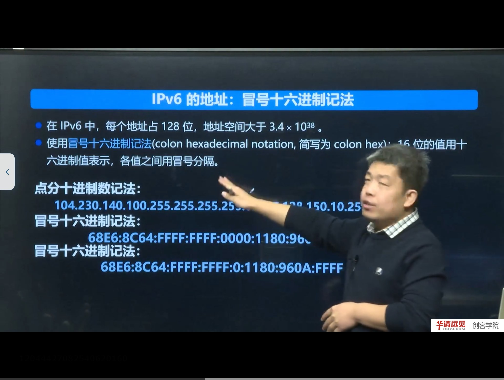

# 第 04 节　IP 地址与端口号

> 对应视频：4.4《IP地址与端口号》，含五个子视频：
> ① 分类 IP（22:00）　② 无分类编址 CIDR（8:00）　③ 子网掩码（5:00）　④ IPv6 的表示方式（6:00）　⑤ 协议端口号（18:00）
>
> 上一节说“网络层负责逻辑地址寻址”，本节就把“逻辑地址”讲透：IPv4 地址怎么编、怎么划、怎么算网络号，IPv6 长什么样，以及为什么还需要端口号。

## 学习目标

1. 说清 IPv4 地址的 32 位结构与“点分十进制”表示，能手算二进制/十进制互换。
2. 掌握 A/B/C/D/E 五类地址的起止范围、网络号位数、可用主机数。
3. 理解分类编址的浪费问题，以及子网划分、CIDR 各自解决什么问题。
4. 会用子网掩码做“与运算”求网络地址，能看懂 `192.168.1.10/24` 这类写法。
5. 记住 IPv6 的 128 位、冒号十六进制、零压缩规则。
6. 理解端口号的作用、范围划分，以及“IP + 端口”如何唯一标识一个通信端点。

---

## 一、IP 地址是什么：32 位、两级结构



IPv4 地址在计算机内部是一个 **32 位二进制数**，也就是 **4 个字节**。为了人读方便，把它按每 8 位一组、转成十进制、用点分开，就是**点分十进制**（dotted decimal）：

```
11000000 10101000 00000001 01100100
  192      168       1        100
```

结构上，IP 地址是**两级**的：

```
IP 地址 ::= { <网络号>, <主机号> }
```

- **网络号**：标识这台主机所在的网络；
- **主机号**：标识该网络内的具体主机。

寻址逻辑就是“先找网络，再找主机”——这与互联网“网络通过网络互联”的结构完全对应。

课程强调：**IP 地址在整个互联网范围内是唯一的**。有同学会问“为什么我家的 `192.168.1.100` 和老师家的一样？”——因为那是**私有地址**，只在一个局域网内部有效；局域网对外通信时，经过 NAT 转换成公网地址，所以在公网上看到的并不是 `192.168.1.100`。

> **补充：二进制敏感度**
> 课程要求记住几个关键值：
> - `11111111` = 255
> - `10000000` = 128
> - `11000000` = 192（128+64）
> - `11100000` = 224（128+64+32）
>
> 这几个数正好对应 A/B/C/D 类的首字节边界，记住它们，判断地址类别和算掩码都会快很多。

---

## 二、分类 IP：A、B、C、D、E

早期的做法是把 32 位地址的前几位固定，用“首字节范围”区分五类：

| 类别 | 首字节范围 | 固定前缀 | 网络号位数 | 主机号位数 | 用途 |
|---|---|---|---|---|---|
| A | 0 ～ 127 | 0 | 8 | 24 | 单播，超大网络 |
| B | 128 ～ 191 | 10 | 16 | 16 | 单播，中型网络 |
| C | 192 ～ 223 | 110 | 24 | 8 | 单播，小型网络 |
| D | 224 ～ 239 | 1110 | — | — | 组播（多播） |
| E | 240 ～ 255 | 1111 | — | — | 保留 |

- **A/B/C 是单播地址**：一个发送方对应一个接收方；
- **D 类是组播地址**：一个发送方，多个接收方同时接收（如视频会议、IPTV）；
- **E 类保留**，暂未分配。

判断举例：`10.14.1.8` 首字节 10，在 0～127 → A 类，网络号是 `10`，主机号是 `14.1.8`。

### 2.1 每类能容纳多少主机

| 类别 | 主机号位数 | 理论主机数 | 实际可用（减 2） |
|---|---|---|---|
| A | 24 | 2²⁴ = 16,777,216 | 16,777,214 |
| B | 16 | 2¹⁶ = 65,536 | 65,534 |
| C | 8 | 2⁸ = 256 | 254 |

**为什么要减 2？** 因为一个网络里有两个地址不能分配给主机：

- **主机号全 0**：代表“本网络”本身；
- **主机号全 1**：代表“本网络上的广播地址”。

### 2.2 一般不使用的特殊 IP



| 网络号 | 主机号 | 含义 |
|---|---|---|
| 0 | 0 | 在本网络上的本主机（`0.0.0.0`，常用于表示“任意/本机”） |
| 0 | X | 本网络上主机号为 X 的主机 |
| 全 1 | 全 1 | 只在本网络上广播（`255.255.255.255`，路由器不转发） |
| Y | 全 1 | 对网络号为 Y 的网络进行广播（定向广播） |
| 127 | 非全 0/全 1 | 本地软件环回测试（`127.0.0.1` 就是本机） |

> **补充：`0.0.0.0` 在编程中的两个常见含义**
> 1. `bind(0.0.0.0, port)`：绑定本机所有网卡，任意地址来的连接都接收；
> 2. `connect` 前的占位、或表示“由内核选择源地址”。
>
> 这两个用法在后面 socket 编程中会反复出现，看到 `0.0.0.0` 不要慌，它表示“本机/任意”。

### 2.3 分类编址的致命缺点

分类编址**管理简单、转发迅速**（看一眼首字节就知道网络号），但会造成巨大的浪费：

- 一个只有 1000 台主机的组织，C 类（254 个地址）不够，只能申请 B 类（65,534 个地址），**浪费 6 万多个地址**；
- 而 A 类一个网络就有 1600 多万个地址，几乎没有组织能用完。

随着 20 世纪 90 年代互联网商业化、用户爆炸式增长，地址迅速枯竭。IETF 先后提出两种补救：

1. **划分子网（subnetting）**：在主机号里再切出一段“子网号”，把一个大网络分成若干小网络；
2. **CIDR（无分类编址）**：彻底取消 A/B/C 类边界，按需分配任意长度的前缀。

> **补充：私有地址范围（RFC 1918）**
> - A 类：`10.0.0.0/8`
> - B 类：`172.16.0.0/12`（即 172.16.0.0～172.31.255.255）
> - C 类：`192.168.0.0/16`
>
> 这些地址不会在公网路由，家庭/企业内网随便用，出口处由 NAT 转换。这就是“我家和老师家都是 192.168.1.100”却不冲突的原因。

---

## 三、CIDR：无分类编址



CIDR（Classless Inter-Domain Routing，无分类域间路由选择）**消除了 A/B/C 类和划分子网的概念**，回到“网络前缀 + 主机号”的两段结构，但前缀长度 **n 不再固定**，可以按需取 0～32 任意值。

写法就是**斜线记法**（slash notation）：

```
a.b.c.d / n
```

含义：二进制 IP 地址的**前 n 位是网络前缀**，剩下的 `32 - n` 位是主机号。

例如 `128.14.35.7/20`：

- 前 20 位是网络前缀，后 12 位是主机号；
- 把后 12 位清零，得到**网络前缀** `128.14.32.0/20`；
- 这个地址块包含 `2¹² = 4096` 个地址，可分配给主机的有 `4096 - 2 = 4094` 个（去掉网络地址和广播地址）。

> **补充：CIDR 地址块的三要素**
> 对 `a.b.c.d/n` 这个地址块：
> - **最小地址** = 主机号全 0（网络地址）；
> - **最大地址** = 主机号全 1（广播地址）；
> - **地址总数** = 2^(32-n)。
>
> 聚合（route summarization）也靠它：把多个连续的小前缀合并成一个大前缀，减少路由表条目。例如 `128.14.32.0/20` 可以覆盖 16 个 `/24`。

---

## 四、子网掩码：让计算机“算得快”



人可以从 `/20` 看出前缀长度，但计算机怎么做？答案是**子网掩码**（subnet mask，也叫地址掩码）：

> 网络前缀对应的位全为 **1**，主机号对应的位全为 **0**。

例如 `/20` 的掩码是：

```
11111111 11111111 11110000 00000000
   255      255      240       0
```

即 `255.255.240.0`。

**求网络地址的方法：IP 地址与子网掩码逐位做“与（AND）”运算。**

```
  128.14.35.7   → 10000000 00001110 00100011 00000111
& 255.255.240.0 → 11111111 11111111 11110000 00000000
= 128.14.32.0   → 10000000 00001110 00100000 00000000
```

因为掩码的主机号部分全是 0，与运算后必然为 0；网络前缀部分原样保留——这就是“与运算能快速求网络号”的原理。

### 4.1 默认掩码

虽然 CIDR 从概念上取消了分类，但 A/B/C 类地址仍在大量使用，所以有“默认掩码”：

| 类别 | 默认掩码 | 前缀长度 |
|---|---|---|
| A | 255.0.0.0 | /8 |
| B | 255.255.0.0 | /16 |
| C | 255.255.255.0 | /24 |

> **补充：子网划分的算法**
> 若要把一个 B 类网络（/16）划分成能容纳 1000 台主机的子网：
> - 2¹⁰ = 1024 ≥ 1002（1000+2），所以主机号留 **10 位**；
> - 子网号占 16 - 10 = **6 位**，可划分 2⁶ = 64 个子网；
> - 子网掩码为 `/26`，即 `255.255.255.192`。
>
> 这就是“借位”的思想：从主机号高位借位当子网号，借几位，子网数就是 2 的几次方。

---

## 五、IPv6 的表示方式



IPv4 只有 32 位，地址枯竭是必然。IPv6 把地址扩大到 **128 位**，地址空间大于 `3.4 × 10³⁸`——号称“能给地球上的每一粒沙子分配一个地址”。

表示方法：

1. **冒号十六进制**（colon hexadecimal）：每 16 位（2 字节）用 4 个十六进制数表示，各组之间用冒号分隔。
   ```
   68E6:8C64:FFFF:FFFF:0000:1180:960A:FFFF
   ```
2. **零压缩**：把连续的一串 0 用 `::` 表示，但**一个地址中只能使用一次**。
   ```
   68E6:8C64:FFFF:FFFF::1180:960A:FFFF
   ```
3. **点分十进制后缀**：在 IPv4 兼容地址中，最后 32 位可以写成点分十进制，如 `::192.168.1.1`。

特殊地址：

- `::1`：环回地址（相当于 IPv4 的 `127.0.0.1`）；
- `::`：全零地址（未指定地址）；
- `FF00::/8`：组播地址。

> **补充：IPv6 的现状**
> 课程说得很客观：IPv6 是趋势，但当下主流仍是 IPv4。国内三大运营商和大型互联网公司已大规模双栈部署，家庭宽带多数也支持 IPv6。写程序时用 `AF_INET6` 即可支持，但本课程后续代码仍以 IPv4 为主，先把 IPv4 的 socket 编程学扎实。

---

## 六、端口号：一台主机上的“门牌号”

IP 地址只能把数据送到**主机**，但一台主机上同时跑着浏览器、微信、QQ、SSH……数据到底交给哪个进程？这就要靠**端口号（port number）**。

### 6.1 端口号是什么

- 端口号是一个 **16 位**的无符号整数，范围 **0～65535**；
- 它由**传输层**（TCP/UDP）使用，用来标识主机上的一个进程（更准确说，是标识一个通信端点）；
- **IP 地址 + 端口号**才能唯一标识互联网上的一个通信端点，常写作 `IP:Port`。

### 6.2 端口号的划分

| 范围 | 名称 | 说明 |
|---|---|---|
| 0 ～ 1023 | 熟知端口（well-known） | 分配给常见服务，如 HTTP 80、HTTPS 443、FTP 21、SSH 22、DNS 53；普通用户程序绑定需要 root 权限 |
| 1024 ～ 49151 | 登记端口（registered） | 由 IANA 登记，供普通应用使用，如 MySQL 3306、Redis 6379 |
| 49152 ～ 65535 | 动态/私有端口（ephemeral） | 客户端临时使用，由内核自动分配 |

> **补充：为什么客户端一般不 bind 固定端口**
> 客户端调用 `connect` 时，内核会自动从 ephemeral 范围选一个空闲端口作为源端口。如果客户端也 `bind` 固定端口，同一台机器上就只能有一个客户端实例能连服务器（端口冲突）。服务器才需要 `bind` 知名端口。

### 6.3 套接字与四元组

一个 TCP 连接由**四元组**唯一确定：

```
(源 IP, 源端口, 目的 IP, 目的端口)
```

所以“同一个服务器 80 端口可以同时服务成千上万个客户端”并不矛盾：目的 IP/端口相同，但源 IP/端口不同，四元组不同，就是不同的连接。

> **补充：端口号与进程的关系**
> 一个进程可以绑定多个端口（多个 socket），一个端口在同一时刻通常只能被一个进程绑定（除非设置 `SO_REUSEADDR/SO_REUSEPORT`）。这也是后面写服务器时 `bind` 报 `Address already in use` 的原因——上一个进程还没释放端口，或者用了 `TIME_WAIT` 状态。

---

## 七、本节易错点与纠错

| 容易说错/写错 | 正确说法 | 说明 |
|---|---|---|
| 字网掩码 / 子网掩码 | 子网掩码 | 同音字 |
| 语运算 | 与运算（AND） | 同音字 |
| 多拨 / 组拨 | 组播（多播） | 同音字 |
| 环回 / 还回 | 环回（loopback） | 同音字 |
| A 类地址首字节 1～127 | 0～127 | 0 和 127 有特殊用途，实际可分配从 1 开始 |
| 主机数 = 2^n | 2^n - 2 | 去掉网络地址与广播地址 |
| `192.168.1.100` 全球唯一 | 私有地址，仅局域网内唯一 | 公网需 NAT |
| IPv6 的 `::` 可多次使用 | 一个地址只能用一次 | 否则无法还原 |

---

## 八、小结与自测

**一句话总结**：IP 地址用“网络号 + 主机号”定位主机，分类编址简单但浪费，CIDR 按需分配前缀，子网掩码用与运算快速求网络号，IPv6 把地址扩到 128 位；而端口号在传输层进一步定位到进程，`IP:Port` 才是完整的通信端点。

**自测题**

1. 把 `192.168.10.130` 写成二进制，并指出它属于哪一类地址、网络号和主机号各是多少。
2. 一个 B 类网络要划分 20 个子网，子网号至少借几位？子网掩码是多少？
3. `172.16.5.10/20` 的网络地址、广播地址、可用主机数分别是多少？
4. 为什么主机号全 0 和全 1 不能分配给主机？
5. IPv6 地址 `2001:0DB8:0000:0000:0000:0000:1428:57AB` 用零压缩怎么写？
6. 端口号范围如何划分？为什么客户端通常不 bind 固定端口？
7. 用四元组解释“一个 Web 服务器如何同时服务多个客户端”。

**下一节预告**：IP 地址在程序里怎么表示？为什么 `inet_addr("192.168.1.1")` 得到的值看起来是反的？这就是**字节序**与 **IP 地址转换函数**要解决的问题。
