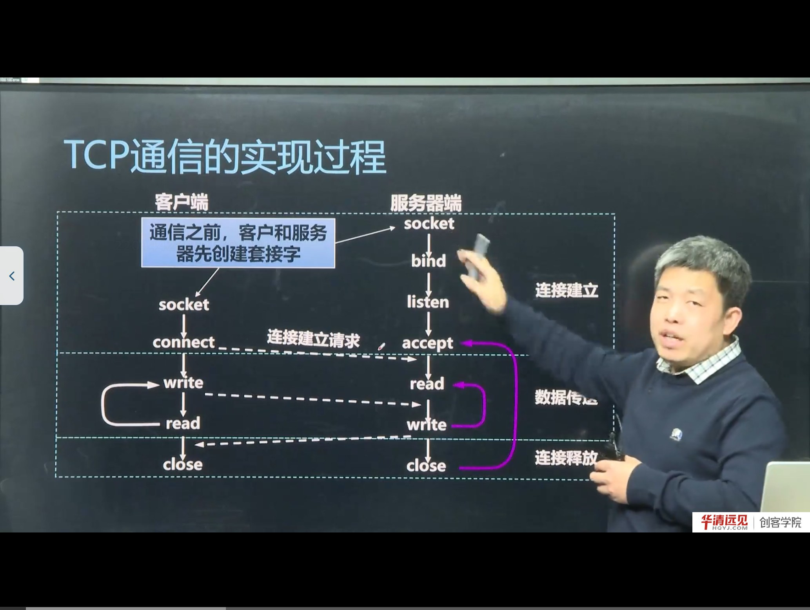
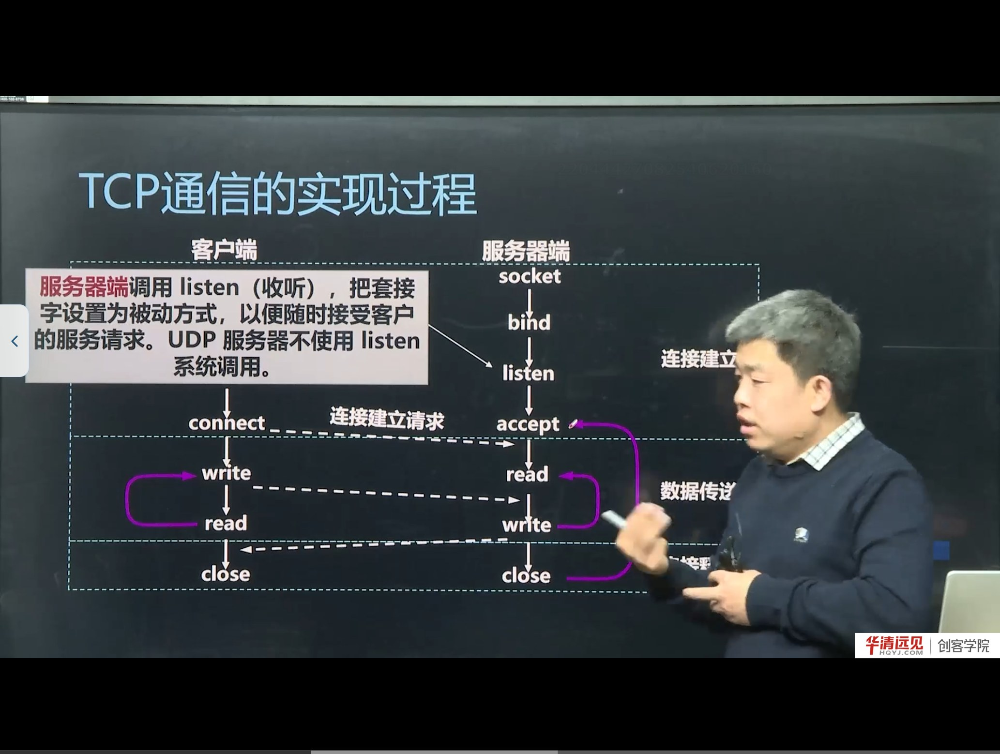
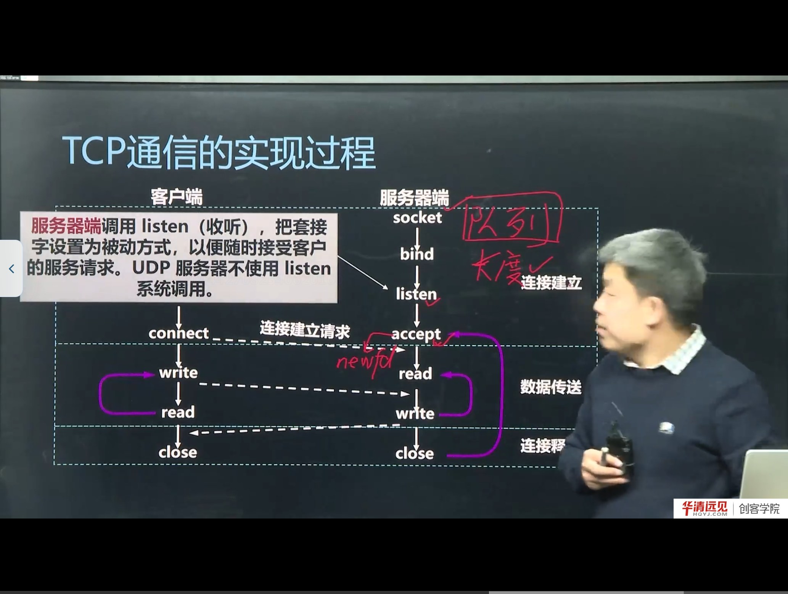

# 第 06 节　socket 套接字及 TCP 的实现框架

> 对应视频：4.6《socket套接字及TCP的实现框架》，含两个子视频：
> ① socket 套接字（27:00）　② TCP 通信的实现过程（17:00）
>
> 从这一节开始进入编程。核心只有一句话：**TCP 通信分三步——建立连接、传输数据、释放连接**；Linux 用一组 socket API 把这三步映射成固定的函数调用顺序。

## 学习目标

1. 理解 socket 是什么：为什么说它是“文件描述符”，为什么能用 `read/write` 操作。
2. 记住 `struct sockaddr_in` 的字段，理解为什么 `bind/connect/accept` 都要把它强转成 `struct sockaddr *`。
3. 背下 TCP 服务器与客户端的函数调用顺序，并能说清每个函数的作用与返回值。
4. 理解 `listen` 的 backlog 队列、`accept` 的“出队 + 新 fd”机制。
5. 能解释“为什么客户端不需要 bind”。

---

## 一、socket 是什么



在 Linux 的“一切皆文件”设计下，**socket 也是一个文件描述符（fd）**。创建一个 socket，内核返回一个非负整数，之后就可以像读写文件一样用 `read/write` 收发数据，最后用 `close` 关闭。

但 socket 与普通文件不同：

- 普通文件的 fd 指向磁盘上的文件；
- socket 的 fd 指向内核里的一个**通信端点**，它绑定了协议族、类型、本地地址/端口、远端地址/端口等状态。

> **补充：socket 的本质是“五元组 + 状态机”**
> 一个 TCP socket 在内核里对应一条连接的状态（LISTEN、SYN_SENT、ESTABLISHED、TIME_WAIT…）。你在应用层看到的只是 fd，真正干活的是内核协议栈。这也是为什么 `read` 在没数据时会阻塞——它在等内核把数据放进接收缓冲区。

---

## 二、地址结构：sockaddr_in

在填地址之前，先把 `socket()` 的三个参数拆开看——它们决定了“用哪个协议族、哪种通信语义”：

| domain（协议族） | 含义 | 配套地址结构 |
|---|---|---|
| `AF_INET` | IPv4 | `struct sockaddr_in` |
| `AF_INET6` | IPv6 | `struct sockaddr_in6` |
| `AF_UNIX` / `AF_LOCAL` | 本地（UNIX 域） | `struct sockaddr_un` |
| `AF_PACKET` | 链路层原始套接字 | `struct sockaddr_ll` |

| type（套接字类型） | 语义 | 对应协议 |
|---|---|---|
| `SOCK_STREAM` | 有序、可靠、面向连接 | TCP |
| `SOCK_DGRAM` | 数据报、无连接 | UDP |
| `SOCK_RAW` | 原始套接字，可自己构造 IP 头 | IP/ICMP 等 |

> **补充：`AF_*` 与 `PF_*`**
> `AF` = Address Family，`PF` = Protocol Family。历史上二者有区分，现代 Linux 里 `AF_INET == PF_INET`，填哪个都能工作，但约定俗成用 `AF_*`。

要 bind 或 connect，必须告诉内核“哪个 IP、哪个端口”。IPv4 用 `struct sockaddr_in`：

```c
struct sockaddr_in {
    sa_family_t    sin_family;   // 地址族：AF_INET
    in_port_t      sin_port;     // 端口号（网络字节序）
    struct in_addr sin_addr;     // IP 地址（网络字节序）
    char           sin_zero[8];  // 填充，使结构体与 sockaddr 等长
};
```

三个要点：

1. **`sin_family = AF_INET`**：表示 IPv4；
2. **端口和 IP 必须是网络字节序**：端口用 `htons()`，IP 用 `htonl()` 或 `inet_addr()/inet_pton()`；
3. **`sin_zero[8]` 只是填充**：让 `sockaddr_in` 与通用的 `struct sockaddr` 大小一致，通常用 `memset` 清零。

### 2.1 为什么要强制类型转换

`bind`、`connect`、`accept` 的第二个参数类型是 `struct sockaddr *`（通用地址结构），而 IPv4 用的是 `sockaddr_in`。C 语言没有继承，只能靠**强制转换**：

```c
bind(fd, (struct sockaddr *)&addr, sizeof(addr));
```

内核通过 `sa_family` 字段判断实际是哪种地址结构，再按对应格式解析。这就是“通用接口 + 具体结构”的经典设计。

> **补充：IPv6 与 UNIX 域 socket**
> - IPv6 用 `struct sockaddr_in6`（`AF_INET6`）；
> - UNIX 域套接字用 `struct sockaddr_un`（`AF_UNIX`）。
>
> 它们都强转成 `struct sockaddr *` 传给同一套 API。第 13 节会专门讲 `sockaddr_un`。

---

## 三、TCP 服务器：socket → bind → listen → accept

### 3.1 socket：创建套接字

```c
int fd = socket(AF_INET, SOCK_STREAM, 0);
```

三个参数：

| 参数 | 取值 | 含义 |
|---|---|---|
| domain | `AF_INET` | IPv4 协议族 |
| type | `SOCK_STREAM` | 流式套接字，对应 TCP |
| protocol | `0` | 默认协议（TCP） |

返回值：成功返回 **大于 0 的 fd**，失败返回 -1 并设置 `errno`。

> **易错点：创建 socket 不能用 `open()`**
> 这是选择题高频陷阱。`open()` 只能打开文件/设备，不能创建网络通信端点；创建套接字必须用 `socket()`。

### 3.2 bind：绑定本地地址

```c
struct sockaddr_in addr;
memset(&addr, 0, sizeof(addr));
addr.sin_family = AF_INET;
addr.sin_port = htons(8888);              // 端口转网络字节序
addr.sin_addr.s_addr = htonl(INADDR_ANY); // 或 inet_addr("192.168.1.10")
bind(fd, (struct sockaddr *)&addr, sizeof(addr));
```

- `INADDR_ANY`（即 `0.0.0.0`）表示绑定本机所有网卡；
- 端口建议用 1024 以上（<1024 需要 root）；
- 若端口被占用，`bind` 返回 -1，`errno = EADDRINUSE`。

### 3.3 listen：把套接字设为被动，维护连接队列



```c
listen(fd, 5);
```

`listen` 做两件事：

1. 把主动套接字变为**被动套接字**，准备接受连接请求；
2. 维护一个**连接队列**，`backlog` 指定队列的最大长度。

> **补充：backlog 到底是什么**
> 内核为监听套接字维护两个队列：
> - **未完成连接队列**（收到 SYN，尚未完成三次握手）；
> - **已完成连接队列**（三次握手完成，等待 accept 取走）。
>
> `backlog` 影响的是“已完成队列”的长度上限（具体实现会做一定调整）。队列满了之后，新的连接请求可能被丢弃或收到 RST——这就是高并发服务器要调大 backlog、并及时 accept 的原因。

> **注意：UDP 服务器不需要 listen**（UDP 无连接）。

### 3.4 accept：从队列取出一个连接



```c
struct sockaddr_in cli;
socklen_t len = sizeof(cli);
int newfd = accept(fd, (struct sockaddr *)&cli, &len);
```

`accept` 做三件事：

1. 从**已完成连接队列**中取出一个客户端（若队列为空则阻塞）；
2. 创建一个**新的套接字 newfd**，它专门与这个客户端一对一通信；
3. 通过第二个参数（**传出参数**）把客户端的 IP/端口写回 `cli`，第三个参数是它的长度指针。

关键区别：

| 套接字 | 作用 |
|---|---|
| `fd`（监听套接字） | 只负责“接客”，不用于收发数据 |
| `newfd`（连接套接字） | 与某个客户端一对一收发数据 |

> **易错点**：用 `fd` 去 `read/write` 是错的，数据要在 `newfd` 上读写。这也是“一个服务器如何服务多个客户端”的关键：每个客户端一个 newfd，互不干扰。

### 3.5 read/write/close

```c
char buf[1024];
int n = read(newfd, buf, sizeof(buf));   // 读客户端发来的数据
write(newfd, "hello", 5);                // 回数据给客户端
close(newfd);                            // 关闭这个连接
```

`read` 返回 0 表示对端关闭了连接（EOF），返回 -1 表示出错。

---

## 四、TCP 客户端：socket → connect

客户端简单得多：

```c
int fd = socket(AF_INET, SOCK_STREAM, 0);

struct sockaddr_in srv;
memset(&srv, 0, sizeof(srv));
srv.sin_family = AF_INET;
srv.sin_port = htons(8888);
srv.sin_addr.s_addr = inet_addr("127.0.0.1");

connect(fd, (struct sockaddr *)&srv, sizeof(srv));
write(fd, "hello", 5);
read(fd, buf, sizeof(buf));
close(fd);
```

### 4.1 为什么客户端不需要 bind

课程的解释很到位：**客户端只需要知道服务端的地址，自己的地址由系统分配即可**。

- 客户端调用 `connect` 时，内核会自动为它选择一块网卡、分配一个**临时端口**（ephemeral port，49152～65535）；
- 如果客户端也 bind 固定端口，同一台机器上就只能起一个客户端实例（端口冲突）。

> **补充：connect 做了什么**
> `connect` 触发三次握手：发送 SYN → 收到 SYN+ACK → 发送 ACK，连接建立后返回。如果服务端没开、端口没监听，`connect` 会返回 -1，`errno = ECONNREFUSED`。

---

## 五、完整调用顺序与常见错误

### 5.1 顺序图

```
服务器                                客户端
socket()                              socket()
bind()                                  |
listen()                                |
accept()  ←──── 三次握手 ────→        connect()
read()    ←──── 数据 ────────→        write()
write()   ───── 数据 ────────→        read()
close()                               close()
```

### 5.2 常见错误清单

| 错误 | 现象 | 正确做法 |
|---|---|---|
| 用 `open()` 创建 socket | 编译/运行失败 | 用 `socket()` |
| 端口没 `htons()` | 绑定到错误端口（如 8888 变成 22528） | 端口一律 `htons()` |
| `bind` 的 addrlen 写成 0 | `EINVAL` | `sizeof(struct sockaddr_in)` |
| 用监听 fd 读写 | 读到的是连接请求，数据错乱 | 用 `accept` 返回的 newfd |
| `accept` 的 addrlen 传值而非指针 | 编译警告/运行异常 | 传 `&len` |
| 客户端 bind 固定端口 | 只能起一个实例 | 客户端不 bind |
| 忘记 `close` | fd 泄漏，端口占用 | 每个 fd 都要 close |

---

## 六、本节易错点与纠错

| 容易说错/写错 | 正确说法 | 说明 |
|---|---|---|
| 套捷字 / 套件字 | 套接字 | 同音字 |
| sockadd2-1 | `sockaddr_in` | 结构体名 |
| 雷森 / 勒塞 | listen | 音译 |
| asap / 塞普特 | accept | 音译 |
| backlog 是“连接数上限” | 是**已完成连接队列**的长度 | 不是并发连接总数 |
| accept 返回监听 fd | 返回**新的连接 fd** | 关键区别 |

---

## 七、小结与自测

**一句话总结**：TCP 服务器“创建→绑定→监听→接受→读写→关闭”，客户端“创建→连接→读写→关闭”；`sockaddr_in` 描述地址，`htons` 处理字节序，`accept` 返回的新 fd 才是真正用来通信的句柄。

**自测题**

1. 为什么 socket 可以用 `read/write` 操作？它和普通文件 fd 有何不同？
2. `sockaddr_in` 有哪些字段？为什么端口要 `htons`？
3. 为什么 `bind/connect/accept` 的地址参数要强转成 `struct sockaddr *`？
4. `listen` 的 backlog 限制的是什么队列？队列满了会怎样？
5. `accept` 的三个参数分别是什么？哪个是传出参数？
6. 为什么客户端不需要 bind？它的端口从哪来？
7. 用监听 fd 调 `read` 会发生什么？为什么？

**下一节预告**：本节只讲了“框架”，下一节把服务器和客户端的代码一行行写出来，包括错误处理、循环收发、以及第一次运行会遇到的 `Address already in use`、`Connection refused` 等问题。
