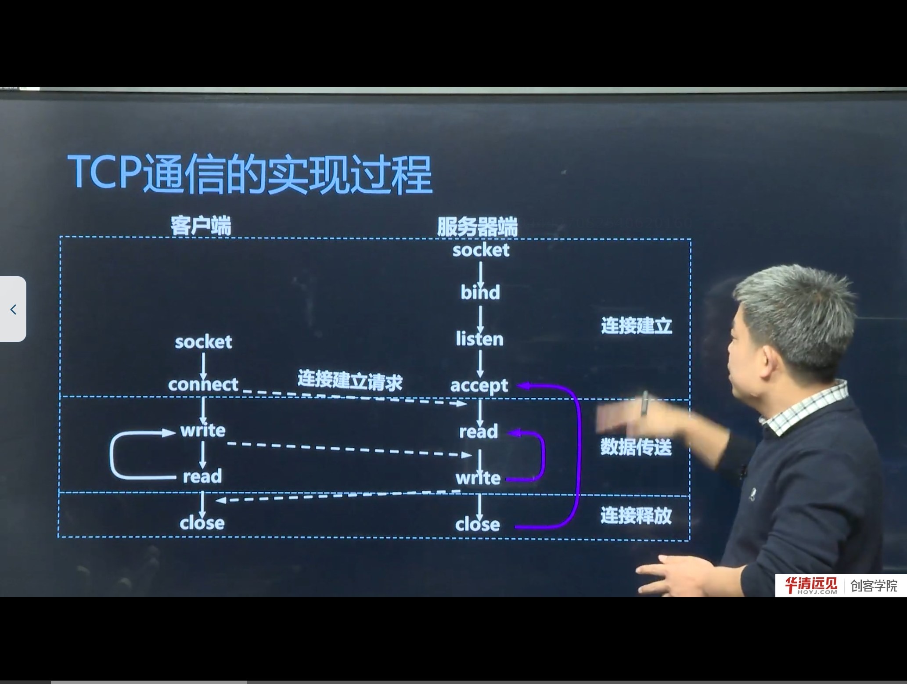
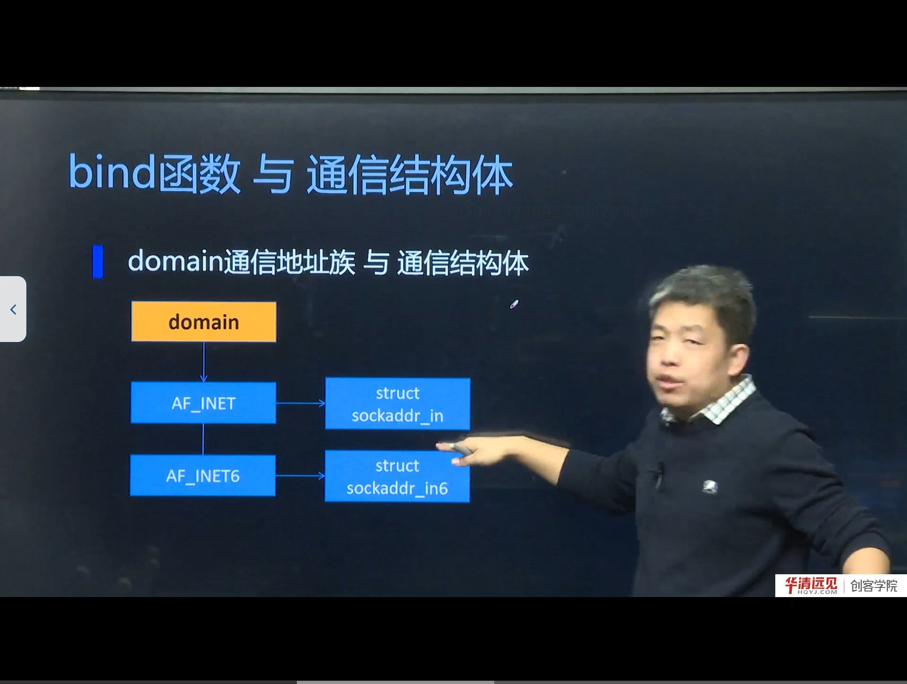
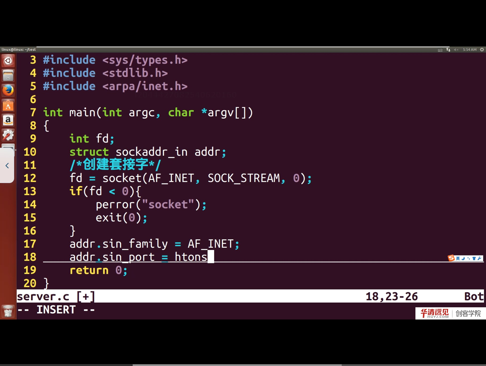

# 第 07 节　实现 TCP 通信

> 对应视频：4.7《实现TCP通信》，含四个子视频：
> ① TCP 服务器的实现（理论，19:00）　② 服务器实现代码（19:00）　③ 服务器/客户端代码（9:00）　④ 代码优化（25:00）
>
> 这一节把第 06 节的“函数框架”落成**能编译、能运行、能互相收发**的完整代码。建议边读边敲，不要只看。

## 学习目标

1. 独立写出 TCP 服务器与客户端代码，理解每个参数为什么这样填。
2. 掌握 `bind`、`listen`、`accept` 的细节与返回值处理。
3. 能解释 `Address already in use`、`Connection refused`、`accept` 阻塞等常见现象。
4. 学会用 `nc`/`telnet` 做最小化连通性测试，再上自写客户端。
5. 理解“代码优化”要解决的四类问题：错误处理、端口复用、循环收发、粘包/边界。

---

## 一、服务器实现的理论回顾



服务器四步（建立连接阶段）：

```c
socket() → bind() → listen() → accept()
```

- `socket`：创建通信端点，返回 fd；
- `bind`：把“IP + 端口 + 协议”绑定到 fd；
- `listen`：把 fd 变成被动监听，维护连接队列；
- `accept`：从队列取出一个客户端，返回**新的 fd** 用于通信。



`socket` 的三个参数：

| 参数 | 取值 | 说明 |
|---|---|---|
| domain | `AF_INET` | IPv4（IPv6 用 `AF_INET6`） |
| type | `SOCK_STREAM` | 流式套接字，对应 TCP（UDP 用 `SOCK_DGRAM`） |
| protocol | `0` | 流式套接字唯一对应 TCP，填 0 即可 |

> **为什么 `domain` 要和结构体匹配**
> `AF_INET` 对应 `struct sockaddr_in`，`AF_INET6` 对应 `struct sockaddr_in6`。`bind/connect/accept` 接收的是通用的 `struct sockaddr *`，内核靠 `sa_family` 判断该按哪种结构解析。所以“域”和“结构体”必须成对出现，强转只是让编译器闭嘴。

---

## 二、服务器完整代码



```c
// tcp_server.c
#include <stdio.h>
#include <stdlib.h>
#include <string.h>
#include <unistd.h>
#include <errno.h>
#include <arpa/inet.h>
#include <sys/socket.h>
#include <netinet/in.h>

#define PORT 8888
#define BUF_SIZE 1024

int main(void)
{
    int listenfd, connfd;
    struct sockaddr_in srv, cli;
    socklen_t clilen = sizeof(cli);
    char buf[BUF_SIZE];
    ssize_t n;

    /* 1. 创建套接字 */
    listenfd = socket(AF_INET, SOCK_STREAM, 0);
    if (listenfd < 0) { perror("socket"); exit(1); }

    /* 2. 绑定地址（端口复用，避免重启时报 Address already in use） */
    int opt = 1;
    setsockopt(listenfd, SOL_SOCKET, SO_REUSEADDR, &opt, sizeof(opt));

    memset(&srv, 0, sizeof(srv));
    srv.sin_family      = AF_INET;
    srv.sin_port        = htons(PORT);          // 端口必须转网络字节序
    srv.sin_addr.s_addr = htonl(INADDR_ANY);    // 0.0.0.0，绑定所有网卡

    if (bind(listenfd, (struct sockaddr *)&srv, sizeof(srv)) < 0) {
        perror("bind"); exit(1);
    }

    /* 3. 监听，backlog=5 */
    if (listen(listenfd, 5) < 0) { perror("listen"); exit(1); }
    printf("server listening on port %d ...\n", PORT);

    /* 4. 接受连接 */
    connfd = accept(listenfd, (struct sockaddr *)&cli, &clilen);
    if (connfd < 0) { perror("accept"); exit(1); }
    printf("client connected: %s:%d\n",
           inet_ntoa(cli.sin_addr), ntohs(cli.sin_port));

    /* 5. 收发数据：注意用 connfd，不是 listenfd */
    while ((n = read(connfd, buf, sizeof(buf) - 1)) > 0) {
        buf[n] = '\0';
        printf("recv: %s\n", buf);
        write(connfd, buf, n);                  // 原样回显
    }

    /* 6. 关闭 */
    close(connfd);
    close(listenfd);
    return 0;
}
```

### 2.1 逐段说明

- **`SO_REUSEADDR`**：服务器重启时，旧连接可能处于 `TIME_WAIT`，端口仍被占用。设置该选项后，内核允许立即复用该端口。这是“代码优化”里最实用的一条。
- **`htonl(INADDR_ANY)`**：`INADDR_ANY` 就是 `0`，表示“本机所有地址”。写 `htonl` 是习惯（0 的字节序无所谓），但端口 `htons` 绝不能省。
- **`accept` 的 `clilen`**：必须初始化为 `sizeof(cli)`，且传**地址**。它是“传入+传出”参数：传入告诉内核缓冲区多大，传出告诉实际写入多大。
- **`read` 返回 0**：表示对端调用了 `close`，本端也应关闭。

> **易错点：`inet_ntoa` 不可重入**
> `inet_ntoa` 返回的是静态缓冲区，多次调用会互相覆盖，且不线程安全。工程中建议用 `inet_ntop`（第 05 节会讲）。

---

## 三、客户端完整代码

```c
// tcp_client.c
#include <stdio.h>
#include <stdlib.h>
#include <string.h>
#include <unistd.h>
#include <arpa/inet.h>
#include <sys/socket.h>
#include <netinet/in.h>

#define PORT 8888
#define BUF_SIZE 1024

int main(int argc, char *argv[])
{
    int fd;
    struct sockaddr_in srv;
    char buf[BUF_SIZE];
    const char *ip = (argc > 1) ? argv[1] : "127.0.0.1";

    fd = socket(AF_INET, SOCK_STREAM, 0);
    if (fd < 0) { perror("socket"); exit(1); }

    memset(&srv, 0, sizeof(srv));
    srv.sin_family = AF_INET;
    srv.sin_port   = htons(PORT);
    if (inet_pton(AF_INET, ip, &srv.sin_addr) <= 0) {
        perror("inet_pton"); exit(1);
    }

    if (connect(fd, (struct sockaddr *)&srv, sizeof(srv)) < 0) {
        perror("connect"); exit(1);
    }
    printf("connected to %s:%d\n", ip, PORT);

    while (fgets(buf, sizeof(buf), stdin)) {
        write(fd, buf, strlen(buf));
        ssize_t n = read(fd, buf, sizeof(buf) - 1);
        if (n <= 0) break;
        buf[n] = '\0';
        printf("echo: %s", buf);
    }

    close(fd);
    return 0;
}
```

### 3.1 客户端为什么不用 bind

- 客户端只需要**服务端**的地址；自己的 IP 由内核按路由选择，端口由内核从临时端口范围分配；
- 如果客户端 bind 固定端口，同一台机器上只能起一个客户端实例。

> **补充：`connect` 失败排查顺序**
> 1. `ECONNREFUSED`：服务端没启动，或端口写错，或防火墙 REJECT；
> 2. `ETIMEDOUT`：网络不通/防火墙 DROP；
> 3. `ENETUNREACH`：没有到目的网络的路由；
> 4. `EADDRNOTAVAIL`：绑定了本机不存在的地址。

---

## 四、编译、运行与测试

```bash
gcc tcp_server.c -o tcp_server
gcc tcp_client.c -o tcp_client

# 终端 1
./tcp_server

# 终端 2（用 nc 做最小测试）
nc 127.0.0.1 8888
hello            # 输入后应看到回显 hello

# 或用自写客户端
./tcp_client 127.0.0.1
```

> **建议的调试顺序**
> 1. 先 `netstat -anp | grep 8888`（或 `ss -lntp`）确认服务器在 LISTEN；
> 2. 再 `nc -vz 127.0.0.1 8888` 确认端口可达；
> 3. 最后才用自写客户端。这样能把“网络问题”和“代码问题”分开。

---

## 五、代码优化：从“能跑”到“能用”

课程最后用一整段讲优化，主要解决四类问题。

### 5.1 错误处理：每个系统调用都要检查

```c
#define CHECK(ret, msg) do { if ((ret) < 0) { perror(msg); exit(1); } } while (0)
```

生产代码还应区分“可恢复错误”（如 `EINTR`）与“致命错误”，对 `EINTR` 应重试而不是退出。

### 5.2 端口复用与地址复用

```c
int opt = 1;
setsockopt(fd, SOL_SOCKET, SO_REUSEADDR, &opt, sizeof(opt));
```

解决“服务器重启后 bind 失败”。高并发场景还会配合 `SO_REUSEPORT` 做多进程负载均衡。

### 5.3 参数化：把 IP/端口从命令行传入

课程最后的版本把地址和端口做成了命令行参数，便于换机测试：

```c
if (argc < 3) {
    fprintf(stderr, "usage: %s <ip> <port>\n", argv[0]);
    return -1;
}
addr.sin_port = htons(atoi(argv[2]));
inet_pton(AF_INET, argv[1], &addr.sin_addr);
```

好处：

- 服务器既可以绑 `0.0.0.0`，也可以绑某块网卡的具体 IP，方便多网卡环境；
- 客户端可以指向本机、局域网另一台机器或公网服务器，不用改代码重编译；
- 端口冲突时换个端口即可，便于同时起多个实例。

> **注意**：`atoi` 不检查错误，端口越界（>65535）会被截断；工程中应使用 `strtol` 并检查范围。

### 5.4 循环收发与优雅关闭

- 服务器用 `while (read(...) > 0)` 持续服务；
- `read` 返回 0 表示对端关闭，应 `close(connfd)` 后继续 `accept` 下一个；
- 退出前最好 `shutdown(fd, SHUT_WR)` 发送 FIN，再 `close`，避免数据未发完就断开。

### 5.5 粘包与消息边界

TCP 是**字节流**，没有消息边界：客户端连续 `write` 两次，服务器可能一次 `read` 全收到。解决方式：

| 方案 | 做法 | 适用 |
|---|---|---|
| 固定长度 | 每条消息定长 | 简单协议 |
| 长度前缀 | 先发 4 字节长度，再发内容 | 最常用 |
| 分隔符 | 以 `\n`、`\0` 结尾 | 文本协议 |

> **这是后面“文件传输”项目的基础**：如果不处理边界，收到的文件会多一段或少一段。

---

## 六、本节易错点与纠错

| 现象 | 原因 | 解决 |
|---|---|---|
| `bind: Address already in use` | 端口被占用或处于 TIME_WAIT | `SO_REUSEADDR`，或换端口 |
| `connect: Connection refused` | 服务端没起/端口错/防火墙 | 先 `ss -lntp` 确认监听 |
| `accept` 一直阻塞 | 没有客户端连接 | 正常行为；可先用 `nc` 测试 |
| 服务器读到自己的回显 | 用了 `listenfd` 读写 | 改用 `accept` 返回的 `connfd` |
| 端口变成 22528 | 没 `htons(8888)` | 8888=0x22B8，字节序反了就是 0xB822=47138 或类似值 |
| 客户端只能起一个 | 客户端 bind 了固定端口 | 客户端不要 bind |

---

## 附：本节视频索引

| 视频 | 时长 | 关键内容 | 起始时间 |
|---|---|---|---|
| TCP服务器的实现(理论) | 19:00 | socket 三参数；sockaddr_in 填写；bind/listen/accept 细节 | 0:00 |
| TCP服务器的实现代码 | 19:00 | 服务器完整代码；错误处理；read/write 用 newfd | 19:00 |
| TCP服务器客户端代码 | 9:00 | 客户端代码；connect；联调 | 38:00 |
| 代码优化 | 25:00 | 命令行参数；SO_REUSEADDR；循环收发；粘包与边界 | 47:00 |

> 起始时间指该视频在所在小节播放列表中的位置；单视频小节从 0:00 开始。截图文件名中的秒数即该视频内容时间。

## 七、小结与自测

**一句话总结**：服务器 `socket→bind→listen→accept→read/write→close`，客户端 `socket→connect→write/read→close`；能跑之后，再用 `SO_REUSEADDR`、错误封装、循环收发、长度前缀把它变成“能用”的代码。

**自测题**

1. `bind` 的第二个参数为什么要强转？`addrlen` 传什么？
2. `listen(fd, 5)` 的 5 限制的是什么？能无限大吗？
3. `accept` 返回的 fd 和监听 fd 有什么区别？读写用哪个？
4. 为什么服务器重启常报 `Address already in use`？怎么解决？
5. 客户端不 bind，端口从哪来？范围是多少？
6. TCP 为什么会“粘包”？给出两种解决方案。
7. 写一个最小的测试流程，证明“服务器在监听、端口可达、应用层能收发”。

**下一节预告**：上面的服务器一次只能服务一个客户端（`accept` 后阻塞在 `read`）。要同时服务多个客户端，就要引入**并发**——多进程、多线程，以及绕不开的**僵尸进程**问题。
