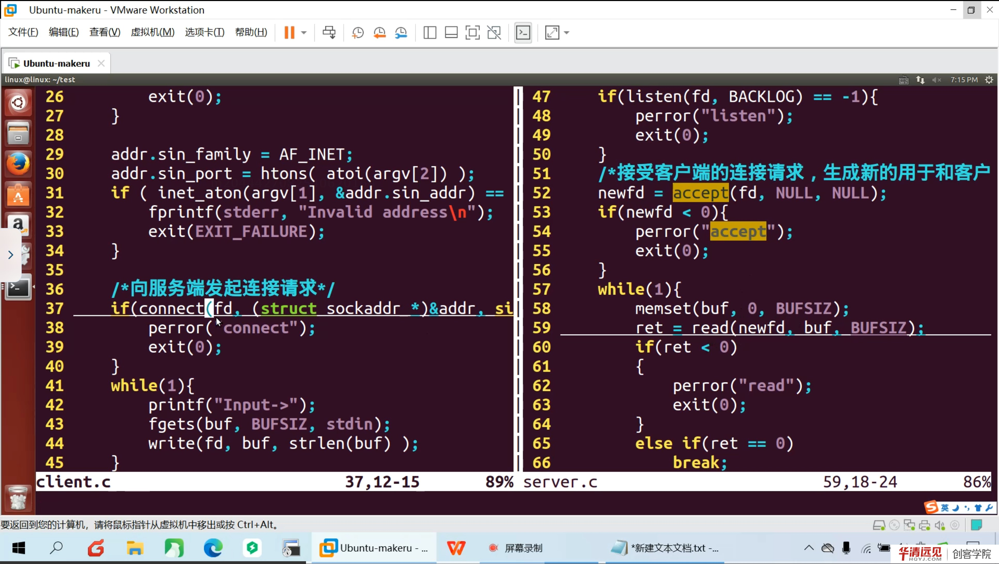
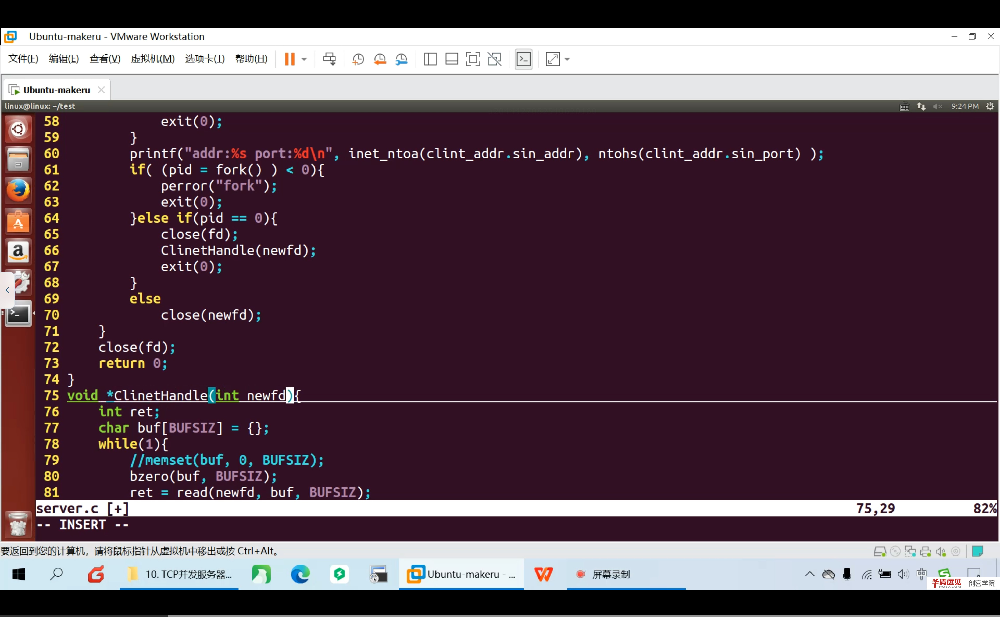

# 第 08 节　TCP 并发实现

> 对应视频：4.8《TCP并发实现》，含三个子视频：
> ① TCP 多进程并发（33:00）　② 僵尸进程处理（12:00）　③ TCP 并发多线程（9:00）
>
> 第 07 节的服务器一次只能服务一个客户端：`accept` 之后阻塞在 `read`，第二个客户端只能排队。本节用**多进程**和**多线程**两种方式让它同时服务多个客户端，并解决随之而来的**僵尸进程**问题。

## 学习目标

1. 说清“单进程服务器”的阻塞点在哪里，为什么需要并发。
2. 掌握 `fork` 版并发服务器的代码结构：谁 accept、谁 read、父子进程各自该关哪些 fd。
3. 理解僵尸进程的成因、危害与三种处理方法（`wait/waitpid`、`SIGCHLD`、`SIG_IGN`）。
4. 掌握 `pthread` 版并发服务器：如何传 `connfd`、`detach` 与 `join` 的区别。
5. 能对比多进程与多线程的优缺点，知道各自适用场景。

---

## 一、单进程服务器为什么不够用

```c
while (1) {
    connfd = accept(listenfd, ...);   // 没有新连接就阻塞
    while (read(connfd, buf, ...) > 0) {   // 有连接后阻塞在这里
        ...
    }
    close(connfd);
}
```

问题：`read` 是阻塞的，一个客户端连着不发数据，整个服务器就卡住，后面的连接全部排队。要同时服务多个客户端，必须让“每个连接”独立执行。

两种经典方案：

| 方案 | 并发单位 | 隔离性 | 开销 | 通信 |
|---|---|---|---|---|
| 多进程 | 进程 | 强（独立地址空间） | 大（fork、页表） | 需 IPC（管道/共享内存） |
| 多线程 | 线程 | 弱（共享地址空间） | 小（共享资源） | 直接读写全局变量（需加锁） |

---

## 二、多进程并发服务器



### 2.1 基本结构

```c
while (1) {
    connfd = accept(listenfd, (struct sockaddr *)&cli, &clilen);
    if (connfd < 0) { perror("accept"); continue; }

    pid_t pid = fork();
    if (pid == 0) {                 // 子进程
        close(listenfd);            // 子进程不负责监听
        handle_client(connfd);      // 读写、处理业务
        close(connfd);
        exit(0);                    // 必须退出，否则子进程会回到 while 循环
    } else if (pid > 0) {           // 父进程
        close(connfd);              // 父进程不参与这个连接
        // 可选：这里 waitpid 回收，见第三节
    } else {
        perror("fork");
    }
}
```

三个关键点：

1. **子进程要 `close(listenfd)`**：它不 accept，留着只会多占一个 fd；
2. **父进程要 `close(connfd)`**：连接已经交给子进程处理，父进程留着会导致 fd 泄漏，且连接无法真正关闭（引用计数不为 0）；
3. **子进程处理完必须 `exit`**：否则会继续执行 `while` 循环，出现多个进程同时 `accept`（惊群），逻辑混乱。

> **补充：fork 后 fd 是“复制”的**
> `fork` 后父子进程各自有一份 fd 表，指向**同一个打开文件描述**（共享文件偏移等）。所以父进程 `close(connfd)` 只是减少引用计数，不会影响子进程的读写；反过来，子进程不关 `listenfd`，监听套接字也不会释放。

### 2.2 一个可运行的骨架



```c
static void handle_client(int fd)
{
    char buf[1024];
    ssize_t n;
    while ((n = read(fd, buf, sizeof(buf))) > 0) {
        write(fd, buf, n);          // 回显
    }
}
```

编译运行后，可以用多个终端同时 `nc 127.0.0.1 8888`，每个连接都会得到一个独立子进程。

> **观察方法**：`ps -ef | grep tcp_server` 可以看到“父进程 + 若干子进程”；`pstree -p` 更直观。

---

## 三、僵尸进程：fork 绕不开的坑

### 3.1 什么是僵尸进程

子进程退出后，内核会保留它的退出状态（exit code、资源使用等），等待父进程调用 `wait/waitpid` 读取。**在父进程读取之前，这个子进程就是僵尸进程（zombie，状态 Z）**。

```bash
ps -ef | grep defunct
# 或者
ps aux | awk '$8 ~ /Z/'
```

### 3.2 危害

- 僵尸进程不占用 CPU/内存，但**占用 PID**；
- PID 是有限资源，僵尸太多会导致无法创建新进程（`fork: Resource temporarily unavailable`）；
- 父进程退出后，僵尸会被 init/systemd 收养并回收，但服务器父进程通常长期运行，不能指望这个。

### 3.3 三种处理方法

**方法一：父进程阻塞 `wait`**

```c
pid_t pid = fork();
if (pid > 0) {
    wait(NULL);   // 阻塞等一个子进程结束
}
```

缺点：`wait` 会阻塞父进程，期间无法 `accept` 新连接——等于退化成串行。

**方法二：信号 + `waitpid(-1, ..., WNOHANG)`（推荐）**

```c
void sigchld_handler(int sig)
{
    (void)sig;
    while (waitpid(-1, NULL, WNOHANG) > 0) {
        // 回收所有已退出的子进程
    }
}

signal(SIGCHLD, sigchld_handler);
```

要点：

- `SIGCHLD` 在子进程状态变化（退出、暂停、继续）时发送；
- 处理函数里要**循环** `waitpid`，因为多个子进程可能同时退出，而信号可能合并；
- `WNOHANG` 表示“没有已退出子进程就立即返回”，避免阻塞。

**方法三：`signal(SIGCHLD, SIG_IGN)`**

```c
signal(SIGCHLD, SIG_IGN);
```

让内核自动回收子进程，不产生僵尸。写法最简单，但可移植性和语义在不同系统上有差异，工程中更常用方法二。

> **补充：SIGCHLD 处理函数的可重入性**
> 信号处理函数里只能调用**异步信号安全**的函数（`waitpid`、`write` 可以；`printf`、`malloc` 不行）。所以处理函数应尽量短，只做回收，不做业务。

---

## 四、多线程并发服务器

### 4.1 基本结构

```c
#include <pthread.h>

void *client_thread(void *arg)
{
    int fd = *(int *)arg;
    free(arg);                 // 释放堆上的参数
    char buf[1024];
    ssize_t n;
    while ((n = read(fd, buf, sizeof(buf))) > 0) {
        write(fd, buf, n);
    }
    close(fd);
    return NULL;
}

while (1) {
    int connfd = accept(listenfd, ...);
    int *pfd = malloc(sizeof(int));   // 每个线程一份，不能用同一个变量地址
    *pfd = connfd;

    pthread_t tid;
    if (pthread_create(&tid, NULL, client_thread, pfd) != 0) {
        perror("pthread_create");
        close(connfd);
        free(pfd);
        continue;
    }
    pthread_detach(tid);              // 分离，线程结束后自动回收资源
}
```

### 4.2 三个易错点

1. **不能把 `&connfd` 传给线程**：`connfd` 是循环里的局部变量，下一轮 `accept` 会覆盖它，线程可能读到错误的 fd。要 `malloc` 一份，或者用 `(void *)(intptr_t)connfd` 传值。
2. **`pthread_detach` 与 `pthread_join` 二选一**：不 join 也不 detach，线程结束后会留下“线程僵尸”（资源不回收）。
3. **共享数据要加锁**：多线程共享全局变量/链表时，必须用 `pthread_mutex_t` 保护，否则出现数据竞争。

> **补充：`pthread_create` 的第四个参数**
> 它既可以传指针，也可以传一个“伪装成指针的整数”。传 `int` 时用 `(void *)(intptr_t)fd`，线程里用 `(int)(intptr_t)arg` 还原。小整数直接塞进指针是安全的；大结构体则必须用堆。

### 4.3 线程版 vs 进程版

| 维度 | 多进程 | 多线程 |
|---|---|---|
| 创建开销 | 大（fork 复制页表） | 小（共享地址空间） |
| 隔离性 | 强，一个崩溃不影响其他 | 弱，一个段错误全进程退出 |
| 通信 | 需要 IPC | 直接共享内存（需同步） |
| 调试 | 相对容易 | 竞态、死锁难查 |
| 适用 | 需要稳定隔离的服务 | 高并发、轻量任务 |

课程最后也提到：真正的高并发服务器很少“来一个连接开一个线程”，而是用**线程池**（预先创建固定数量线程，任务队列分发），这能避免频繁创建/销毁线程的开销。线程池的具体实现会在后续课程/项目中展开。

---

## 五、本节易错点与纠错

| 现象 | 原因 | 解决 |
|---|---|---|
| 子进程也 accept | 子进程没 `exit`，回到循环 | 子进程处理完 `exit(0)` |
| 连接关不掉、fd 泄漏 | 父进程没 `close(connfd)` | 父进程 accept 后立即 close |
| 大量 defunct | 父进程没回收 | SIGCHLD + waitpid(WNOHANG) 循环 |
| 线程读到错误 fd | 传了 `&connfd` | malloc 一份或按值传 |
| 线程资源不释放 | 没 join 也没 detach | `pthread_detach` |
| 数据错乱 | 多线程共享变量没加锁 | `pthread_mutex` |

---

## 附：本节视频索引

| 视频 | 时长 | 关键内容 | 起始时间 |
|---|---|---|---|
| TCP多进程并发 | 33:00 | fork 模型；父子 close 分工；子进程 exit；僵尸成因 | 0:00 |
| 僵尸进程处理 | 12:00 | wait/waitpid；SIGCHLD；SIG_IGN；异步信号安全 | 33:00 |
| TCP并发多线程 | 9:00 | pthread_create；传 fd 的坑；detach；线程 vs 进程 | 45:00 |

> 起始时间指该视频在所在小节播放列表中的位置；单视频小节从 0:00 开始。截图文件名中的秒数即该视频内容时间。

## 六、小结与自测

**一句话总结**：并发服务器让每个连接独立执行——`fork` 版靠“父子进程分工 + 关闭不需要的 fd”，线程版靠“每个连接一个线程 + detach”；`fork` 必须配套回收子进程，否则僵尸会耗尽 PID。

**自测题**

1. 单进程服务器在哪些点上会阻塞？为什么第二个客户端连不上？
2. `fork` 后为什么子进程要关 `listenfd`、父进程要关 `connfd`？
3. 僵尸进程是怎么产生的？不处理会有什么后果？
4. 写出 `SIGCHLD` 处理函数，并解释为什么要循环 `waitpid`、为什么要 `WNOHANG`。
5. 线程版服务器为什么不能把 `&connfd` 直接传给线程？
6. `pthread_detach` 和 `pthread_join` 有什么区别？各自的适用场景？
7. 多进程与多线程各有什么优缺点？线程池解决了什么问题？

**下一节预告**：TCP 是“面向连接、可靠”的，UDP 则是“无连接、尽最大努力”。下一节把服务器/客户端代码改成 UDP 版本，对比两者的 API 差异与适用场景。
