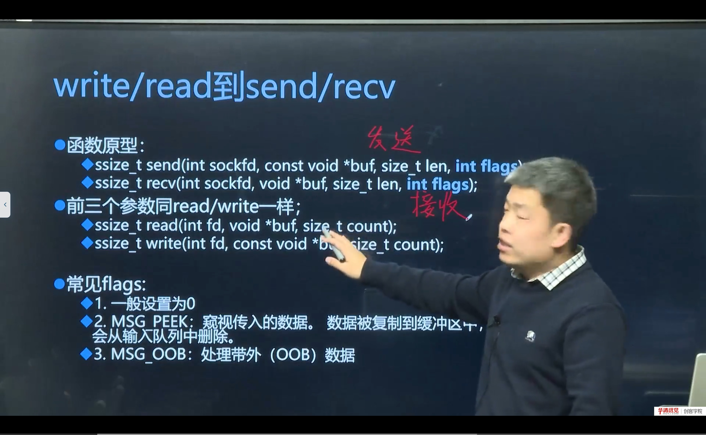
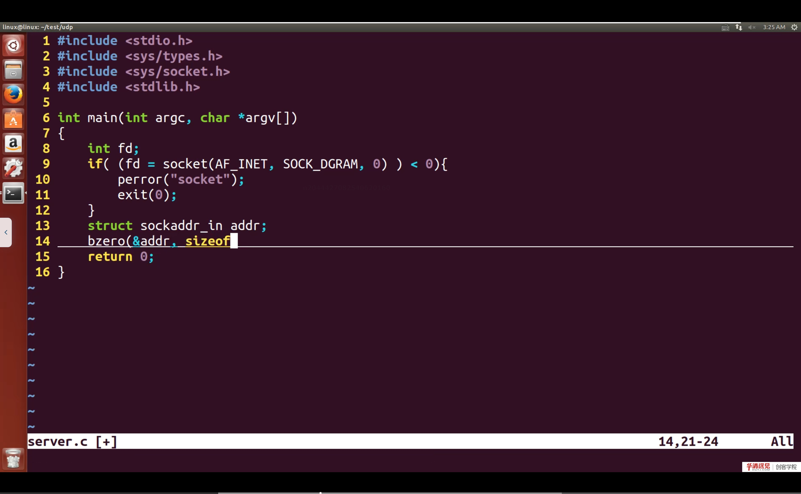

# 第 09 节　实现 UDP 通信

> 对应视频：4.9《实现UDP通信》，含三个子视频：
> ① 函数接口扩展与 UDP 通信实现流程（8:00）　② UDP 服务器代码（19:00）　③ UDP 客户端代码（7:00）
>
> TCP 的服务器要先 `listen/accept`，UDP 完全不需要：**没有连接，直接收发**。这一节把第 07 节的代码“换成 UDP 版本”，重点体会 API 的差异。

## 学习目标

1. 掌握 `sendto/recvfrom` 的参数与用法，理解为什么 UDP 不需要 `connect/accept`。
2. 写出 UDP 服务器与客户端代码，能互相收发。
3. 理解“数据报边界”：一次 `sendto` 对应一次 `recvfrom`，不会粘包也不会拆分。
4. 能对比 TCP/UDP 的 API 差异与适用场景。

---

## 一、UDP 的通信模型

TCP 是“先建立连接，再像文件一样读写”；UDP 是“每个数据报都带上目的地址，直接扔出去”。

| 对比项 | TCP | UDP |
|---|---|---|
| 连接 | 面向连接（三次握手） | 无连接 |
| 可靠性 | 可靠（确认、重传、按序） | 尽最大努力，不保证 |
| 数据形式 | 字节流 | 数据报（有边界） |
| 服务器 API | socket/bind/listen/accept/read/write | socket/bind/recvfrom/sendto |
| 客户端 API | socket/connect/write/read | socket/sendto/recvfrom |
| 典型场景 | 文件、网页、登录 | 视频、语音、DNS、广播 |

> **关键差异**：UDP 没有 `listen/accept`，因为不存在“连接队列”；服务器 bind 完端口就可以直接 `recvfrom`。客户端甚至可以不 bind，`sendto` 时内核自动分配源端口。

---

## 二、核心函数：sendto / recvfrom



在讲 `sendto/recvfrom` 之前，先看一对更容易理解的函数：`send/recv`——它们的前三个参数与 `write/read` 完全一致，只是多了一个 `flags`（通常填 0）。`sendto/recvfrom` 则是在此基础上增加了“地址”参数。

```c
ssize_t sendto(int sockfd, const void *buf, size_t len, int flags,
               const struct sockaddr *dest_addr, socklen_t addrlen);

ssize_t recvfrom(int sockfd, void *buf, size_t len, int flags,
                 struct sockaddr *src_addr, socklen_t *addrlen);
```

### 2.1 sendto

| 参数 | 含义 |
|---|---|
| sockfd | UDP 套接字（`SOCK_DGRAM`） |
| buf/len | 要发送的数据及长度 |
| flags | 通常 0 |
| dest_addr | 目的地址（`sockaddr_in` 强转） |
| addrlen | 地址结构长度 |

返回值：成功返回发送的字节数，失败 -1。

### 2.2 recvfrom

| 参数 | 含义 |
|---|---|
| sockfd | UDP 套接字 |
| buf/len | 接收缓冲区及大小 |
| flags | 通常 0 |
| src_addr | **传出参数**：发送方的地址 |
| addrlen | **传入+传出**：缓冲区大小 / 实际地址长度 |

返回值：成功返回收到的字节数；返回 0 表示收到一个 0 长度数据报；失败 -1。

> **注意**：`recvfrom` 的 `addrlen` 是**指针**，和 `accept` 一样；`sendto` 的 `addrlen` 是**值**，和 `bind` 一样。这两个别记反。

### 2.3 send/recv 与 flags：和 read/write 的关系

`send/recv` 的前三个参数与 `write/read` 完全一致，只多一个 `flags`：

```c
ssize_t send(int sockfd, const void *buf, size_t len, int flags);
ssize_t recv(int sockfd, void *buf, size_t len, int flags);
```

- `flags = 0` 时，`send` 等价于 `write`，`recv` 等价于 `read`；
- 常用 flags：
  - `MSG_PEEK`：**窥视**数据——数据被复制到缓冲区，但**不从接收队列删除**，下次读还能读到同一批数据（甚至可能读到“旧数据 + 新到达的数据”）；
  - `MSG_OOB`：处理**带外数据**（TCP 的紧急数据），UDP 一般不用；
  - `MSG_DONTWAIT`：非阻塞本次调用（不改变 socket 的阻塞属性）。

> **补充：MSG_PEEK 的典型用途**
> 先“看一眼”包头判断消息类型，再决定读多少、怎么解析；或者实现“多消费者窥视同一队列”的逻辑。它不常用，但面试会问“peek 和 read 的区别”。

UDP 通信的完整流程因此非常短：

```
服务器：socket(AF_INET, SOCK_DGRAM) → bind → recvfrom / sendto（循环）
客户端：socket(AF_INET, SOCK_DGRAM) → sendto / recvfrom（不必 bind）
```

与 TCP 相比，服务器少了 `listen/accept`，客户端少了 `connect`——这正是“无连接”在 API 上的体现。

---

## 三、UDP 服务器代码



```c
// udp_server.c
#include <stdio.h>
#include <stdlib.h>
#include <string.h>
#include <unistd.h>
#include <arpa/inet.h>
#include <sys/socket.h>
#include <netinet/in.h>

#define PORT 9999
#define BUF_SIZE 1024

int main(void)
{
    int fd = socket(AF_INET, SOCK_DGRAM, 0);   // 注意：SOCK_DGRAM
    if (fd < 0) { perror("socket"); exit(1); }

    struct sockaddr_in srv, cli;
    socklen_t clilen = sizeof(cli);
    char buf[BUF_SIZE];

    memset(&srv, 0, sizeof(srv));
    srv.sin_family      = AF_INET;
    srv.sin_port        = htons(PORT);
    srv.sin_addr.s_addr = htonl(INADDR_ANY);

    if (bind(fd, (struct sockaddr *)&srv, sizeof(srv)) < 0) {
        perror("bind"); exit(1);
    }
    printf("udp server on %d\n", PORT);

    while (1) {
        ssize_t n = recvfrom(fd, buf, sizeof(buf) - 1, 0,
                             (struct sockaddr *)&cli, &clilen);
        if (n < 0) { perror("recvfrom"); continue; }
        buf[n] = '\0';
        printf("from %s:%d : %s\n",
               inet_ntoa(cli.sin_addr), ntohs(cli.sin_port), buf);

        // 原样回给发送方
        sendto(fd, buf, n, 0, (struct sockaddr *)&cli, clilen);
    }
    close(fd);
    return 0;
}
```

要点：

- `socket(AF_INET, SOCK_DGRAM, 0)`；
- **没有 listen/accept**；
- `recvfrom` 既收数据，也拿到对方地址，回包时直接用这个地址 `sendto`。

---

## 四、UDP 客户端代码

```c
// udp_client.c
#include <stdio.h>
#include <stdlib.h>
#include <string.h>
#include <unistd.h>
#include <arpa/inet.h>
#include <sys/socket.h>
#include <netinet/in.h>

#define PORT 9999
#define BUF_SIZE 1024

int main(int argc, char *argv[])
{
    int fd = socket(AF_INET, SOCK_DGRAM, 0);
    if (fd < 0) { perror("socket"); exit(1); }

    struct sockaddr_in srv;
    memset(&srv, 0, sizeof(srv));
    srv.sin_family = AF_INET;
    srv.sin_port   = htons(PORT);
    inet_pton(AF_INET, argc > 1 ? argv[1] : "127.0.0.1", &srv.sin_addr);

    char buf[BUF_SIZE];
    while (fgets(buf, sizeof(buf), stdin)) {
        sendto(fd, buf, strlen(buf), 0, (struct sockaddr *)&srv, sizeof(srv));

        struct sockaddr_in from;
        socklen_t fromlen = sizeof(from);
        ssize_t n = recvfrom(fd, buf, sizeof(buf) - 1, 0,
                             (struct sockaddr *)&from, &fromlen);
        if (n < 0) { perror("recvfrom"); continue; }
        buf[n] = '\0';
        printf("echo: %s", buf);
    }
    close(fd);
    return 0;
}
```

客户端也可以先 `connect` 到服务器（UDP 的 `connect` 只是绑定默认目的地址，不握手），之后就能用 `send/recv`，但初学阶段用 `sendto/recvfrom` 更直观。

> **补充：UDP 的 `connect` 有什么用**
> 调用 `connect` 后，内核会记录默认对端地址，之后 `send` 不用再写地址；同时内核只接收该对端发来的数据报（过滤其他来源）。它**不会**发送任何报文，也没有三次握手。

---

## 五、数据报边界与常见问题

### 5.1 一次发送 = 一次接收

UDP 保留消息边界：发送方 `sendto` 两次 100 字节，接收方 `recvfrom` 两次，每次 100 字节；不会像 TCP 那样粘成一个 200 字节的流。

但如果接收缓冲区小于数据报长度，**多余部分会被丢弃**（不是留在下一次读），所以缓冲区要足够大。

### 5.2 丢包与乱序

UDP 不保证送达，也不保证顺序。实际项目中通常要自己在应用层加：

- 序号（检测丢包/乱序）；
- 超时重传（对关键数据）；
- 或直接容忍（视频/音频）。

### 5.3 常见错误

| 现象 | 原因 | 解决 |
|---|---|---|
| `recvfrom` 收不到 | 服务器没 bind 或端口错 | 检查 bind、端口、防火墙 |
| 客户端收不到回包 | 服务器回包地址写错 | 用 `recvfrom` 拿到的 `cli` 回 |
| 数据被截断 | 缓冲区太小 | 缓冲区 ≥ 最大数据报 |
| 用 `SOCK_STREAM` 写 UDP | 协议不匹配 | 改 `SOCK_DGRAM` |
| 以为 UDP 会粘包 | 把 TCP 经验套过来 | UDP 有边界，不会粘包 |

---

## 六、本节易错点与纠错

| 容易说错/写错 | 正确说法 | 说明 |
|---|---|---|
| UDP 服务器要 listen | UDP 不需要 listen/accept | 无连接 |
| `recvfrom` 的 addrlen 传值 | 传指针 | 与 accept 相同 |
| `sendto` 的 addrlen 传指针 | 传值 | 与 bind 相同 |
| UDP 可靠 | 尽最大努力，不保证 | 可靠性要在应用层做 |
| UDP 会粘包 | 有消息边界 | 一次发一次收 |

---

## 七、小结与自测

**一句话总结**：UDP 把“连接”去掉，服务器 `socket→bind→recvfrom/sendto`，客户端 `socket→sendto/recvfrom`；一次发送对应一次接收，简单、快，但可靠性要自己兜底。

**自测题**

1. UDP 为什么不需要 `listen/accept`？
2. `sendto` 与 `recvfrom` 的 `addrlen` 参数有什么区别？
3. UDP 服务器如何知道回包给谁？
4. UDP 会粘包吗？为什么？
5. 接收缓冲区小于数据报会发生什么？
6. UDP 的 `connect` 做了什么？有什么好处？
7. 设计一个“文件传输”需求，你会选 TCP 还是 UDP？说明理由。

**下一节预告**：TCP 凭什么“可靠”？序号、确认、重传、滑动窗口、拥塞控制分别解决什么问题？下一节拆开 TCP 的机制，并结合包头字段讲清楚。
