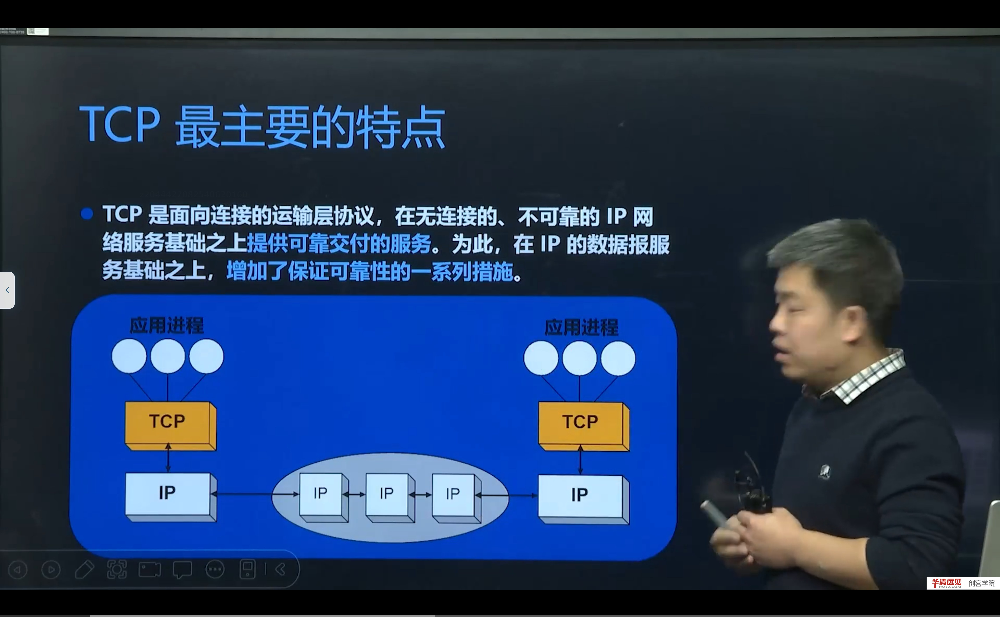
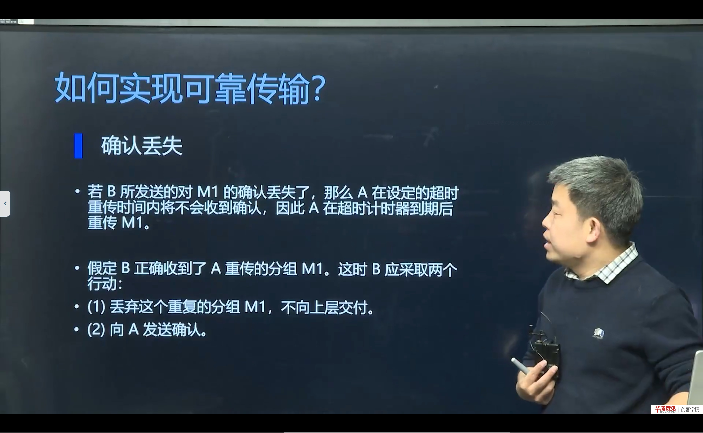
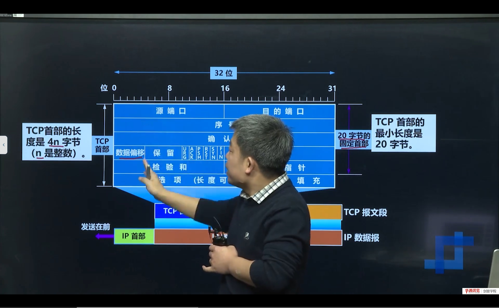

# 第 10 节　TCP 协议是如何实现可靠传输的

> 对应视频：4.10《TCP协议是如何实现可靠传输的》，含三个子视频：
> ① TCP 最主要的特点（12:00）　② TCP 是如何实现可靠传输的（13:00）　③ TCP 包头（17:00）
>
> 这一节从“用起来可靠”深入到“为什么可靠”：序号、确认、重传、滑动窗口、流量控制、拥塞控制，以及承载这些机制的 TCP 包头。

## 学习目标

1. 说出 TCP 的五个主要特点（面向连接、可靠、字节流、全双工、端到端）。
2. 理解“可靠传输”的四个基本机制：校验、序号、确认、重传。
3. 掌握滑动窗口如何兼顾“可靠”与“效率”，区分流量控制与拥塞控制。
4. 能逐字段解释 TCP 包头，特别是序号、确认号、标志位、窗口字段。

---

## 一、TCP 最主要的特点



| 特点 | 含义 | 带来的后果 |
|---|---|---|
| 面向连接 | 通信前必须建立连接 | 有握手/挥手开销 |
| 可靠传输 | 不丢、不重、按序 | 需要确认、重传、排序 |
| 字节流 | 没有消息边界 | 应用层要自己处理“粘包” |
| 全双工 | 双方可同时收发 | 两个方向各自有序号与窗口 |
| 端到端 | 只在两端主机维护状态 | 中间路由器不感知 TCP |

> **“可靠”不等于“一定送达”**
> TCP 保证的是：**只要连接还在、且没有超时放弃，数据最终会按序、无差错地交给应用层**。如果网络长时间不通，TCP 会重传若干次后放弃并报错（`ETIMEDOUT`）。所以“可靠”是“尽力保证”，不是“物理上一定”。

---

## 二、可靠传输的四个基本机制

### 2.1 校验和

TCP 首部有 16 位校验和，覆盖首部 + 数据 + 伪首部（源/目的 IP、协议号、TCP 长度）。接收方校验失败就丢弃，不确认，发送方超时重传。

### 2.2 序号（sequence number）

TCP 把字节流按字节编号。每个报文段的序号是**该段第一个字节的编号**。

- 初始序号（ISN）在握手时随机生成（防伪造、防旧连接干扰）；
- 序号是 32 位，回绕后按模运算比较。

### 2.3 确认（ACK）

接收方收到数据后，回复**确认号 = 期望收到的下一个字节序号**，表示“这个序号之前的我都收到了”。

- 累计确认：ACK=1001 表示 1～1000 全部收到；
- 延迟确认：不必每收一个段就回 ACK，可以等一小段时间或攒两个段再回，减少开销。

### 2.4 超时重传



发送方为每个已发送未确认的段设置定时器（RTO）。超时未收到 ACK 就重传。

RTO 不是固定的，而是根据 RTT（往返时延）动态估算：

```
SRTT = (1-α)·SRTT + α·RTT        // 平滑 RTT
RTTVAR = (1-β)·RTTVAR + β·|SRTT-RTT|
RTO = SRTT + 4·RTTVAR
```

> **补充：快速重传**
> 如果发送方连续收到 3 个重复 ACK（说明某个段丢了，后面的段都到了），就不等超时，立即重传丢失的段。这就是“快重传”，常配合“快恢复”。

---

## 三、滑动窗口：可靠与效率的平衡

如果“发一个段、等一个 ACK”，吞吐量会很低（停等协议）。TCP 用**滑动窗口**允许“一次发多个段，边发边等确认”。

### 3.1 发送窗口

发送方维护一个窗口，窗口内的数据可以连续发送而不必逐个等待 ACK。窗口左边界随 ACK 前移（滑动），右边界由接收方通告的窗口和拥塞窗口共同决定。

```
已发送已确认 | 已发送未确认 | 可发送未发送 | 不可发送
             ↑窗口左沿      ↑窗口右沿
```

### 3.2 流量控制

接收方通过 TCP 首部的**窗口字段**告诉发送方：“我还能收多少字节”。发送方据此限制发送速率，避免接收缓冲区溢出。

- 窗口为 0 时，发送方停止发送，定期发**窗口探测**（zero window probe）；
- 窗口更新后，接收方发 ACK 通知发送方继续。

### 3.3 拥塞控制

流量控制是“接收方能力”，拥塞控制是“网络能力”。发送方维护**拥塞窗口 cwnd**，实际发送窗口 = min(接收窗口 rwnd, cwnd)。

四个阶段：

| 阶段 | 行为 |
|---|---|
| 慢启动 | cwnd 从 1 个 MSS 开始，每收到一个 ACK 翻倍（指数增长） |
| 拥塞避免 | cwnd 达到 ssthresh 后，每个 RTT 加 1 个 MSS（线性增长） |
| 快重传 | 收到 3 个重复 ACK，立即重传丢失段 |
| 快恢复 | ssthresh = cwnd/2，cwnd = ssthresh，进入拥塞避免 |

> **区分流量控制与拥塞控制（高频考点）**
> - 流量控制：**点对点**，接收方告诉发送方“别发太快，我处理不过来”，靠窗口字段；
> - 拥塞控制：**全局**，发送方根据网络丢包/时延判断“网络堵了”，靠 cwnd 调整。
>
> 一个管“接收端”，一个管“网络”。

---

## 四、TCP 包头逐字段



TCP 首部固定 20 字节（不含选项），最多 60 字节。

| 字段 | 长度 | 作用 |
|---|---|---|
| 源端口 | 16 位 | 发送方端口 |
| 目的端口 | 16 位 | 接收方端口 |
| 序号 seq | 32 位 | 本段第一个字节的编号 |
| 确认号 ack | 32 位 | 期望收到的下一个字节编号（ACK=1 时有效） |
| 数据偏移 | 4 位 | 首部长度，单位 4 字节（最小 5，即 20 字节） |
| 保留 | 6 位 | 保留，现部分用于 ECN 等 |
| 标志位 | 6 位 | URG/ACK/PSH/RST/SYN/FIN |
| 窗口 | 16 位 | 接收窗口大小（流量控制） |
| 校验和 | 16 位 | 首部+数据+伪首部 |
| 紧急指针 | 16 位 | URG=1 时有效 |
| 选项 | 可变 | MSS、窗口扩大、SACK、时间戳等 |

### 4.1 六个标志位

| 标志 | 含义 | 典型场景 |
|---|---|---|
| URG | 紧急指针有效 | 带外数据 |
| ACK | 确认号有效 | 除 SYN 外的绝大多数段 |
| PSH | 催促接收方尽快交付应用 | 交互式数据 |
| RST | 重置连接 | 端口未监听、异常断开 |
| SYN | 同步序号，建立连接 | 三次握手前两个包 |
| FIN | 发送方没有数据了，请求关闭 | 四次挥手 |

> **补充：MSS 与 MTU**
> MSS（最大报文段长度）是 TCP 层能携带的最大数据量，通常由 MTU 决定：`MSS = MTU - IP 首部 - TCP 首部`。以太网 MTU=1500，IPv4 首部 20，TCP 首部 20，所以 MSS=1460。MSS 在 SYN 报文的选项里协商。

---

## 五、一次数据传输的完整过程（简化）

```
发送方                         接收方
  | ---- seq=1, len=100 -------> |
  | <--- ack=101 --------------- |
  | ---- seq=101, len=100 -----> |   （窗口内可连续发）
  | ---- seq=201, len=100 -----> |
  | <--- ack=301 --------------- |   （累计确认）
  |      ... 某段丢失 ...
  | ---- seq=401, len=100 -----> |   （收到重复 ACK）
  | <--- ack=301 (dup) --------- |
  | <--- ack=301 (dup) --------- |
  | <--- ack=301 (dup) --------- |   （3 次重复）
  | ---- 重传 seq=301 ----------> |   （快重传）
```

> **抓包验证**：在 Wireshark 里过滤 `tcp.port == 8888`，看 `Seq`、`Ack`、`Len`、`[TCP Retransmission]`、`[TCP Window Full]` 等标记，就能把上面的机制“看见”。

---

## 六、本节易错点与纠错

| 容易说错/写错 | 正确说法 | 说明 |
|---|---|---|
| TCP 保证一定送达 | 保证可靠（按序、无差错），超时会放弃 | 不是物理保证 |
| ACK 是“我收到了第几个包” | ACK 是“期望的下一个字节序号” | 累计确认 |
| 流量控制=拥塞控制 | 一个管接收方，一个管网络 | 高频混淆 |
| 窗口字段是发送方窗口 | 是接收方通告的接收窗口 | 流量控制 |
| 序号按报文段编号 | 按字节编号 | 字节流 |
| MSS 是 MTU | MSS = MTU - IP头 - TCP头 | 常差 40 字节 |

---

## 七、小结与自测

**一句话总结**：TCP 用“校验 + 序号 + 确认 + 重传”保证不丢不乱，用“滑动窗口”提高效率，用“流量控制”照顾接收方、用“拥塞控制”照顾网络；这些机制全部体现在 TCP 包头的字段里。

**自测题**

1. TCP 的五个主要特点是什么？
2. 序号和确认号分别怎么理解？为什么确认号是“期望的下一个字节”？
3. 超时重传的 RTO 如何估算？快速重传的触发条件是什么？
4. 画出滑动窗口的四个区间，说明窗口如何“滑动”。
5. 流量控制与拥塞控制分别解决什么问题？靠什么实现？
6. TCP 包头固定多少字节？数据偏移字段的单位是什么？
7. SYN、FIN、RST 分别在什么场景出现？
8. MSS 与 MTU 的关系是什么？以太网下 MSS 通常是多少？

**下一节预告**：知道了 TCP 如何传数据，下一节看它如何“开始”和“结束”——三次握手、四次挥手，以及用 Wireshark 抓包验证；最后对比 UDP 协议。
