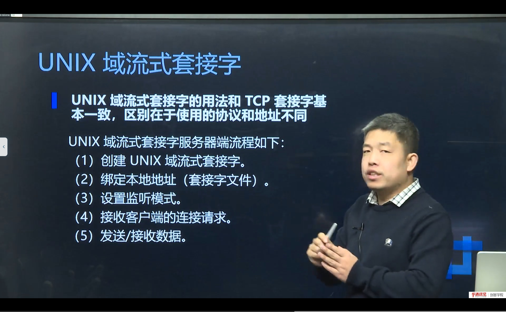
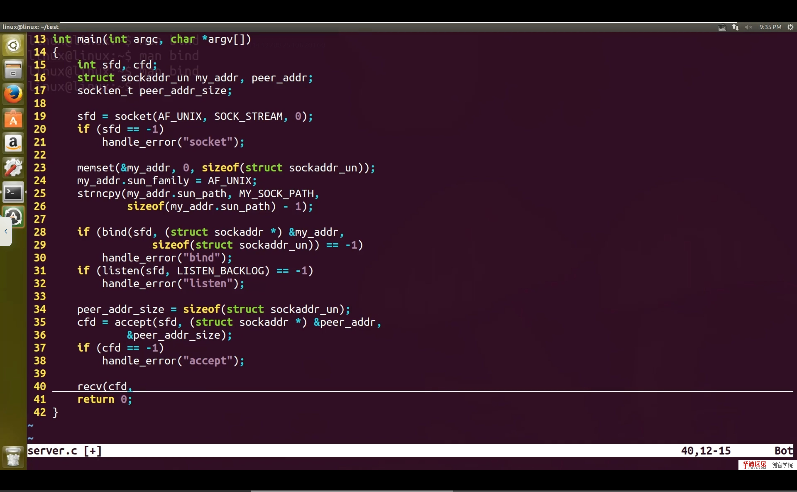

# 第 13 节　UNIX 域套接字

> 对应视频：4.13《UNIX域套接字》，含三个子视频：
> ① UNIX 域套接字理论（3:00）　② UNIX 域流式套接字实现（16:00）　③ UNIX 域数据报套接字实现（11:00）
>
> 前面所有 socket 都走网卡、用 `IP:Port` 寻址。本节讲一种“不出主机”的套接字：用**文件路径**当地址，在同一台机器上做进程间通信（IPC），效率比 TCP 回环更高。

## 学习目标

1. 理解 AF_UNIX（AF_LOCAL）与 AF_INET 的区别与适用场景。
2. 掌握 `struct sockaddr_un` 的填法，理解 `sun_path` 的长度限制。
3. 能写出 UNIX 域**流式**（SOCK_STREAM）与**数据报**（SOCK_DGRAM）的服务器/客户端。
4. 知道文件权限、路径删除、抽象命名空间等工程细节。

---

## 一、什么是 UNIX 域套接字

UNIX 域套接字（UNIX domain socket，也称本地套接字）是**同一台主机上进程间通信**的一种方式。它：

- 使用**文件系统路径**作为地址（如 `/tmp/my.sock`），而不是 IP + 端口；
- 数据不经过网络协议栈（不回环网卡），由内核直接在内核缓冲区之间传递；
- 支持流式（`SOCK_STREAM`，类似 TCP）和数据报（`SOCK_DGRAM`，类似 UDP）两种语义；
- 也支持 `socketpair()` 创建一对无名连接（常用于父子进程通信）。

### 1.1 与 AF_INET 的对比

| 维度 | AF_INET（TCP/UDP） | AF_UNIX |
|---|---|---|
| 地址 | IP + 端口 | 文件路径 |
| 范围 | 跨主机 | 仅本机 |
| 性能 | 经过协议栈，开销较大 | 内核直接转发，开销小 |
| 可靠性 | TCP 可靠 / UDP 不可靠 | 流式可靠 / 数据报不保证 |
| 权限 | 端口权限 | 文件系统权限（rwx） |
| 典型用途 | 网络服务 | 本地服务（Docker、systemd、数据库） |

> **为什么本地服务爱用它**
> 没有 TCP 的三次握手、校验和、路由查找，吞吐更高、延迟更低；还能直接用文件权限控制“谁能连”。Docker 的 `/var/run/docker.sock` 就是典型例子。

---

## 二、地址结构：sockaddr_un

```c
#include <sys/un.h>

struct sockaddr_un {
    sa_family_t sun_family;   // AF_UNIX
    char        sun_path[108]; // 路径（Linux 下 108 字节）
};
```

填写示例：

```c
struct sockaddr_un addr;
memset(&addr, 0, sizeof(addr));
addr.sun_family = AF_UNIX;
strncpy(addr.sun_path, "/tmp/my.sock", sizeof(addr.sun_path) - 1);

bind(fd, (struct sockaddr *)&addr, sizeof(addr));
```

要点：

- `sun_path` 长度有限（Linux 108），路径太长会截断；
- `sizeof(addr)` 与 `offsetof(struct sockaddr_un, sun_path) + strlen(path) + 1` 都可以，后者更精确；
- 绑定前如果文件已存在，`bind` 会失败（`EADDRINUSE`），需要先 `unlink`。

---

## 三、流式 UNIX 域套接字



流式（`SOCK_STREAM`）的调用顺序与 TCP 几乎一样，只是地址结构不同：

**服务器**

```c
int fd = socket(AF_UNIX, SOCK_STREAM, 0);

struct sockaddr_un addr;
memset(&addr, 0, sizeof(addr));
addr.sun_family = AF_UNIX;
strcpy(addr.sun_path, "/tmp/my.sock");
unlink("/tmp/my.sock");                 // 清理旧文件

bind(fd, (struct sockaddr *)&addr, sizeof(addr));
listen(fd, 5);

int connfd = accept(fd, NULL, NULL);    // 本地连接，可不关心对端地址
char buf[1024];
int n = read(connfd, buf, sizeof(buf));
write(connfd, "ok", 2);
close(connfd);
close(fd);
unlink("/tmp/my.sock");                 // 退出时删除
```

**客户端**



```c
int fd = socket(AF_UNIX, SOCK_STREAM, 0);

struct sockaddr_un addr;
memset(&addr, 0, sizeof(addr));
addr.sun_family = AF_UNIX;
strcpy(addr.sun_path, "/tmp/my.sock");

connect(fd, (struct sockaddr *)&addr, sizeof(addr));
write(fd, "hello", 5);
read(fd, buf, sizeof(buf));
close(fd);
```

> **注意**：`connect` 的地址长度要与服务器 `bind` 时一致；`accept` 的第二个参数可以传 `NULL`，因为本地连接不需要知道对端地址（对端没有 IP/端口）。

---

## 四、数据报 UNIX 域套接字

数据报（`SOCK_DGRAM`）类似 UDP：无连接、有消息边界，但地址是文件路径。

**服务器**

```c
int fd = socket(AF_UNIX, SOCK_DGRAM, 0);

struct sockaddr_un addr;
memset(&addr, 0, sizeof(addr));
addr.sun_family = AF_UNIX;
strcpy(addr.sun_path, "/tmp/my.dgram");
unlink("/tmp/my.dgram");
bind(fd, (struct sockaddr *)&addr, sizeof(addr));

struct sockaddr_un cli;
socklen_t len = sizeof(cli);
char buf[1024];
int n = recvfrom(fd, buf, sizeof(buf), 0, (struct sockaddr *)&cli, &len);
sendto(fd, "ok", 2, 0, (struct sockaddr *)&cli, len);
```

**客户端**

```c
int fd = socket(AF_UNIX, SOCK_DGRAM, 0);

struct sockaddr_un srv;
memset(&srv, 0, sizeof(srv));
srv.sun_family = AF_UNIX;
strcpy(srv.sun_path, "/tmp/my.dgram");

sendto(fd, "hello", 5, 0, (struct sockaddr *)&srv, sizeof(srv));
recvfrom(fd, buf, sizeof(buf), 0, NULL, NULL);
```

> **关键差异**：数据报客户端如果希望服务器能回包，**自己也必须 bind 一个路径**（否则服务器不知道回给谁）。这一点和 UDP 不同：UDP 客户端不 bind 也能收到回包（内核分配临时端口），而 UNIX 数据报没有“临时路径”的概念。

---

## 五、工程细节与常见问题

### 5.1 文件残留

`bind` 会在文件系统创建一个 socket 文件；进程异常退出时文件不会自动删除，下次 `bind` 报 `EADDRINUSE`。解决：

- 启动时 `unlink(path)`（注意不要误删别人的）；
- 用 `atexit` 或信号处理在退出时 `unlink`；
- 或使用**抽象命名空间**（Linux 特有）：`sun_path[0] = '\0'`，后面跟名字，不会在文件系统留文件，但不可跨平台。

### 5.2 权限控制

socket 文件的权限决定谁能连接：

```bash
chmod 600 /tmp/my.sock     # 只有属主可读写
```

这比 TCP 的“端口 + 防火墙”更细粒度，适合本地服务。

### 5.3 常见错误

| 现象 | 原因 | 解决 |
|---|---|---|
| `bind: Address already in use` | 旧 socket 文件残留 | `unlink` 后再 bind |
| `connect: No such file or directory` | 路径不存在/服务器没 bind | 检查路径与服务器状态 |
| `connect: Connection refused` | 文件存在但没有进程监听 | 重启服务器 |
| 数据报收不到回包 | 客户端没 bind 路径 | 客户端也 bind |
| 路径太长 | 超过 108 字节 | 换短路径或用抽象命名空间 |

### 5.4 socketpair：一对“无名”的双向连接

有时父子进程/两个线程只需要一条现成的双向通道，不需要路径，也不想走文件系统。用 `socketpair` 一次创建**两个已连接**的套接字：

```c
int sv[2];
socketpair(AF_UNIX, SOCK_STREAM, 0, sv);
// sv[0] 和 sv[1] 互为对端：写 sv[0]，从 sv[1] 读；反之亦然

if (fork() == 0) {          // 子进程
    close(sv[0]);
    write(sv[1], "hello", 5);
    _exit(0);
}
close(sv[1]);               // 父进程
char buf[16];
read(sv[0], buf, sizeof(buf));
```

特点：

- 无需 `bind/listen/accept/connect`，创建即连接；
- 没有文件系统节点，不会残留 `.sock` 文件；
- 常用于 `fork` 前后的父子进程通信、线程间传递 fd（配合 `SCM_RIGHTS`）。

### 5.5 抽象命名空间（Linux 特有）

把 `sun_path[0]` 设为 `'\0'`，后面的字节作为名字：

```c
struct sockaddr_un addr;
memset(&addr, 0, sizeof(addr));
addr.sun_family = AF_UNIX;
addr.sun_path[0] = '\0';
strcpy(addr.sun_path + 1, "my_abstract_socket");
bind(fd, (struct sockaddr *)&addr,
     offsetof(struct sockaddr_un, sun_path) + 1 + strlen("my_abstract_socket"));
```

优点：不产生文件、进程退出自动释放、名字不会与文件路径冲突；缺点：**Linux 特有**，不可移植，且不能用文件权限控制访问。

---

## 六、本节易错点与纠错

| 容易说错/写错 | 正确说法 | 说明 |
|---|---|---|
| UNIX 域套接字走网卡 | 不经过网卡，内核直接传递 | 性能更高 |
| 地址是 IP:Port | 地址是文件路径 | `sockaddr_un` |
| 数据报客户端不用 bind | 需要 bind 才能收回包 | 与 UDP 不同 |
| socket 文件会自动删除 | 需手动 unlink | 常见坑 |
| AF_UNIX 只能流式 | 也支持 SOCK_DGRAM | 两种语义 |

---

## 附：本节视频索引

| 视频 | 时长 | 关键内容 | 起始时间 |
|---|---|---|---|
| UNIX域套接字理论 | 3:00 | AF_UNIX；文件路径寻址；与 AF_INET 对比 | 0:00 |
| UNIX域流式套接字实现 | 16:00 | sockaddr_un；bind/listen/accept；unlink 残留文件 | 3:00 |
| UNI域数据报套接字实现 | 11:00 | SOCK_DGRAM；客户端也要 bind；sendto/recvfrom | 19:00 |

> 起始时间指该视频在所在小节播放列表中的位置；单视频小节从 0:00 开始。截图文件名中的秒数即该视频内容时间。

## 七、小结与自测

**一句话总结**：UNIX 域套接字把“地址”从 `IP:Port` 换成“文件路径”，用 `AF_UNIX` + `sockaddr_un`，调用顺序与 TCP/UDP 基本一致；它不出主机、性能高、权限细，是本地服务间通信的首选。

**自测题**

1. AF_UNIX 与 AF_INET 的本质区别是什么？各自适用什么场景？
2. `sockaddr_un` 有哪两个字段？`sun_path` 有什么限制？
3. 流式 UNIX 域套接字的服务器/客户端调用顺序是什么？
4. 数据报 UNIX 域套接字为什么客户端也要 bind？
5. `bind` 报 `EADDRINUSE` 常见原因是什么？怎么处理？
6. 什么是抽象命名空间？它有什么优缺点？
7. 为什么 Docker、systemd 等本地服务喜欢用 UNIX 域套接字？

---

## 附：全课程知识地图

到这里，《网络编程开发及实战（上）》的 13 节就全部走完了。把知识串起来：

```
应用层    HTTP/DNS/自定义协议         ← 第 13 节的本地服务也可视为应用
传输层    TCP（可靠）/ UDP（高效）     ← 第 10、11 节
网络层    IP 寻址、分片、路由          ← 第 04、12 节
链路层    以太网帧、MAC、ARP           ← 第 12 节
物理层    0/1 比特                    ← 第 03 节

编程接口  socket API                  ← 第 06～09 节
数据表示  字节序、地址转换             ← 第 05 节
```

下一步建议：把第 07～09 节的代码真正跑起来，用 Wireshark 抓一次三次握手和一次 UDP 收发；然后进入《网络编程开发及实战（下）》的 IO 模型、select/poll/epoll、广播组播与项目实战。
